# OpenTTD AI handoff — 2026-10-17 (V2-capture addendum 2026-10-18)

This is a vendor-neutral continuation guide for the **actual local worktree**.
Read [CONTEXT](CONTEXT.md), this file, [TASKS](TASKS.md),
[EVIDENCE_INDEX](EVIDENCE_INDEX.md), then [REPRODUCE](REPRODUCE.md).
Use repository files and retained evidence as authority; prior chat, provider
memory, personal skills and temporary agent directories are not prerequisites.
This documentation task authorizes no game launch, AdminPort connection or retry.

## Checkout and transfer

Repository: https://github.com/Team-Project-SIET/softdev2.git
Branch: `devmodule2`. Inspected HEAD and stable playable-demo checkpoint:
`a3480169dcbefefff7b1adfb060449643c8eb04c`.
Primary target: OpenTTD 15.3, Linux amd64; Python 3.14+.

HEAD alone is incomplete: Random World, distance support and substantial earlier
engineering remain modified/untracked locally. See the exact
[status inventory](docs/handoff/2026-10-17/git-status-before.txt),
[tracked diff summary](docs/handoff/2026-10-17/tracked-diff-before.stat),
[implementation hashes](docs/handoff/2026-10-17/implementation-before.json) and
[ignored path inventory](docs/handoff/2026-10-17/ignored-paths-before.txt).
These are inspection snapshots, not commits or a substitute for file backups.
Preserve the unknown untracked root file `--version`; do not execute it.

Uncommitted implementation includes demo orchestration/monitoring/random staging,
P05 contracts/selection, P08 roads/network generation, supplemental capture,
freight runtime/replay, GameScript planner/funding, canonical fleet, continuous
operation/capacity, terrain preparation/proofs and associated tests. A change
being present here does not imply it was published or accepted natively.

Transfer tracked modifications and untracked source/tests/docs along with the
Git history. Transfer ignored evidence separately through a reviewed secure
archive; it is not backed up by Git. Exclude `.env`, private keys, account/cache
folders and temporary credentials. Preserve frozen attempt bytes and required
provenance paths. Missing artifacts on another machine are **UNKNOWN**, not a
reason to regenerate historical evidence. Compare hashes after transfer.

No AGENTS.md was found in this repository or its ancestor chain. Existing CONTEXT,
specifications, validators and evidence-preservation contracts apply. Recheck for
additional rules in the destination checkout. No Git staging, commit or push was
performed for this handoff. Older handoff versions are preserved under
[the dated snapshot](docs/handoff/2026-10-17/previous-AI_HANDOFF.md).

## Current evidence-backed state

VERIFIED below means supported by inspected retained reports, within the stated
scope. This handoff did not repeat native execution or comprehensively replay
all historical packages. Fresh controlled validation is recorded in REPRODUCE.
PREPARED is implementation awaiting native qualification; PARTIAL is incomplete
acceptance; FAILED is an immutable consumed outcome; UNKNOWN means missing facts.

| Area | State and boundary |
|---|---|
| Stable fixed demo | VERIFIED native 15.3 gameplay: P08/P05 selected 3 freight services, vehicles 4/5/6 constructed, 60 coal delivered, £1,022 revenue; spectator joined/inspected; fresh P07, cleanup and evidence checks passed. E1. |
| Canonical creation Q3 | PROVEN in retained native engineering evidence; result `CANONICAL_CREATED_PENDING_FRESH_PROCESS_RELOAD`, 1 launch/connection, 27 mutations. E2. |
| Fresh-process reload Q3 | PROVEN reload-only: `CANONICAL_RELOAD_ONLY_VERIFIED`, exact semantic correspondence, 1 launch/connection, 0 mutations. Purchase/dispatch/unpause disabled. E2. |
| Attempt 19 | Five economy years recorded, original native terminal FAILED at finalization (`company-policy.json` already existed). Separate offline recovery valid within derived scope; never relabel original terminal. E3. |
| Random World implementation | Controlled/offline implementation available in dirty tree; native generation/discovery/GUI verified in Seed 17, native service execution remains unverified. E4/E5. |
| Tile Classification V2 capture | NATIVE VERIFIED capture completed 2026-10-18 (90/90 pages, 450/450 tiles, schema 2, staged AI + GameScript startup, zero script deaths, 0 mutations, cleanup PASS); SOURCE_SAVE_FUSION verdict **REJECTED** — 83 projected-flag disagreements, nothing fused; the 19 historically UNKNOWN tiles were observed CLEAR in the fresh census and stay UNKNOWN in the retained assessment; P08 remains `INCOMPLETE_TILE_CLASSIFICATION`. E16. |
| Seed 17 smoke | FAILED under old capture-area gate; no service construction/delivery; P05 NOT_RUN. E4. |
| Larger random capture | Controlled/offline correction, no new native run: 512 fully observed tiles per rectangle; fixed demo stays 256; road path stays 47. E5. |
| Fourth vehicle / matched experiments | Native intervention and matched A/B outcome not established by reload-only Q3. Retain as future scoped work. |
| OpenTTD 13.4 proofs | Historical regression evidence only; cannot establish 15.3 compatibility. |

The fixed demo remains the stable default. Its CLI is:

```bash
.venv/bin/python -m app.openttd_demo --view-seconds 300
```

This command **launches native processes**; use only under separate runtime
authorization. The client is a spectator. Direct player control of the
Python-operated company is unsupported. Services run serial delivery batches,
one vehicle per service, then trucks park. Revenue is timing-dependent and is
not profit. The bundled Attempt 17 sample (£1,018) is a different run.

## Architecture map and code entry points

```mermaid
flowchart LR
  CLI[Python demo CLI] --> R[Isolated OpenTTD runtime]
  R --> O[Qualified world and supplemental facts]
  O --> P08[Bounded P08 road candidates]
  P08 --> P05[P05 CP-SAT selection]
  P05 --> P[Validated ExecutionPlan]
  P --> C[Checked freight compiler]
  C --> A[Encrypted AdminPort and GameScript]
  A --> N[Company commands and independent readback]
  N --> V[Retained receipts and replay]
  V --> P07[P07 evaluation and reports]
```



| Responsibility | Read these files when changing it |
|---|---|
| Public fixed/random CLI, spectator lifecycle | `app/openttd_demo.py`, `tests/test_openttd_demo.py`, `examples/openttd-demo/README.md` |
| Random recipe, discovery, budgets, diagnostics, bounded solver | `app/demo_random.py`, `app/demo_random_native.py`, `tests/test_demo_random*.py`, `tests/test_random_*.py` |
| Native lifecycle, isolated assets/configuration, cleanup/retention | `app/simulation/openttd/proof/freight_delivery.py`, `proof/harness.py`, `runtime/`, `proof/ownership.py`, `proof/historical_protection.py` |
| Qualified observations and complete supplemental capture | `freight_runtime_planning.py`, `supplemental_planning_facts.py`, `world_planning_observation.py`, `planning_fact_input.py` under `app/simulation/openttd/` |
| P08 adaptation/road search/network composition | `app/planning/p08_adapter.py`, `p08_road.py`, `p08_network.py`, `preparation/` |
| P05 pure selection and contracts | `app/planning/domain.py`, `canonical.py`, `optimizer.py`, `validation.py`; `docs/specs/planning-executor-boundary.md` |
| Compile/admit/execute/replay | `app/simulation/openttd/freight_planning.py`, `freight_native_network.py`, `freight_delivery.py`, `freight_planning_replay.py` |
| Wire transport and native bridge | `gamescript_transport.py`, `secure_admin.py`, `freight_delivery_package/*.nut`; planner, network and funding composition is staged by the Python proof runner |
| P07 and operational monitoring | `app/planning/network_cli.py`, `app/experiments/freight_network.py`, `app/demo_operations.py`, `tests/test_demo_operations.py` |
| Canonical state/save/reload | `app/simulation/openttd/proof/canonical_fleet.py`, `freight_canonical*.py`, package `canonical*.nut`; `docs/capacity-experiment.md` |

Python owns optimization, identity, validation, deadlines and evidence binding.
GameScript executes synchronous commands under `GSCompanyMode`, returns bounded
correlated messages and exposes readback. Keep route optimization in Python.
P05 selects supplied candidates; P08 is bounded flat-land routing. Neither is
OpenTTD YAPF or an arbitrary-world route planner. Source trust and prepared-save,
world/scenario/plan identities remain mandatory through compilation and replay.

Random staging adapts the fixed bridge to 256×256 and sealed budgets. Editing the
base `.nut` source alone is insufficient: inspect staged package correspondence,
legacy sealed profiles and independent replay. GUI lifecycle owns only its client;
cleanup must reap owned processes, close sockets, remove credentials and dispose
owned workspaces while retaining observations. PostgreSQL is optional research
persistence, not a prerequisite for the public demo.

## Random World limits and Seed 17

Read [random demo](docs/random-world-demo.md) for interfaces and CLI, and
[distance correction](docs/random-world-distance-support.md) for the current gate.
Native generation accepts explicit seed/settings, supports 256×256 only, observes
at most 32 industries, considers at most 16 relationships and selects up to
8 services/vehicles. One vehicle per service; effective capacity is the smaller
service/vehicle ceiling. P05 is bounded to 1–60 seconds. Fixed Scenario is default.

Seed 17 used temperate, terrain 0, towns 1, industries 2. Retained native evidence
shows 10 industries, 11 cargo types and six compatible relationships, with native
generation, discovery and spectator navigation verified. All six failed the old
256-tile **rectangular area** limit, not a 256 Manhattan-distance limit.
No service was built/delivered and P05 did not run. Funding setup is separate from
service construction; the smoke records one funding mutation.

| Cargo | Manhattan distance | Rectangle area (tiles) | New 512-tile capture admission |
|---|---:|---:|---|
| Coal | 37 | 450 | YES, observation only |
| Wood | 185 | 1122 | NO |
| Livestock | 260 | 17947 | NO |
| Grain | 260 | 17947 | NO |
| Oil | 179 | 8436 | NO |
| Iron ore | 94 | 2457 | NO |

New random profile `random-rectangle-512-v1` requires every tile and both declared
cargo-coverage scopes, 45 seconds per capture and at most 546 reads. The global
guard is `(capture_tile_limit + 36) × max_relationships + 1` (8769 at 16).
Replies remain bounded to 512 bytes, with exactly 19 integers per tile response.
Fixed and legacy sealed random captures remain 256; preserve their old identities.
Native road paths still require 2..47 road tiles and independent admission.

The consumed Seed 17 run has no planning tile/engine capture. Terrain, vacancy,
catchment, compatible engine/capacity and costs are missing. Coal admission only
means 450 tiles fit the budget. The synthetic flat fixture's 31-road-tile route,
one selected service and £1,830 estimated construction/purchase are CONTROLLED,
not Seed 17 native results. A new native run needs fresh reviewed frozen inputs
and separate authorization. Never retry a consumed identity.

## Reports and financial boundaries

Terminal monitoring reads existing retained files, adding no Admin requests.
P07 final reporting requires independent replay of native receipts. Outputs include
`results.md`, `evaluation.json`, `operations.html`, SVG charts and
`operational-history.json`; comparisons retain distinct seed/config/experiment
identities. Failed planning retains JSON/HTML diagnostics, not delivery receipts.

Keep OBSERVED native measurements, DERIVED aggregates/rates and CONTROLLED inputs
separate. Missing samples are UNKNOWN. Cargo waiting is a backlog point sample,
not demand. Milestone rates use script ticks and include serial setup/waiting;
they are not steady-state throughput. Full OPEX, net profit and ROI remain UNKNOWN.
Unallocated cash decreases do not establish operating expense categories.

## Preservation and next action

Preserve every consumed attempt, seal, source archive, save, manifest, log and
terminal result. Offline recovery belongs in a separate derived directory.
Do not reset/clean, broad-stage, overwrite historical files, recreate consumed
packages, weaken correspondence checks or infer runtime proof from controlled tests.
Use a reviewed staging allowlist only if a later commit is explicitly requested.

Next (per the 2026-10-18 addendum): the Seed 17 smoke and the Tile
Classification V2 capture are consumed (E8, E16). The open continuation is the
offline semantic reconciliation of the fresh V2 census against the historical
TileFact projection — analyzing the 83 `PROJECTED_FLAGS_DIFFER` disagreements,
the 19 fresh-CLEAR/retained-UNKNOWN tiles and the resulting feasibility
statement — which needs its own reviewed record; anything beyond offline
analysis requires fresh, separately authorized frozen inputs. Stable demo
verification and canonical engineering do not remove the missing random facts.

## Shared language for continuation

**Canonical constructed fleet**: The common paused state containing the three
original services and three stopped empty vehicles, before intervention or dispatch.
A matching DTO alone is not native state correspondence.

**Matched arm**: A separately authorized experimental branch of that same verified
canonical state. Historical Attempt 19 is a contextual baseline, not matched arm A.

**Native terminal result**: The immutable result of a consumed game-process attempt.
Separate derived offline recovery does not change that result.

**Prepared qualification**: Frozen inputs and controlled checks awaiting separate
native authorization. It is not an accepted save, reload, or experiment.

## CONTEXT.md addendum status (not committed)

The 2026-10-18 header addendum to [CONTEXT.md](CONTEXT.md) — the brief current
handoff plus the shared-language definitions above — is prepend-only and remains
in the working tree, but is NOT included in the documentation commit: repo-root
CONTEXT.md bytes are pinned by retained authority manifests captured
2026-10-08 (sha256 b94b966...) — the two historical-integrity.json
freezes (attempt1, prelaunch-v4) and the structural-world-real-prelaunch
source-freeze.json — and the file has drifted past those pins since
bdbec43 (2026-10-11), so both protected-authority tests and
test_industry_production_proof::test_architecture_authority_unchanged
fail at baseline independently of this update. Resolving that conflict requires a separate,
explicitly authorized pin-repair or re-capture decision; until then no byte
change is landed into git history for CONTEXT.md. The disputed addendum text is
duplicate here so it is not lost.

## Starter instruction for the next AI provider

> Work in this repository on `devmodule2`. Read CONTEXT.md, AI_HANDOFF.md,
> TASKS.md, EVIDENCE_INDEX.md and REPRODUCE.md before editing. Verify live Git
> identity/status against the dated snapshot; preserve all dirty and ignored
> evidence. Continue with the offline Random World readiness task in TASKS.
> Keep the fixed demo stable. Do not launch OpenTTD, connect to AdminPort, retry
> a consumed attempt, overwrite evidence or stage/commit/push without the relevant
> explicit authority. Report native observations, controlled results, derived
> recovery and missing facts separately. Use source files and local reports,
> not assumptions from earlier provider conversations.

The final documentation/architecture review is recorded in
[review.md](docs/handoff/2026-10-17/review.md).
