# Roadmap

Derived from [[99-Source-Documents/CONTEXT]] (P01–P08 design progression), the
D-milestone chain in `docs/p08-bounded-clearing-construction.md` and the handoff records,
and [[99-Source-Documents/TASKS]]. **This page grants no runtime authority.**

## Progression overview

```mermaid
timeline
    title Dated key stations (evidence-linked)
    2026-10-04 : P06 controlled real 13.4 road setup proof (historical)
    2026-10-17 : Stable playable demo checkpoint a348016 VERIFIED (E1)
    2026-10-17 : Canonical create/reload Q3 PROVEN (E2)
    2026-10-17 : Seed 17 smoke consumed, FAILED (E8)
    2026-10-18 : Tile Classification V2 captured natively; fusion REJECTED (E16)
    2026-10-21 : D2 native clearing PROVED (E17)
    2026-10-22 : D3 clearing + terraforming PROVEN (E19)
    2026-10-22 : D4 corridor attempt consumed, halted, INCOMPLETE (E21)
    2026-10-22 : D4 Option C restage decision implemented offline, D4 still INCOMPLETE (E22, ADR-011)
    2026-10-22 : independent offline review of that implementation: PASS WITH CONCERNS (E23)
    2026-10-22 : fresh candidate D4-CORRIDOR-2 staged offline — PRELAUNCH/PREFLIGHT PASS (E24)
    2026-10-25 : CONTEXT.md authority-pin repair, three baseline failures resolved (E26, ADR-014)
    2026-10-25 : candidate-2 proved stale; fresh D4-CORRIDOR-3 staged — PRELAUNCH/PREFLIGHT PASS (E27)
    2026-10-25 : D4-CORRIDOR-3 consumed once; op-00–op-02 built, op-03 refused, D4 INCOMPLETE (E28)
    2026-10-25 : offline v3 correction removes the redundant interior join (E29)
    2026-10-25 : candidate-3 cleanup remediation verified; historical failure unchanged (E30)
    2026-10-25 : fresh D4-CORRIDOR-4 staged — PRELAUNCH/PREFLIGHT PASS (E31)
    2026-10-25 : D4-CORRIDOR-4 consumed once; six ops verified, op-06 response-size halt, D4 INCOMPLETE (E32)
    2026-10-25 : offline protocol-4 response-bound fix; retained depot frame parses, no native rerun (E33)
    2026-10-25 : run-level native-attempt analytics integrated offline; D4 still INCOMPLETE (E34)
    2026-10-26 : D4-CORRIDOR-5 signed + consumed exactly once; all seven v3 ops verified; D4 PROVEN for the reviewed v3 scope (E35)
```

## Layer 1 — P-numbered architecture stations

From `docs/specs/planning-executor-boundary.md` ([[01-Architecture/Planning and Execution Boundary]]).

| Station | Responsibility | Status (dated, scoped) |
|---|---|---|
| P01 | Planning contracts + executor boundary specification | Design spec, updated through P08 |
| P02 | Schema v1, canonical serialization, prelaunch validation | Implemented (controlled) |
| P03 | Plan transport + runtime acknowledgement (13.4 thin AI-proven; historical) | Historical proof; retained as regression |
| P04 | Admin observation | Done (13.4 live path) |
| P05 | Baseline candidate-network optimizer (OR-Tools CP-SAT) in **Python** | Implemented + controlled tests ([[01-Architecture/Planning and Execution Boundary]]) |
| P06 | Construction & service executor | 13.4 road setup proved (Attempt #2, historical); 15.3 equivalent via freight pipeline |
| P07 | Plan-attributed simulation evaluation | Controlled implementation + offline analytics extension (2026-10-18) |
| P08 | Supported world facts + road candidates | Controlled chains; native fact acquisition partial — Random World native execution blocked. ADR-012/ADR-013 resolve the derived classification (planning binding allowed, `p08_complete: false`); fusion gate closed |

## Layer 2 — D-numbered native construction milestones

The D-chain reuses one proven one-launch ceremony (operator authorization → staged
candidate → preflight → one-shot claim → independent readback → receipt verification →
cleanup). Commitments live in evidence; this table only links them.

| Milestone | Proposition | Status | Evidence |
|---|---|---|---|
| D1 | Reusable-contract mapping: verified road pipeline → clearing counterpart | Offline implementation/controlled validation complete | `docs/p08-bounded-clearing-construction.md` |
| D2 | One tile native clearing | **PROVED** (tile 46769, £15) | E17 |
| D3 | Two bounded clears + 16 compiled S-corner raises | **PROVEN** (`RECEIPT_VERIFIED`; £496,543 reconciliation) | E18, E19 |
| D4 | Native road + truck stops + depot on receipt-verified post-D3 world | **FOUR ATTEMPTS CONSUMED — PROVEN, 2026-10-26 (candidate-5)** for exactly the reviewed v3 scope. The failed/partial/stale history stays immutable (E21, E28, E30, E32; E23/E29/E31/E33 the offline implementation/review/correction path). `D4-CORRIDOR-5`: signed under the explicit operator authorization after every pre-signing gate was re-verified fresh and the independent review returned PASS 20/20; consumed once — 1 launch / 1 connection / 22 of 28 requests; all seven v3 ops dispatched with positive tested quotes equal to native costs within the £2,000 per-op ceiling (£785 + £1,398 + £1,151 + £71 + £307 + £292 + £390 = £4,394) and each independently read back including `confirm-06` under the E33 640-byte bound; funds £496,543 → £492,149; route `ROUTE_VERIFIED` 23/23; authoritative receipt-bound `after.sav` `a81ac836…ef261`; cleanup certified; manifest 90/90; read-only replay `RECEIPT_VERIFIED`; `PHASE_COMPLETE`, `verified: true`, `NATIVE_CORRIDOR_VERIFIED`. The claim is consumed; no vehicle/delivery/OPEX/ROI claim is implied | E21, E22, E23, E24, E27, E28, E29, E30, E31, E32, E33, E35 |
| D5+ | Vehicle purchase, orders, delivery on the built corridor | Not designed yet — next in sequence now that D4 is proved; requires a fresh reviewed candidate and a fresh explicit operator authorization (D4's one-shot claim consumed 2026-10-26) | E35 |

## Layer 3 — Product work (current priorities per TASKS)

Product priority: the stable demo plus bounded Random World
([[99-Source-Documents/TASKS]]). See [[05-Planning/Task Board]] for the task-level view.

- Keep the fixed demo stable (default scenario; beware of regressing it).
- Bounded Random World readiness: re-run requires fresh frozen inputs + separate
  authorization; Random World facts for planning remain missing
  ([[05-Planning/Blockers]]).
- The V2 classification replay work (staged in the working tree, next stations recorded
  in completion record) after D-chain gaps are addressed.
- Later, separately scoped: obstructed terrain / long corridors / >32 industries, larger
  maps, fourth-vehicle intervention & matched A/B, continuous dispatch, five-year
  experiments — each needs reviewed contracts + authorization
  ([[02-Milestones/Pending Milestones]]).

## Explicitly historical (not a roadmap target)

- OpenTTD 13.4 / OpenTTDLab thin-AI proofs (P03/P06) — regression base only.
- The `transport-experiment` PostgreSQL CLI path — retained legacy, not the 15.3 demo.
