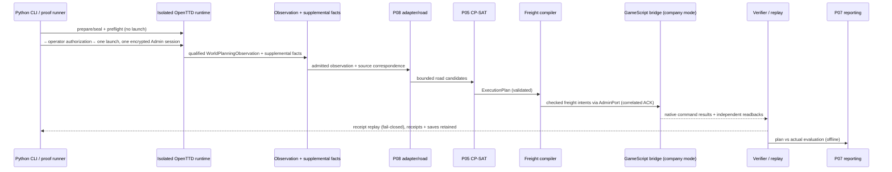

# Data Flow

Compile-time sequence of a planner-authorized native run, as documented in
[[99-Source-Documents/README]] "Architecture" and "Planning integration boundary",
[[99-Source-Documents/CONTEXT]] §11–§13. Controlled pieces are labeled.

## End-to-end planner run (native when authorized)



- The client is a **spectator**; direct control of the Python-operated company is unsupported.
- Services run **serial** delivery batches, one vehicle per service, then trucks park.
- Revenue is timing-dependent and is not profit.

## Command lifecycle (protocol-level)

```text
COMMAND → ACCEPTED → VALIDATED → EXECUTED → VERIFIED → COMPLETED
                 ↘ REJECTED / FAILED / TIMEOUT / DUPLICATE
```

Every externally initiated operation carries a stable `request_id`;
`app/simulation/openttd/gamescript_transport.py` keys classification dispatch on
`(request_id, region, cursor)`. Do not use wall-clock sleeps as proof that OpenTTD
finished an operation — explicit protocol acknowledgements only (CONTEXT §11, §15).

## Message-size / budget flow (recorded, per layer)

| Boundary | Recorded bound | Source |
|---|---|---|
| `GSAdmin.Send(table)` → AdminPort | JSON ≤ **1450 B** | CONTEXT §10 |
| Tile replies (random capture) | ≤ 512 B, exactly 19 integers/tile | E4/E5, [[99-Source-Documents/AI_HANDOFF]] |
| Classification V2 pages | ≤ 508 B/page; census ≤ 52,324 B total; 90 pages | E12/E13/E16 |
| D4 corridor wire | requests ≤ 512 B (worst planned 304 B); responses ≤ 640 B (contract-only delta) | E20 |
| Global random capture request guard | `(capture_tile_limit+36)×max_relationships+1` = 8769 @ 16 | E5 |

Large snapshots are chunked/paginated — never one big packet
([[01-Architecture/AdminPort Protocol]]).

## Evidence / receipt flow

```text
planner request → GameScript execution result → actual world-state verification
→ AdminPort command/log evidence → machine-verifiable receipt → offline replay
```

A GameScript message saying "success" is not proof by itself. Receipts fail closed:
neither a command ACK nor an empty vehicle alone establishes freight delivery
([[99-Source-Documents/README]] "Known limits"). Every consumed attempt retains
`PRELAUNCH.json`, claim, per-exchange request/response pairs, saves, `runtime-identity.json`,
`cleanup.json` and an artifact manifest ([[04-Evidence/Evidence Preservation]]).

## Random World data flow (controlled/offline components marked)

1. Native generation from explicit seed/settings (256×256, ≤ 32 industries observed,
   ≤ 16 relationships, ≤ 8 services/vehicles; one vehicle per service).
2. Discovery separates compatibility from capture admission (`random-rectangle-512-v1`
   profile: ≤ 512 fully observed tiles/rectangle, both cargo-coverage scopes, 45 s,
   ≤ 546 reads per relationship).
3. Qualified observation + supplemental facts → bounded P08 (flat-land candidates,
   2..47 road tiles, terrain-aware reachability) → P05 (1–60 s bound).
4. *CONTROLLED:* the 512-tile correction and the synthetic flat fixture's 31-road-tile
   route and £1,830 estimate — not Seed 17 native results ([[05-Planning/Blockers]]).

## Save/load and idempotency flow

GameScript `Save()` persists basic serializable data (integer/string/array/table/bool/null);
pending events must not be assumed to survive save/load. Commands are retry-safe via
`request_id`; the bridge remembers enough about completed commands to avoid double
execution after reconnect/retry/load/restart (CONTEXT §14). The `Load()`-hook lesson of
E14/E15 (dying AI fallback, AI must be staged with the save's stored identity) is a
captured repair, not a new hypothesis: [[05-Planning/Technical Debt]].
