# System Architecture

**Sources:** [[99-Source-Documents/CONTEXT]] §5–§12, §22; [[99-Source-Documents/README]]
"Architecture"; [[99-Source-Documents/AI_HANDOFF]] architecture map. Proposals from
sources are marked as such. Verified-vs-proposed separation: [[00-Project/Current Status]].

## Preferred (current) architecture

```text
┌─────────────────────┐
│ Python Planner      │
│ OR-Tools / logic    │
└──────────┬──────────┘
           │
           │ command protocol
           ▼
┌─────────────────────┐
│ Python AdminPort    │
│ Client / Transport  │
└──────────┬──────────┘
           │
           │ JSON
           ▼
┌─────────────────────┐
│ OpenTTD AdminPort   │
└──────────┬──────────┘
           ▼
┌─────────────────────┐
│ Bridge GameScript   │
└──────────┬──────────┘
           │
      GSCompanyMode
           │
      validate/test
           │
         execute
           ▼
┌─────────────────────┐
│ OpenTTD 15.3       │
│ Real Game World     │
└──────────┬──────────┘
           ▼
    evidence / receipt
           │
           ▼
┌─────────────────────┐
│ Python Verifier     │
└─────────────────────┘
```

The GameScript stays a relatively **thin** integration/execution bridge; complex route
optimization and logistics planning remain in **Python**.

## Mermaid view (native data path)

```mermaid
flowchart LR
  CLI[Python demo CLI] --> R[Isolated OpenTTD runtime]
  R --> O[Qualified world + supplemental facts]
  O --> P08[Bounded P08 road candidates]
  P08 --> P05[P05 CP-SAT selection]
  P05 --> P[Validated ExecutionPlan]
  P --> C[Checked freight compiler]
  C --> A[Encrypted AdminPort + GameScript]
  A --> N[Company commands + independent readback]
  N --> V[Retained receipts + replay]
  V --> P07[P07 evaluation + reports]
```



## Previous architecture (historical, not current)

```text
Python Planner → plan/transport file → Thin AI → OpenTTD
```

P03/P06 established real-game proofs of the Thin AI / transport approach on OpenTTD
**13.4** via OpenTTDLab. These are historical regression evidence and must **not** be
treated as proof of OpenTTD 15.3 compatibility or of the selected 15.3 architecture.
The project intentionally evaluates a different integration boundary for 15.3
(AdminPort + GameScript).

## Responsibility split

- **Python** owns optimization, identity, validation, deadlines, evidence binding.
- **GameScript** executes synchronous commands under `GSCompanyMode`, returns bounded
  correlated messages, exposes readback.
- **OpenTTD/YAPF** handles vehicle pathfinding over constructed roads — P05/P08 are not
  YAPF and not an arbitrary-world route planner.
- PostgreSQL is optional research persistence, not a demo prerequisite.

## Component stations

| Station | What it does | Details |
|---|---|---|
| World qualification | Same-run structural + production observation contracts, coherent economy-month window, stability checks | [[04-Evidence/Evidence Index]] (E-context), CONTEXT §20 |
| Observation / supplemental facts | Typed observation models assembled in Python; GameScript remains thin | [[01-Architecture/Data Flow]] |
| P08 | Bounded road candidates (flat-land routing, 2..47 road tiles), terrain-aware reachability, terrain-modification planning | [[01-Architecture/Component Map]] |
| P05 | CP-SAT selection of supplied candidates → `ExecutionPlan` | [[01-Architecture/Planning and Execution Boundary]] |
| Freight compiler | Compiles selected single-vehicle service into checked intents; identity retention | [[01-Architecture/Data Flow]] |
| AdminPort client | Encrypted X25519 session; correlated ACK; bounded budgets | [[01-Architecture/AdminPort Protocol]] |
| GameScript bridge | Thin executor; `GSAdmin.Send`; `GSEventAdminPort` intake | [[01-Architecture/OpenTTD Integration]] |
| Verifier | Offline receipt replay; prepared-source correspondence | [[04-Evidence/Evidence Preservation]] |
| D-chain ceremonies | One-shot operator-authorized native mutations (clearing/terraform/roads) | [[02-Milestones/Completed Milestones]] |

## What is implemented vs proposed vs unverified

- Implemented & natively exercised: fixed demo path, canonical fleet Q3, D2/D3 ceremonies,
  freight deliveries (Attempts 4/9/12/17), qualification, secure transport, P07 replay.
- Implemented & controlled-only: Random World planning path, P08 terrain-modification
  planning, tile classification schema-2 sweep/wire, P07 analytics extension.
- Proposed/unverified: closed-loop optimization, arbitrary-world support, concurrent
  throughput, matched A/B native experiments, D5+ (vehicles/orders on corridor).
