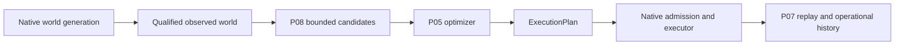

# Random-world demo extension

The fixed seed-42, 64×64 playable demo remains the default. Random mode is opt-in,
bounded to 256×256, and uses OpenTTD 15.3's native TerraGenesis generator. No
heightmap is loaded and no replacement industries or roads are prepared for it.
Native Seed 17 generation, discovery and spectator navigation are verified in
retained evidence, but the smoke terminal remains FAILED: P05 did not run and no
service was constructed or delivered. The new 512-tile capture correction is
controlled/offline only; native service feasibility awaits a fresh authorized run.

## Commands

```bash
# Existing stable flows
.venv/bin/python -m app.openttd_demo check
.venv/bin/python -m app.openttd_demo plan

# Offline recipe: requested settings only; no generated world or selected plan
.venv/bin/python -m app.openttd_demo plan --random-world --seed 17 \
  --map-size 256 --climate temperate --terrain 0 --towns 1 --industries 2 \
  --max-candidates 16 --max-services 4 --max-vehicles 4 --planning-seconds 30

# Only after separate native authorization: generator -> observation -> P08/P05 -> execution
.venv/bin/python -m app.openttd_demo run --random-world --seed 17 \
  --terrain 0 --max-services 4 --max-vehicles 4 --stop-on-delivery

# Offline P07 replay/report; source must be an existing completed native demo
.venv/bin/python -m app.openttd_demo report --source /absolute/path/to/demo-run

# Compare generated P07 report directories, preserving seed/configuration metadata
.venv/bin/python -m app.openttd_demo compare --source /path/to/report-a \
  --compare-with /path/to/report-b
```

`--headless` and `--view-seconds 0..300` work with both run modes. World and planner
options require `--random-world`. Random `check` validates configuration and
prerequisites without generation. Random `plan` writes a reproducible recipe,
not a synthetic world or a claim of feasible services.

| Setting | Supported range |
|---|---|
| Seed | 0..4294967294 (the all-ones random-seed sentinel is excluded) |
| Map size | 256×256 only |
| Climate | temperate, arctic, tropic, toyland |
| Terrain type | native difficulty values 0..5 |
| Town density | native values 0..3; custom town counts excluded |
| Industry density | native values 0..4; zero may yield no freight services |
| Candidate relationships | 1..16; at most 8192 source/cargo/destination checks |
| Services / vehicles | independently 1..8; one vehicle per selected service |
| P05 solve time | 1..60 wall-clock seconds, default 30; killed/reaped on timeout |

The existing finite GBP 500,000 scenario funds random runs. P05 spending is capped
at that budget; each native service still has the executor's GBP 100,000 admission
ceiling. Service capacity is the smaller of the service and vehicle limits.
Execution is serial, stops each truck after its verified delivery batch, and is
bounded to `300 + 300 × service_capacity` seconds plus bounded cleanup. A GUI
viewing hold consumes that same runtime deadline.

## Supported planning and failure boundaries

The existing qualified inventory/catalog/production collectors observe up to 32
industries, without assuming their IDs, count, types, or cargo being coal. Larger
inventories fail the existing explicit collection budget. Production is a
qualified last-month supply benchmark, not a forecast of demand.

Discovery retains compatible positive freight supply with an accepting industry
before capture admission. New random preparations seal a 512-tile **rectangular
area** limit per relationship (`random-rectangle-512-v1`); the fixed profile and
legacy sealed random budgets retain 256 tiles. This is not a Manhattan-distance
limit. Random captures clip padding to the map interior, then require every tile
and both declared cargo-coverage scopes; missing observations fail explicitly.
Search/candidate truncation is retained as `CANDIDATE_SEARCH_LIMIT`. Capture
rejections report `CAPTURE_TILE_BUDGET` or `CAPTURE_MAP_BOUND`. No admitted
relationship is `NO_SUPPORTED_RELATIONSHIP`; an exhausted search with none found
is `SEARCH_LIMIT`. Each capture has a sealed 45-second deadline and at most
`capture_tile_limit + 34` reads (tiles, settings, engine list and at most 32 engines).
The staged global guard is `(capture_tile_limit + 36) × max_relationships + 1`;
at defaults it permits 8769 reads. Each response remains at most 512 bytes and a tile
response contains exactly 19 integers. The total native runtime deadline remains
unchanged. Complete observations must still fit the qualified economy month.
P08 still requires flat, vacant, unobstructed road sites and a bounded corridor.
The native executor permits 2..47 corridor road tiles, two bay stops and one depot.
No slopes, clearing, terraforming, bridges, tunnels, refitting, or arbitrary-terrain
road construction are promised. A generated world may be unsupported or infeasible.

Random service batches use a supported observed engine capacity that fits measured
supply, and P08 restricts the engine to that full-load batch. Different cargoes may
have different capacities. P05 may select fewer services than the resource ceiling;
it is not forced to fill every slot. Random candidates that exceed the native
2..47-road-tile executor bound are rejected before P05 selection. No feasible engine/candidate or zero selected
services fails clearly before company construction. A native admission/command
failure remains a failed attempt, with no retry or reconnect.

## Extension interfaces



- `RandomWorldSettings` describes requested generation settings. Native `-G seed -g`
  selects generation; a config entry alone does not assert seed application.
- PRELAUNCH seals settings, resource limits, generator/configuration source,
  experiment identity, pinned binary/assets and staged code. Independent secure
  welcome evidence supplies actual seed, version and dimensions. A correlated
  `generation` planning read supplies actual climate, terrain and density settings.
  `generation-observation.json` records these observed values separately from the
  recipe, and retained replay checks the settings/configuration and wire exchange.
- `discover_relationships(WorldPlanningObservation, DemoBudgets)` returns bounded
  OD/cargo candidates and rejection/truncation information. It does not authorize
  construction or fabricate native provenance.
- `network_from_facts(..., service_batches=True)` reuses admitted P08 facts and the
  existing road generator. P08's opt-in full-load batch restriction changes no
  default fixed-world behavior. Source/manifest/policy identities remain bound.
- `optimize_bounded(PlanningScenario, DemoBudgets)` runs the existing deterministic
  P05 optimizer in a bounded Python worker and validates its `ExecutionPlan`.
  `compile_freight_network` preserves plan identity; native test/admission,
  independent command readback and P07 replay remain required.
- `operational_snapshot` reads the existing retained request/response files; it
  makes no additional Admin requests. It correlates requests and verifies native
  plan/state and completed delivery measurements. Final report generation first
  requires the existing independent P07 replay.
- `operational-history.json` retains experiment/world/plan identities, per-service
  status and sample ticks, cash, backlog, completed delivery/revenue/command costs
  and milestone trends. `compare_operational_reports` emits descriptive JSON/HTML
  across seeds/configurations without pooling different experiments or claiming
  causation. This structured history can later feed optimizer objectives; no ML,
  feedback controller, or self-optimization is implemented.

## Operational output and evidence labels

Random planning retains `planning-diagnostic.json` and `planning-diagnostic.html`
even when admission or P08/P05 fails. They record actual welcome identity, requested
settings, observed industry/cargo inventory, compatible pairs and coordinates,
capture/candidate rejection reasons, counts, attempted/completed capture reads and
unsupported limits. The terminal prints the same final planning status. Missing
candidate/selection results stay null; delivery and finance fields remain unknown.
These diagnostics do not replace P07 replay or create delivery receipts.


Terminal updates show vehicles, active services/vehicles, delivered cargo, revenue,
measured construction/purchase expenses, company cash, service state and observable
station cargo waiting. Missing samples remain UNKNOWN. Counts reflect retained
point samples; services are sampled asynchronously, not in a simultaneous census.

P07 `results.md` links `operations.html` with standalone SVG charts for cumulative
revenue/cargo and rates between completed delivery milestones. The first rate is
UNKNOWN because it has no preceding completion. Rates use script ticks, not
wall-clock or calendar time, and include serial construction/waiting between
milestones. They are not steady-state throughput. JSON preserves exact numbers.

OBSERVED means native readback/receipt measurements. DERIVED means sums, states
classified from samples, and milestone rates. Command construction/purchase costs
are measured expenses; full operating expenses, profit, OPEX attribution and ROI
remain UNKNOWN. Company cash residuals are not reclassified as operating expenses.
Station waiting cargo is a point sample of backlog, not measured unmet demand.

## Validation boundary

Tests use controlled peers, the existing Squirrel VM and real P08/P05; Python solver
workers are allowed. OpenTTD process launches and Admin connections are forbidden.
Preparation tests cover several seeds/settings, fresh native-generator argv/config,
sealed preflight, a non-mutating random bridge, 256×256 tile IDs above 4095, variable
selected counts, zero supply, unsupported capture regions, replay identities,
operational results and partial files. Existing demo and freight regression tests
retain the fixed profile. Successful roads/deliveries with dynamic P08/P05 on a real random world await
separate native authorization. Generation, graphical visibility and cleanup were
verified by the consumed Seed 17 smoke; that did not establish delivery.

The consumed Seed 17 smoke verified generation, qualified discovery and GUI
navigation, then stopped before construction because all six compatible pairs
exceeded the old 256-tile capture area. New 512-tile admission permits the 450-tile
coal pair; the other five still exceed the bound. Its native terrain, catchment and
engine reads were never collected, so actual P08/P05 feasibility remains unknown.
See [distance support and Seed 17 evidence](random-world-distance-support.md).

Native settings were checked against the locally installed 15.3 API reference and
[15.3 difficulty settings](https://github.com/OpenTTD/OpenTTD/blob/15.3/src/table/settings/difficulty_settings.ini),
[15.3 command-line generation](https://github.com/OpenTTD/OpenTTD/blob/15.3/src/openttd.cpp),
and [15.3 GameScript game API](https://github.com/OpenTTD/OpenTTD/blob/15.3/src/script/api/script_game.hpp).
