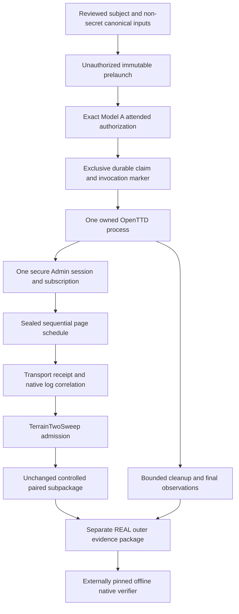
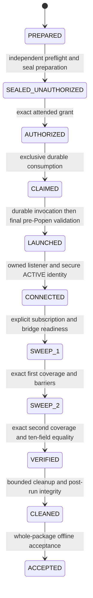

# P08 native multi-page integration design

Status: design for controlled integration, 2026-10-11. This document authorizes
documentation and review only. It prepares a separate native proof contract; it
does not implement it, seal an attempt or authorize execution.

The architecture authority remains `CONTEXT.md`. Relevant contracts are the
[regional plan](p08-multi-page-terrain-acquisition.md),
[two-sweep design](p08-two-sweep-equality-design.md),
[CONTROLLED paired package](terrain-paired-evidence-v1.md) and documented
[offline baseline-1](openttd-offline-evidence-freeze.md). All remain unchanged.

## Scope and established evidence

The first integration is a standalone region in a new-world recipe for OpenTTD
15.3, not the WPO-qualified acquisition path. A region contains 1..256 tiles.
A 256-tile region covers only 1/16 of a 64x64 map. The proposed first native subject
is a six-tile rectangle inside that map: two pages per sweep, four requests total.
Its exact rectangle, seed, request prefix and selected limits require later review
and sealing. This proposal grants no permission for even that small subject.

| Evidence level | Established claim |
| --- | --- |
| Historical native | One process, encrypted connection and request returned five records. Native REAL_PASS is supported within Model A local attestation. |
| Current controlled | Pagination, ten-field equality, paired retention and offline replay pass controlled tests. The latest run reported 79 paired, 157 combined, 603 compatibility and 3,507 ordinary passes. These are carried-forward results, not tests executed by this design task. |
| Proposed here | Native session adapter, multi-request lifecycle evidence, REAL outer package, authorization and whole-attempt verification. |
| Future separately approved proof | Measured multi-page native accounting, session lifetime, two-sweep observations and cleanup. No production-world, saved-world, full-map or construction claim follows. |

Historical complete offline acceptance remains AUDIT_BLOCKED because 13 original
canonical inputs are missing. No compatibility exception reconstructs or ignores
them. The original independent audit JSON remains unavailable; its reconstructed
summary is not restored primary evidence.

## Reuse and missing interfaces

| Existing module | Reuse | Required new work |
| --- | --- | --- |
| [secure_admin.py](../../app/simulation/openttd/secure_admin.py) | Authorized-key login, directional authenticated encryption, ACTIVE-only traffic, quiescence, no insecure fallback | Bounded transcript/byte observations and queue admission for the new proof profile; preserve existing behavior |
| [gamescript_transport.py](../../app/simulation/openttd/gamescript_transport.py) | Sequential `tile_facts_page`, exact receipt correlation, completion PING/PONG, terminal unusable transport | A native coordinator must restrict sends to the sealed plan and reject any unselected packet type |
| [terrain_bridge.nut](../../app/simulation/openttd/terrain_bridge.nut) | Read-only protocol 1, five records/page, selector initialization/verification, native response markers | No road-semantic change; verify multi-request marker behavior against tagged 15.3 sources |
| [main.nut](../../app/simulation/openttd/gamescript_bridge_package/main.nut) | Bounded event batch, script-tick yield and post-response marker | Test sequential page barriers; no new application command needed |
| [terrain_sweeps.py](../../app/simulation/openttd/terrain_sweeps.py) | Private paginators, complete sweep transition, equality and immutable exchanges | Supply context only after native identity checks; no native trust change inside this pure module |
| [terrain_paired_evidence.py](../../app/simulation/openttd/terrain_paired_evidence.py) | Exact nested inventory, caller-pinned descriptor, replay and derived identity | Embed unchanged as a computational subpackage; it continues to assert CONTROLLED data assembly only |
| [terrain_native.py](../../app/simulation/openttd/proof/terrain_native.py) | Capture ownership, process health, secure startup and cleanup design | Separate multi-page backend. `SinglePageSession.send` and `SinglePageNativeBackend.tile_facts_page` explicitly prohibit a second request |
| [terrain_authorization.py](../../app/simulation/openttd/proof/terrain_authorization.py), [terrain_seal.py](../../app/simulation/openttd/proof/terrain_seal.py) | Exact digest/destination, owner PID/start/nonce, attended trust, exclusive durable claim | Separate operation subject and validators. Existing operation is fixed to single-page; its grant cannot authorize multiple requests |
| [terrain_retention.py](../../app/simulation/openttd/proof/terrain_retention.py), [ownership.py](../../app/simulation/openttd/proof/ownership.py) | Reviewed non-secret canonical retention, materialization commitments, sealed ownership and disposal | Review the new operation's exact source/config/page-plan identities without widening old allowlists |
| [terrain_logs.py](../../app/simulation/openttd/proof/terrain_logs.py) | Explicit prefix and final-file digest concepts | Separate multi-page policy. v1 is bound to one request and cannot authorize a multi-page lifecycle index |
| [terrain_collection.py](../../app/simulation/openttd/terrain_collection.py) | Reference for same-session and native-marker reconciliation | Leave WPO/month/industry admission unchanged. Do not fabricate WPO to use it for standalone collection |

The smallest native orchestration module owns one backend and one `TerrainTwoSweep`.
Its acquisition interface accepts a verified sealed subject and consumed typed
grant, and returns retained attempt evidence, never an unverified planning bundle.
An internal fake backend substitutes only process/transport observations in tests.
Acceptance validators, source retention, replay and cleanup validation stay real.
Avoid a second pagination algorithm or a generic proof framework.

## Architecture and data flow

Only one request is outstanding. Use the coordinator's request tuple, not a
caller-created queue. Sweep 1 must finish before exposing sweep 2. For each page:

1. Check process identity, ACTIVE session object, expected plan position and
   remaining operation/byte/deadline allowances before sending exact request bytes.
2. Receive one correlated response and complete the existing PING/PONG barrier.
   Reject malformed, duplicate, stale, wrong-ID or unrelated responses, including
   surplus buffered frames. Retain exact application bytes and receipt.
3. Require the four existing native markers for that request, including the
   post-yield liveness marker. Reconcile native canonical response facts with the
   retained on-wire response. Require secure-stream quiescence before advancing.
4. Reconcile the secure frame observer delta with the exchange's operations.
   Admit the exchange to the existing two-sweep coordinator only after these gates.

The transport allows at most 256 ordinary request IDs; the proposed 104-page ceiling
fits that implementation limit. Subscription uses no extra application request.
The first native profile permits only the selected page command plus secure
handshake, subscription, completion PING/PONG and cleanup protocol frames. Unknown
or unsolicited telemetry packets fail, even if they fit a numerical frame budget.
No `world_info` request is silently added to the selected page budget.

## World and endpoint identity

Seal exact source recipe, executable/version, graphics, assembled bridge, public
configuration, geometry, seed, start date, endpoint pair and region. Form the
declared world fingerprint from that canonical source/context commitment, not from
observed terrain rows. The authenticated welcome must corroborate version 15.3,
dedicated mode, dimensions, seed, landscape and start date using the existing
[native identity checks](../../app/simulation/openttd/proof/native.py).
Every page corroborates geometry and ordered date brackets. Bind the same process
PID/start identity, owned listener, session and public key for the whole attempt.

These observations establish correspondence to a locally attested new-world recipe.
Welcome does not authenticate a saved-world digest or complete map contents.
`TerrainSweepContext` is supplied by the verified adapter; its fingerprint is not
independently emitted by each tile response. Declared recipe identity and native
corroboration must remain separate fields in the REAL record.

Use the existing frozen IPv4 loopback endpoint policy. Cleanup records describe
final matched observations, not earlier startup states. Relevant live TCP/UDP
sockets reject closure. Matching TCP4/TCP6 TIME_WAIT, including producer-permitted
wildcard representations, may remain; unrelated retained rows, malformed rows or
wrong sealed ports reject. Reuse `verify_retained_endpoints`, not a new socket-state
predicate. Socket observations are local attestations, not remotely signed facts.

## Native session state machine

Exact-seal authorization follows sealing. The requested conceptual
PREPARED/AUTHORIZED/SEALED chain would authorize a subject not yet identified by
its final digest. The concrete production order is:

Any invalid transition, timeout, source change, disconnected/replaced session,
missing marker, malformed page, budget exhaustion or drift causes terminal
REJECTED and mandatory CLEANING. CLEANING ends in FAILED_CLEANED or CLEANUP_FAILED;
neither returns an accepted dataset. The success diagram omits these common failure
edges for readability; every post-claim state has them. Failures before consumption
remain unconsumed and cannot launch. After consumption the claim and invocation
history survive failures, including final pre-Popen failure. Cleanup termination
escalation is disposal of the owned process, not a relaunch/retry.

Accepted output is published only after final cleanup, source/history validation,
final-log hashing and independent replay. A computational VERIFIED pair is not a
REAL accepted attempt. Equal observations do not establish an atomic snapshot;
transient changes restored between reads and later world mutation remain possible.

## Budgets and resource derivation

Let `N` be selected tile count, `P=ceil(N/5)`, and `Q=2P`. All selected ceilings are
explicit in the future immutable subject and cannot exceed the reviewed regional
envelope. Actual lengths and admitted counts are retained; theoretical ceilings
are never substituted for observations.

| Quantity | Per sweep | Two-sweep envelope | Basis and qualification |
| --- | ---: | ---: | --- |
| Tiles/pages | N<=256; P<=52 | Q<=104 pages | Existing protocol/plan, partial region |
| Application request | <=159/page; <=8,268 | <=16,536 bytes | Exact serialized planned requests; preflight their actual sum |
| Application response | <=508/page; <=26,416 | <=52,832 bytes | Exact received byte lengths, native 1450 ceiling is separate |
| Query operations | <=8/page; <=416 | <=832 | Receipt counts reconciled with owned secure observer, not added twice |
| Encrypted post-auth frames | <=8P query | <=6+8Q=838 | Two protocol/welcome + three setup + query + one graceful QUIT |
| Native getters | <=44N+6P | <=88N+12P=23,152 | Static successful-path bound, not dynamic measurement |
| Selector setters | P | Q<=104 | Handler executes `SetCurrentRoadType` once per page; do not reuse single-page setter=1 |
| Native capture | n/a | <=262,144 bytes per stream | Existing bounded stdout/stderr; overflow terminally fails |
| Paired subpackage | n/a | <=1,048,576 bytes, <=315 files | Unchanged v1 safety ceiling, includes metadata |
| Application payload retention | n/a | <=69,368 bytes | Request+response subset of paired package, not extra copies |

Four expected query frames are request, response, completion PING and PONG. The
eight-operation ceiling remains a cap, not permission for four arbitrary extras.
No extras are allowed by the initial native packet profile. Keep both actual frame
counts and per-page receipt deltas. Failed candidates retain bounded rejected-frame
diagnostics separately; rejected traffic does not become admitted accounting.

`encode_gamescript` adds three Admin header bytes and one NUL; `PacketCipher`
adds 16 bytes/frame. At maximum payload sizes the expected four query frames use
`159+20+508+20+2*(7+16)=753` encrypted stream bytes/page, or 78,312 at Q=104.
This is conditional protocol arithmetic, not measured usage. It excludes handshake,
welcome/setup/QUIT, extra/failed traffic and TCP/IP packet headers/retransmissions.
The shared encoded-frame maximum is 32,767 bytes including encryption overhead.
A conservative post-auth stream envelope is `838*32,767` bytes; pre-auth permits
exactly the four handshake frame identities with the same hard frame ceiling.
Retain actual directional encoded-byte lengths and enforce an aggregate ceiling
before admitting further traffic. Do not label these totals physical network bytes.

Handshake traffic is not included in `TerrainFrameBudget`. Future observation must
explicitly record its exact JOIN_SECURE, AUTH_REQUEST, AUTH_RESPONSE and
ENABLE_ENCRYPTION order plus byte lengths, without secrets. Validate fixed packet
shapes and reject repeated/unknown authentication frames. No secret session keys,
private key, plaintext authentication response or password enters retained evidence.

Timeout proposal uses existing upper waits as safety configuration, not latency
measurements: listener 30s, connect 5s, authentication <=10s, bridge readiness 10s,
subscription 5s, query+barrier 15s/page, native marker 10s/page. Thus startup <=60s,
each sweep collection <=25P seconds and both <=25Q, at most 2,600s. A selected
process cleanup deadline must cover the lifecycle's three <=5s waits plus capture
join <=2s; propose a 20s cleanup envelope and 15s finalization/replay envelope.
The proposed total operational deadline is `60+25Q+20+15` seconds, at most 2,695s.
Use one monotonic deadline and intersect each local wait with remaining allowance.
Reserve cleanup time outside the acquisition timeout; cancellation must still
dispose of the process and credentials. Authorization waiting occurs before
consumption and outside this runtime deadline. The old 90s attended wrapper cannot
be reused unchanged. Controlled deadline tests must prove every bound before sealing.

Bound the event loop to one outstanding application page and the existing native
32-event batch plus one script-tick yield. Do not infer an instruction count or
execution time from getter arithmetic. Native script memory and total OpenTTD RSS
cannot be derived from payload sizes. The future subject must select and document
process/host memory admission from controlled profiling of pinned assets; this is
a gate before native proof preparation, not a measured value supplied by this design.

Python integration retains at most Q exchanges, 2N rows and Q lifecycle references.
Frame retention allows 838 admitted post-auth records plus the first rejected
post-auth frame, and four pre-auth records, at most 843 records in total. A failure
during authentication instead retains its bounded handshake prefix and first
rejected frame; it cannot proceed to collection. Bound socket read buffering and decrypted
queues before growth. Existing decoder feed limits do not alone bound an asyncio
reader's accumulated backlog; the controlled transport gate must add explicit
buffer/queue limits and overflow rejection for this profile. An idle flood must
fail even while the coordinator awaits a file marker.

For storage let C be exact deduplicated canonical-object bytes, derived from the
reviewed retention index. Proposed outer allowances are <=512 bytes/frame record,
<=512 bytes/page lifecycle index and <=262,144 bytes total remaining outer metadata,
including manifests, four public handshake records and the first rejected-frame
record. The explicit 838-record term covers admitted post-auth traffic only;
the five additional records consume at most 2,560 bytes of the remaining metadata
allowance. The package envelope is therefore
`C + 1,048,576 + 524,288 + 838*512 + Q*512 + 262,144`, at most C+2,317,312 bytes.
The paired bytes include application payloads and receipts. Store one native log,
not cumulative logs per page. Measure canonical C and writer output at controlled
maximum scope; any allowance that cannot encode valid required records requires
explicit new-contract sizing review before sealing, never silent truncation or
an increase during execution. Historical external authority is declared separately.

## Separate REAL contract and commitments

Proposed versioned outer identifier `terrain-native-paired-evidence-v1`, version 1,
operation `openttd-15.3.tile_facts_page.two_sweeps`. These are proposed names, not
newly implemented schemas. It requires its own dispatch and rejects unsupported
schema/version/mode combinations. Do not change baseline-1's inventories, grants,
validators or `terrain-paired-evidence-v1`'s CONTROLLED mode.

The outer record binds an unchanged `paired/` package as replay data. Its nested
CONTROLLED label describes computational admission only; REAL authority comes
solely from separately verified outer native lineage. Validate the exact paired
inventory through its existing verifier and pass the descriptor digest committed
by the externally pinned outer completion descriptor. Never relabel that subpackage
REAL or infer native provenance from its stored context alone.

The future contract specification must define these concrete commitments:

* Immutable PRELAUNCH binds exact operation, source/runtime/bridge/config identities,
  historical protection/base, ownership/materializations, endpoints/public key,
  world recipe, context, both canonical request plans, all selected budgets and
  deadline/resource caps, acceptance gates and an authoritative artifact policy.
* Model A attended grant binds that exact prelaunch SHA256, attempt, destination,
  owner PID/start/nonce, one launch, one connection and Q exact requests. Trust is
  LOCAL_OPERATOR_ATTESTED. CONTROLLED fixture grants remain explicitly separate
  and cannot establish genuine operator authorization.
* Exclusive consumed claim and durable invocation marker bind the grant and exact
  seal before final source validation/Popen. No retry, reconnect or resume allowance.
* Completed outer descriptor binds the prelaunch digest and every retained artifact
  identity/length/digest, paired descriptor, whole-attempt result and lifecycle index.
  The caller supplies both expected prelaunch and completion descriptor digests
  from a trusted record outside the mutable package. Prelaunch cannot know future
  response bytes; it binds the plan and verification policy, not a fabricated response.
* The pinned completion digest establishes byte identity relative to local supplied
  authority. It does not authenticate the operator, server or truth of all local
  process observations. A digest stored only beside the package is insufficient.

Candidate artifact inventory for the future specification is explicit: immutable
PRELAUNCH and source/ownership/history/materialization commitments with indexed
`canonical/<digest>` objects; attempt consumed grant, launch claim and native
invocation marker; authentication and runtime identity; `paired/` exact v1 files;
frame accounting; one lifecycle index; one stdout/stderr pair; raw and normalized
cleanup, endpoint/disposal/post-run attestations; result, completion descriptor and
deterministic manifests. No arbitrary diagnostics directory or filename wildcard.
Define required, phase-conditional and forbidden paths for each failure prefix
before implementing the writer. A failed record may be authentic failure evidence
but cannot receive successful native acceptance. Optional stdout must be explicitly
specified; additional secret-bearing or unknown files reject even with valid hashes.

Canonical retention must cover all reviewed non-secret critical inputs after
candidate/runtime removal, with stable origin/ownership and exact bytes. Do not
blindly retain workspaces. Private credentials are mandatory disposable inputs;
retain public-key identity, exact reviewed public templates and commitments only.
Require any external immutable assets/history base explicitly, with identity and
integrity checks. Missing declared authority fails closed. Current 188 identities
are a carried-forward controlled count, not a hard requirement for future sources.

## Lifecycle and offline verification

Propose a separate `terrain-execution-log-multi-page-v1` record. Each planned request
has a prefix scope with artifact identity, start=0, captured end offset, length,
SHA256 and the four marker associations. Record the endpoint when the evidence
producer snapshots bytes; never infer it by searching repeated marker text.
Hash prefixes incrementally and store only one bounded final log. Verify every
committed prefix remains exact, as well as the complete final-file hash/length.
Offsets must be monotonic, each request's marker sequence unique and ordered, and
the whole final log must contain exactly the selected request identities. Appended
disconnect/shutdown records are permitted; repeated/extra page markers are not.
Use the existing per-request marker parser and semantic response comparison; add
global schedule correlation in the separate policy. A suffix log segment need not
be copied into a second cumulative artifact to prove a prefix.

Planned verifier interface takes package path, required expected prelaunch SHA256,
required expected completion SHA256 and explicitly declared immutable authorities.
Verification order:

1. Validate independent commitments, version/mode and bounded canonical descriptors.
2. Derive inventory from immutable contract and lifecycle phase; enforce exact files,
   regular types, no aliases/traversal/hardlinks and bounded no-follow reads.
3. Validate canonical retention, provenance, materializations, ownership and bound
   historical authority; do not consult deleted candidate paths for retained inputs.
4. Validate exact Model A lineage, durable claim/invocation and process/runtime/auth
   correspondence. Authenticate only as strongly as the declared local trust model.
5. Verify all exact payload/receipt bytes; replay the unchanged paired verifier with
   the committed descriptor digest. Derive independent coverage and ten-field equality.
6. Reconcile secure frame/byte accounting, per-page deltas, ordered native marker
   evidence, prefix scopes and final-log identity against both plans and responses.
7. Validate raw/normalized cleanup, final endpoints, process reaping and credential
   disposal using established semantics; verify post-run source and historical integrity.
8. Derive whole-attempt outcomes and reconcile mandatory result gates for identity,
   authentication/encryption, coverage, equality, budgets, liveness, cleanup/disposal
   and post-run integrity. Success flags never override their validated evidence.

The future native verifier must reject CONTROLLED records as REAL lineage, and
must never treat the existing single-page verifier as an aggregate verifier. A
mutated manifest cannot authorize any artifact, source identity or success gate.
Offline replay works after permitted disposable originals are deleted and from a
fresh interpreter/cwd, using retained bytes, trusted caller pins, verifier code and
declared immutable external authorities. No private secret is needed for offline
semantic replay. Retained authentication success and runtime/cleanup facts remain
local attestations; no independent reconstruction of discarded traffic keys is claimed.

## Failure handling and trust

Any uncertainty about a sent request burns its plan position and terminally rejects.
Never resend on ambiguous delivery or reconnect after EOF. Preserve the consumed
claim, bounded partial page prefix, rejected-frame metadata and exact failure stage.
Incomplete sweep 2 cannot publish sweep 1 as accepted terrain. Capture/evidence
overflow fails the proof and still executes disposal. Keep failures distinct from
successful packages; future contracts must bind permitted failure inventories.

Cryptographic guarantees cover externally pinned bytes and immutable plan/source
relationships. Semantic guarantees cover replay, coverage, equality, budgets and
cross-record consistency. Operator attendance, listener ownership, process identity,
native log origin, timing and cleanup are locally attested. Coordinated fabrication
of every local attestation is outside this trust model. Authenticated encryption
protects the live session; the offline package does not constitute a third-party
cryptographic transcript proving genuine native execution.

P08 may later consume accepted regional facts after independent source/supplemental
admission. No full `SupplementalPlanningFacts`, WPO month qualification, production
world correspondence, P05 optimization, native construction or P07 result follows.

## Controlled milestones and test gates

| Stage | Work | Required gate before advancing |
| --- | --- | --- |
| A | Write the separate REAL contract specification and fake-native coordinator; use real pagination/equality | Reviewed operation/phase inventories, supplied-pin authority, 1/5/6/255/256 tile plans, no frozen-contract changes |
| B | Controlled secure stream, process lifecycle and deadline/resource tests | One connection/launch, no retry, exact schedule, all counters/buffers/timeouts bounded, no unselected packets, RSS/storage admission selected before native preparation |
| C | Real writer/verifier replay on synthetic native evidence | Complete prefixes/final log, cleanup consistency, exact inventory; survives disposable cleanup and separate-cwd fresh-process verification |
| D | Independent Spec, Standards and targeted adversarial implementation review | All mandatory tests and quality gates pass; no inconclusive acceptance claims, pinned baseline digests/history unchanged |
| E | Separately requested preflight and immutable proof preparation | Reviewed small scope, current assets/source, budgets, deadlines, total size/memory admission, exact unauthorised seal and no consumption |
| F | Future explicit attended authorization for one exact OpenTTD 15.3 attempt | Grant matches seal/attempt/destination; one process/session, no retries; post-run independent offline acceptance and accounting required |

No stage E/F action occurs in this design task. Approval here permits only future
controlled integration work. Native capacity is established only by a separately
authorized retained native result and cannot be inferred from maximum-scope fake tests.

| Test challenge | Required acceptance/rejection boundary |
| --- | --- |
| Complete equal 1/5/6/255/256 regions, partial final page | Existing two-sweep replay; no partial/full-map confusion |
| Wrong order/cursor/ID, duplicate, stale or missing response | Sealed scheduler and transport correlation before admission |
| Drift in any of ten fields, changed fingerprint/geometry, date regression | Identity gate and production equality replay |
| Foreign process/session/endpoint or repeated authentication | Owned runtime and secure lifecycle gate |
| Packet fragmentation/coalescing, duplicate after PONG, queued surplus | Completion/quiescence and exact frame deltas |
| Per-page/sweep/combined caps, unselected packet, raw byte flood | Before-write/receive admission, aggregate counters and queue limits |
| Deadline at every phase, EOF mid-sweep, interrupted second sweep | Terminal failure, bounded cleanup; no retry or accepted partial result |
| Prefix corruption, wrong offset/hash, repeated or foreign markers | Multi-page log policy; valid append-only shutdown remains accepted |
| Native response log disagrees with received response | Existing marker semantic comparison plus exact receipt byte commitments |
| False cleanup gate, raw/summary conflict, live endpoint or missing disposal | Established cleanup/endpoint predicates plus outer result reconciliation |
| Missing/extra/nested/symlink artifact; recomputed mutable manifests | Exact outer/nested inventory and caller pins |
| Cross-attempt grant, log, page or cleanup substitution | Immutable plan, lineage, lifecycle and pinned completed descriptor |
| CONTROLLED-to-REAL classification or reused single-page grant | Version/operation/mode and Model A authorization dispatch |
| Delete permitted candidate/runtime/credential copies | Offline retained-source replay; protected/persistent identities remain untouched |
| Baseline compatibility and protected historical artifacts | All 26 digests and historical integrity; 13 missing legacy inputs remain unresolved |

## Independent design reviews

Spec review: PASS, independently checked against source contracts and this task.
Standards/architecture review: PASS, independently checked for reuse, trust,
bounded resources, failure handling and minimal complexity. Neither review found
a blocking design issue. Both requested clarification of handshake and rejected
frame-record storage. The resource section now separates 838 admitted post-auth
records from four handshake records and the first rejected record, with the latter
five inside the bounded outer-metadata allowance. No allowance was silently raised.

These are design-review verdicts, not implementation approval or native evidence.
No tests or measurements described as future gates were executed in this task.
Design approved for controlled integration. Native preparation/execution remains
blocked until its separate specification, resource selections and controlled gates
are complete, followed by explicit preparation and exact-attempt authorization.
