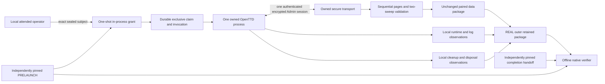
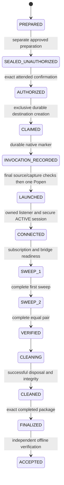

# Terrain native paired evidence v1

Status: specification for controlled contract implementation, 2026-10-11.
This document defines `terrain-native-paired-evidence-v1`, integer version `1`,
mode `REAL`, operation `openttd-15.3.tile_facts_page.two_sweeps`.
Approval permits controlled implementation and review only. It does not permit
native preparation, a persistent seal, operator approval or execution.

The [native integration design](p08-native-multi-page-integration-design.md) is
the design authority. The [paired data contract](terrain-paired-evidence-v1.md)
and [baseline-1](openttd-offline-evidence-freeze.md) remain unchanged.
Current controlled integration and its completed checks are described in
[controlled integration](../p08-controlled-native-integration.md). Its simulated
authentication, process and cleanup observations establish no REAL provenance.

## Scope and compatibility

The subject is one freshly generated OpenTTD 15.3 world, one selected region of
1..256 tiles and two sequential complete sweeps. With `N` selected tiles,
`P=ceil(N/5)` pages form each sweep and `Q=2P` requests form the attempt.
A 256-tile region is partial coverage of a 64x64 map. Equal observations are not
an atomic snapshot, saved-world correspondence, production-world qualification,
construction, P05 execution or P07 evaluation.

This is a separate outer contract. Its embedded `paired/` files retain mode
`CONTROLLED` and their existing acceptance meaning. The outer verifier adds native
lineage and lifecycle validation; it never changes the embedded mode to REAL.
Dispatch requires the exact outer schema, version and operation. Unknown versions,
single-page grants and CONTROLLED outer lineage reject without fallback.

Proposed subordinate identifiers are `terrain-native-paired-prelaunch-v1`,
`terrain-native-paired-local-grant-v1` and `terrain-execution-log-multi-page-v1`,
each version 1. Other outer records use the outer schema plus the record's exact
`kind`. These identifiers are specifications, not implemented formats.
The existing single-page authorization's hardcoded operation is not widened.
Future code reuses its one-shot semantics through separate operation dispatch.

Historical native REAL_PASS remains supported within Model A. Historical complete
offline acceptance remains AUDIT_BLOCKED with 13 missing canonical inputs.
All 1,868 baseline artifacts and historical seal/source commitments remain intact.
The original independent audit JSON is unavailable; the
[reconstructed summary](openttd-reconstructed-independent-audit-summary.md) records
its provenance limitations. Neither limitation has a compatibility exception here.

## Trust and independent authority

The verifier takes a package path, required caller-pinned prelaunch SHA256,
required caller-pinned completion SHA256 and an explicit immutable-authority map.
Neither digest has a default. Values read only from the package, its manifests,
logs or filenames are not trusted pins. The caller obtains pins from a separately
retained reviewed preparation record and completed local-attested handoff record.
The handoff identifies attempt, operation, both digests and trust model. A caller
who cannot establish that authority receives AUDIT_BLOCKED, never REAL_PASS.

The prelaunch pin authorizes exact intended inputs and verification policy.
It cannot commit future observations. The completion pin commits their exact
retained bytes. Caller trust in the handoff is local unless another separately
reviewed authentication mechanism authenticates it. SHA256 does not authenticate
an operator or prove that a process event occurred.



| Guarantee | Classification and limit |
| --- | --- |
| Pinned artifacts, source bytes, plan and cross-record digest links | Cryptographically verified relative to supplied pins and trusted verifier code |
| Coverage, ten-field equality, schedule, budgets and record consistency | Semantically verified by retained-byte replay |
| Attended action, owner identity, native log origin, process/session ownership, timings and disposal | Locally attested with required structural and relational checks |
| Session confidentiality and integrity while ACTIVE | Established by the live secure implementation; retained public summaries do not independently reproduce discarded traffic keys |
| Truth of coordinated fabricated local observations, complete memory erasure, atomic world snapshot | Not independently verifiable from retained bytes |

Current verifier code and declared immutable external authorities remain trusted
dependencies. Retained source digests identify the executed build, not a mechanism
that automatically executes arbitrary retained verifier code. Missing external
history authority fails closed; the verifier never searches another checkout.

## Immutable preparation and exact authorization

`seal/PRELAUNCH.json` has exactly `{schema,version,mode,operation,attempt,
runtime,source,context,plan,budgets,resources,endpoint_policy,artifact_policy,
required_gates,commitments,external_authorities}`. Metadata uses strict frozen
models and the [existing canonical encoding](terrain-paired-evidence-v1.md#encoding-and-scalar-rules).
Reject duplicate JSON keys, missing/unknown fields, booleans as integers,
nonfinite values and noncanonical metadata. Application response bytes retain
their original encoding. Digests cover exact bytes and are lowercase SHA256.

* `attempt` is `{identity,destination,seal_destination}`. Destinations are exact
  canonical absolute paths selected during preparation, not ambient cwd identities.
* `runtime` commits executable origin, bytes digest and version 15.3, graphics
  archive and extracted-file index, GameScript/library inputs and assembled bridge
  digests, argv, public environment and public configuration commitments.
* `source` commits the reviewed candidate digest, complete original source-freeze
  digest, durable canonical index, ownership, materializations and historical
  protection digests. The reviewed list includes every reachable runtime-critical
  bridge/source asset. Current source count is discovered, not fixed at 188.
* `context` is the existing `TerrainSweepContext` shape. `source` also commits seed,
  landscape and start date. World fingerprint derives from the declared recipe
  commitment, not terrain rows. Native welcome corroboration is recorded separately.
* `plan` commits `seal/page-plan.json`. Its two ordered sweeps contain exact existing
  pagination identities, cursors, tile IDs and request byte lengths/digests.
* `budgets` contains existing per-sweep and combined budgets, selected frame caps
  and selected handshake/stream byte ceilings. `resources` contains all selected
  deadlines, buffer/queue/memory and storage caps described below.
* `endpoint_policy` contains the existing closure policy, AF_INET loopback host,
  distinct game/Admin ports, client public key and its raw-key SHA256.
* `artifact_policy` is the exact outer schema/version inventory in this document.
  `required_gates` is the exact successful result-gate set below.
* `commitments` is ASCII-path-sorted `{path,byte_length,sha256}` entries for every
  seal file except PRELAUNCH, SEAL and the seal manifest. It includes each distinct
  canonical object. `external_authorities` identifies exact historical root,
  provenance identity, protected inventory digest and declared identity verifier.

The seal writer validates original sources and safe public materializations,
copies exact reviewed non-secret inputs and writes PRELAUNCH last in an exclusive
owned staging directory. Publish the seal atomically, then validate its exact
inventory. `SEAL.sha256` is the prelaunch hex digest followed by LF.
No runtime output is an immutable seal input. No arbitrary external input or
path wildcard becomes approved through a mutable inventory.

### Strict nested preparation shapes

The following are normative field sets. `Digest` means a lowercase 64-character
SHA256 string. `Count` means a nonnegative integer excluding booleans; `Positive`
means a positive integer. `Text` is a nonempty UTF-8 string bounded by its enclosing
record limit. Public identifiers are safe ASCII strings, at most 128 characters,
and request IDs also satisfy the existing protocol validator. Paths are canonical
relative POSIX artifact paths or explicitly marked canonical absolute provenance
paths. No field is optional unless its type below includes null.

`Commitment` is exactly `{path,byte_length,sha256}` with an artifact path, Count and
Digest. `Input` is exactly `{identity,origin,byte_length,sha256}` with a stable public
identity, canonical absolute original provenance path, Count and Digest.
Arrays retain order; input indexes are identity-sorted with no duplicates.
These names describe wire types, not new implementation abstractions.

| Object | Exact fields and wire types |
| --- | --- |
| attempt | identity: identifier; destination and seal_destination: canonical absolute paths |
| runtime | executable: Input; version: literal `15.3`; graphics_archive: Input; graphics_files: Input array; bridge_inputs: Input array; bridge_sha256: Digest; argv: Text array; environment: public string-to-string map; public_config: Input array |
| source | candidate: Input; source_freeze_sha256, canonical_inputs_sha256, ownership_sha256, materializations_sha256, historical_integrity_sha256: Digest; recipe: Recipe; recipe_sha256: Digest |
| Recipe | map_x and map_y: Positive map-size exponents accepted by existing source validation (for example, 6 means 64 tiles; the exponent itself need not be a power of two); seed and start_date: Count; landscape: supported integer native landscape enum |
| context | acquisition_id and world_fingerprint, map_width, map_height and region: exact existing TerrainSweepContext wire shape from paired v1 |
| plan | Commitment with path exactly `seal/page-plan.json` |
| budgets | per_sweep: exact PaginationBudget field set; combined: exact TwoSweepBudget field set; frames: FrameCaps |
| FrameCaps | post_auth_frames, pre_auth_frames, post_auth_stream_bytes, pre_auth_stream_bytes: Positive, with the ceilings below |
| resources | startup_ns, query_ns, marker_ns, acquisition_ns, cleanup_ns, finalization_ns: Positive; raw_reader_bytes, frame_queue_count, frame_queue_bytes, decrypted_queue_count, decrypted_queue_bytes, host_admission_bytes, process_rss_bytes, memory_monitor_interval_ns: Positive; stdout_bytes, stderr_bytes, paired_bytes, outer_bytes, outer_files: Positive; admission_evidence: Commitment array |
| endpoint_policy | policy: exact `endpoint_cleanup_contract()` object; family: literal AF_INET; host: literal 127.0.0.1; game_port and admin_port: distinct positive integers <=65535; client_public_key: lowercase 64-character hex; client_public_key_sha256: Digest |
| artifact_policy | schema: literal outer identifier; version: integer 1 |
| required_gates | exact ordered list of the gate names in the result table, in that table's order |
| external_authorities | exactly one HistoricalAuthority for the protected historical base |
| HistoricalAuthority | role: literal `historical`; provenance_base: canonical absolute path; identity: identifier; inventory_sha256: Digest; policy: literal `historical-exact-paths-v1` |

`environment` is a map, not an extensible record. Its exact reviewed key/value map
is sealed and validated against the sanitized runtime renderer. No key or value
may contain credentials. Graphics/bridge/config input entries must match retained
source origins and digests. `recipe_sha256` commits canonical Recipe bytes.
World fingerprint is SHA256 of canonical bytes of exactly
`{policy:"terrain-native-world-v1",recipe,executable_sha256,graphics_sha256,
bridge_sha256}`. Digests come from the selected runtime inputs, not observations.
Region and recipe dimensions must agree.
Memory/deadline values are integer bytes/nanoseconds, not JSON floats. Selected
admission-evidence commitments reference required canonical retained inputs.
An empty or missing admission-evidence list cannot authorize unresolved native caps.

`seal/page-plan.json` is exactly `{schema,version,context,sweeps}` using the outer
identifier and version 1. Each sweep is exactly `{identity,pages}` with the existing
paired-v1 sweep identity. Each planned page is exactly `{ordinal,request_id,cursor,
tile_ids,request_byte_length,request_sha256}`. Ordinals are Positive, cursor/tile IDs
are Counts, and digests/lengths commit existing exact request serialization.
The verifier regenerates this plan from context and selected budgets.

The new canonical index has exactly `{policy,candidate_path,entries}`. Policy is
`terrain-native-durable-canonical-v1`. Candidate path is original canonical absolute
provenance. Entries retain the existing exact `{identity,origin,artifact,sha256}`
shape and candidate/source origin rules, with artifact relative to `seal/`.
The source freeze is the exact origin-to-Digest map. Public original candidate
bytes must validate their reviewed file and source-integrity relationships; every
required origin is covered by retained content or exact seal metadata. Ownership,
materialization and historical records use the existing authoritative semantic
shapes, committed byte-for-byte, including historical `provenance_base`.
Outer inventory dispatch is separate; no original temporary path is a read authority.

Existing [retention rules](../../app/simulation/openttd/proof/terrain_retention.py)
define content review and stable origin relationships. The future outer verifier
needs a separate native index/inventory dispatch because existing `verify_inputs`
and whole single-page seal validation assume single-page paths. Reuse their checks;
do not call them with an incompatible layout or relax their existing allowlists.
Origin labels remain provenance, not instructions to reread removed candidate files.
Repository, pinned assets and protected history are persistent; only explicit
disposable copies may be removed. Resolved deletion identities must not overlap
protected, persistent or retained canonical identities.

Public-only templates named `private.cfg` or `secrets.cfg` are retained only after
exact content review, as in existing retention. Plaintext private keys, passwords,
authentication-response payloads, derived keys and secrets are forbidden everywhere.
Retain public-key identity and commitments for disposable secret materializations,
not their bytes. Secret disposal is mandatory. Offline validation does not require
secret reconstruction or claim locked memory or complete memory erasure.



Before authorization, present the executable, exact seal digest, attempt/destination,
world/region, Q requests, public key/endpoints, all selected limits and local trust.
Read and write a real controlling TTY. Exact input is
`CONFIRM <prelaunch_sha256> <attempt_identity> <attempt_destination>`.
Use the existing nonseekable-safe, separate terminal read/write convention.
Declining or noninteractive input cannot yield an in-process grant.

`authorization-consumed.json` is the new operation-qualified public grant plus
`{state:"STARTED",no_retry:true}`. The grant fields are exactly `{schema,version,
authorization_mode,trust,proof_operation,seal_sha256,attempt_identity,
attempt_directory,owner_pid,owner_start,owner_nonce,launch_allowance,
connection_allowance,request_allowance,no_reconnect,no_relaunch,no_resume}`.
Policy is `OPERATOR_ATTENDED_LOCAL_PROOF`, trust `LOCAL_OPERATOR_ATTESTED`,
allowances are 1, 1 and Q, and all prohibitions are true. PID and Linux start
identity bind the executing owner; nonce is fresh for this grant. The private
in-process grant token is neither serialized nor reconstructible from this record.
CONTROLLED fixture trust cannot satisfy REAL launch or retained lineage validation.

Create the attempt directory exclusively, mode 0700, and fsync directory and claim.
Its existence consumes the attempt even if writing or final validation fails.
`launch-claim.json` binds the exact consumed-record digest, prelaunch digest,
attempt/destination and owner identity. `native-launch-claimed.json` adds
mode REAL, `launch_invocations:1`, exact launch-claim digest and `no_retry:true`.
Persist it before the final pre-Popen source/materialization/capture validation.
No automatic retry, reconnect, relaunch, resume or grant reconstruction is allowed.
Termination escalation during cleanup is disposal, not another launch.

These three records are flat exceptions to the observation envelope below.
`authorization-consumed.json` has exactly the declared grant fields plus state
and no_retry. `launch-claim.json` has exactly `{schema,version,mode,attempt_identity,
attempt_directory,seal_sha256,consumed_record_sha256,owner_pid,owner_start,owner_nonce,
no_retry}`. `native-launch-claimed.json` has exactly those fields plus
`launch_claim_sha256,launch_invocations`. Schema is the outer identifier, version 1,
mode REAL, and the claim's exact grant identity values must agree. Owner PID is
Positive, owner_start is a nonempty decimal start-ticks string, owner_nonce is
32 lowercase hexadecimal characters, invocation count is exactly 1 and no_retry true.
Grant schema is the new grant identifier, version 1, with the same scalar rules.

## Exact retained artifact inventory

The completion descriptor authorizes no filenames by itself. The verifier derives
inventory from the pinned prelaunch policy, exact lifecycle prefix and page plan.
Every finalized post-claim package requires the common files below, even on failure.
Unreached observations use explicit typed unavailable records, never invented facts.

| Path | Requirement |
| --- | --- |
| `seal/PRELAUNCH.json`, `seal/SEAL.sha256`, `seal/artifact-manifest.sha256` | Required exact sealed authority |
| `seal/source-freeze.json`, `seal/canonical-inputs.json` | Required complete source commitments and provenance index |
| `seal/path-ownership.json`, `seal/runtime-materializations.json` | Required immutable ownership and safe materialization commitments |
| `seal/historical-integrity.json`, `seal/page-plan.json` | Required protection/root authority and complete request plan |
| `seal/canonical/<sha256>` | Exactly the deduplicated objects required by the sealed index, no extra objects |
| `authorization-consumed.json` | Required for every post-claim package, exact new grant |
| `launch-claim.json` | Required after completed launch-claim publication |
| `native-launch-claimed.json` | Required after invocation publication, absent before it |
| `runtime.json`, `authentication.json` | Required typed observations or explicit unavailable phase records |
| `frame-accounting.json`, `lifecycle.json`, `execution-log.json` | Required bounded accounting, transitions and captured log scopes |
| `stdout.log`, `stderr.log` | Required final captured bytes, possibly empty when process never launched |
| `cleanup.raw.json`, `cleanup.json`, `credential-disposal.json` | Required attempted disposal observations and reconciled summary |
| `post-run-integrity.json`, `result.json` | Required final checks and outcome, including failed/unavailable checks |
| `paired/` | Required COMPLETE package for REAL_PASS; phase-conditional incomplete/failed prefix for failures |
| `completion.json`, `artifact-manifest.sha256` | Required final independently pinned descriptor and deterministic recursive manifest |

`paired/` contains exactly the unchanged v1 inventory. No outer file is placed
inside it. On failure it is absent only if no page was admitted; otherwise its
FAILED/INCOMPLETE descriptor contains exactly the admitted sequential prefix.
It cannot publish COMPLETE before both sweeps pass computational replay.
An equal COMPLETE subpackage may remain after a later cleanup failure; outer
status is still REAL_FAIL. Raw incomplete exchange bytes are not copied into
unindexed arbitrary files. Bounded rejected-frame digest/type/length diagnostics
and a possible pending request/response commitment reside in frame-accounting.

Only ancestors of required files are permitted directories. No optional stdout,
wildcard diagnostics directory, extra grant or arbitrary extension is allowed.
Unknown files, empty directories, aliases, symlinks, hardlinks, traversal,
noncanonical numbering, special files and file/directory substitutions reject.
Use bounded no-follow reads on a quiescent package and verify/replay the same bytes.
Changing cwd or deleting disposable originals does not change package authority.

Crash prefixes without a finalized completion commitment remain consumed diagnostic
evidence, not completed REAL_FAIL or REAL_PASS packages. A read-only inspector may
report AUDIT_BLOCKED and enumerate missing mandatory records. It cannot manufacture
completion, approval or unavailable cleanup records after a crash.
Prelaunch failures use a separate bounded preparation report, no claimed attempt.

`completion.json` has exactly `{schema,version,mode,operation,attempt_identity,
prelaunch_sha256,status,terminal_phase,paired_descriptor_sha256,artifacts}`.
`artifacts` is a unique ASCII-path-sorted list of `{path,byte_length,sha256}` for
every required/conditional regular file except completion and the root manifest.
Paired descriptor digest is null exactly when `paired/` is absent. Status equals
the derived final result. The caller pins SHA256 of these canonical descriptor bytes.
Root manifest covers every recursive file except itself, including completion and
both nested manifests. Nested manifests cover their own exact inventories.
Format is `<sha256><two spaces><relative path><LF>`, sorted by ASCII path.
There is no digest cycle. A recomputed manifest cannot change either external pin.

## Native records and page correlation

The runtime, authentication, frame-accounting, lifecycle, execution-log, cleanup,
credential-disposal, post-run-integrity and result record envelopes have exactly
`{schema,version,kind,attempt_identity,
prelaunch_sha256,observations}`. The observations model is specific to `kind`.
Prelaunch, completion, grants, claims, manifests and embedded paired files are
explicit exceptions with the previously defined shapes. Kind equals the file stem,
including `cleanup.raw` for raw cleanup and `cleanup` for normalized cleanup.
Execution-log additionally uses its subordinate policy identifier inside observations.
Unavailable observations are `{available:false,reason,phase}` with a bounded reason
code and no success fields. Success requires every mandatory observation available.
Recorded timestamps are integer nanoseconds on one monotonic clock domain anchored
to claim acquisition. Pre-consumption states carry time zero; runtime timing starts
at consumption. They do not authenticate elapsed time to another machine.

| Kind | Required available observations |
| --- | --- |
| runtime | owner and child PID/start identities, launch argv/config/bridge/executable commitments, one process instance, namespace/endpoint ownership, launch/exit/reap times |
| authentication | one session ID, same process/endpoint/public key, X25519_AuthorizedKey method, encrypted true, ACTIVE state, ordered auth-state events, public protocol/welcome, handshake metadata |
| lifecycle | contiguous event ordinals, valid phases, monotonic times, one launch/connect, exact request IDs and page/sweep admissions, failure and cleanup transitions |
| credential-disposal | exact disposable materialization identities/commitments, removal observations, workspace disposal and no retained secret bytes |
| post-run-integrity | sealed input and materialization comparisons captured before disposal, required external history checks, exact missing/changed sets and disposal completion |

### Strict available observation shapes

Available observations include `available:true` and exactly the remaining fields
below. Counts/digests/identifiers follow the preparation scalar rules. Nullable
timestamps, exit codes and pending diagnostics occur only for documented failed
phases. Unavailable observation records use the exact three-field alternative
above and cannot establish a successful gate. Per-record metadata remains bounded
by the resource contract; these field sets do not grant unlimited strings or arrays.

| Kind or nested record | Exact additional fields |
| --- | --- |
| runtime | owner: ProcessIdentity; child: ProcessIdentity or null; launch_argv_sha256, configuration_sha256, bridge_sha256, executable_sha256: Digest; process_instances: Count; network_namespace: identifier; endpoints: EndpointIdentity; launched_ns, exited_ns, reaped_ns: Count or null |
| ProcessIdentity | pid: Positive; start: decimal start-ticks string |
| EndpointIdentity | family: AF_INET; host: 127.0.0.1; game_port and admin_port: positive distinct port integers |
| authentication | session_id: identifier; process: ProcessIdentity; endpoints: EndpointIdentity; public_key: 64-character public hex; public_key_sha256: Digest; method: X25519_AuthorizedKey or null; encrypted: boolean; state: existing AuthState name; states: AuthEvent array; protocol: ProtocolFacts or null; welcome: WelcomeFacts or null; handshake: HandshakeFrame array |
| AuthEvent | ordinal: Positive; state: existing AuthState name; time_ns: Count |
| ProtocolFacts | version: integer; frequencies: array of exactly {update_type: Count, frequency: Count}, sorted by update_type, no duplicate type |
| WelcomeFacts | revision: Text; dedicated: boolean; width,height: Positive; seed,landscape,start_date: Count |
| HandshakeFrame | ordinal: Positive; direction: inbound or outbound; packet_type: Count; encoded_byte_length: Positive; encoded_sha256: Digest; state: existing AuthState name |
| lifecycle | events: LifecycleEvent array; failure: Failure or null; cleanup_errors: Error array |
| LifecycleEvent | ordinal: Positive; phase: named state from the lifecycle or REJECTED/FAILED_CLEANED/CLEANUP_FAILED; event: named transition action or request_sent/response_received/page_admitted; time_ns: Count; session_id: identifier or null; sweep,page: Positive or null; request_id: protocol ID or null |
| frame-accounting | frames: Frame array; page_deltas: PageDelta array; totals: FrameTotals; rejected: RejectedFrame or null; pending: PendingExchange or null |
| Frame | ordinal: Positive; direction: inbound or outbound; phase: handshake/establishment/setup/sweep1/sweep2/cleanup; session_id: identifier; request_id: protocol ID or null; packet_type: Count; plaintext_byte_length,encoded_byte_length: Positive; plaintext_sha256: Digest or null; encoded_sha256: Digest |
| PageDelta | sweep,page: Positive; request_id: protocol ID; first_frame,last_frame: Positive; admitted: boolean; request_bytes,response_bytes,query_operations: Count; request_sha256: Digest; response_sha256: Digest or null |
| FrameTotals | establishment,setup,sweep1,sweep2,cleanup,handshake: Count; query_operations,post_auth_frames,pre_auth_frames,request_bytes,response_bytes,inbound_stream_bytes,outbound_stream_bytes: Count |
| RejectedFrame | direction and phase as Frame; packet_type: Count or null; captured_byte_length: Count; sha256: Digest; reason: failure code |
| PendingExchange | sweep,page: Positive; request_id: protocol ID; request: exactly {byte_length: Count,sha256: Digest}; response: same shape or null; delivery: SENT/UNKNOWN; admitted: literal false |
| credential-disposal | materializations: Disposal array; workspace_disposed: boolean; retained_secret_count: Count |
| Disposal | identity: identifier; commitment_sha256: Digest; removed: boolean; observed_ns: Count |
| post-run-integrity | before_disposal: IntegrityCheck array; history: exactly {identity: identifier,inventory_sha256: Digest,validated_paths: Count,missing: Text array,changed: Text array}; workspace_disposed: boolean |
| IntegrityCheck | identity: identifier; phase: final_pre_popen or post_run; expected_sha256: Digest; observed_sha256: Digest or null; checked_ns: Count; outcome: MATCH/MISSING/CHANGED |
| cleanup.raw | cleanup: RawCleanup; completed_ns: Count |
| RawCleanup | pid: Positive or null; graceful_attempted: boolean; quit_command: literal quit; returncode: integer or null; reaped: boolean; remaining_processes: ProcessIdentity array; events: Text array; cleanup_error: Error array; admin_frame_accounting: FrameTotals |
| Error | stage: named lifecycle/finalization stage; type: bounded public exception-type identifier |
| cleanup | cleanup: same RawCleanup; endpoints: exactly {sockets_closed: boolean,endpoint_verification: EndpointVerification or null}; completed_ns: Count |
| EndpointVerification | exact existing verify_retained_endpoints accepted shape and strict socket-row fields, sealed ports substituted as metadata |
| result | status: REAL_PASS or REAL_FAIL; terminal_phase: named lifecycle/finalization state; failure: Failure or null; gates: exact boolean gate map below |
| Failure | code: safe ASCII identifier <=64 characters; phase: named lifecycle/finalization state; message: public UTF-8 <=1024 characters; cause_type: bounded public exception-type identifier or null |

Authentication `available:true` means the observer retained session observations,
not that authentication succeeded. A failed pre-ACTIVE session retains its bounded
handshake and state-event prefix; method, protocol and welcome are null only when
the corresponding facts were not yet observed. Successful authentication requires
all three non-null, the complete required handshake, encryption and ACTIVE state.
An unavailable authentication record cannot hide observed handshake frames: it
requires zero handshake observations and cannot establish authentication success.

Handshake frame metadata is stored in authentication; frame-accounting contains
only post-auth admitted frames. Its handshake total must equal the handshake array
length. This avoids duplicate traffic accounting. The rejected record describes
at most the first failed frame and never increases admitted operation counts.
Pending byte digests are diagnostic commitments whose unavailable payloads cannot
be independently replayed or contribute accepted coverage.

Every admitted PageDelta selects contiguous frame ordinals with exact matching
session/phase/request and four allowed query packets. The same deltas, lengths and
operations must match embedded exchanges. Failed PageDelta may select a nonempty
partial prefix and has admitted false; response_bytes is zero with null digest
before any matching response. Lifecycle page IDs must agree with these deltas.
RawCleanup permits null PID/returncode only when no child launched; successful
REAL cleanup uses the existing native predicate with integer child PID/exit code.
The summary raw object must equal the raw artifact exactly, including completed_ns.
The established predicate is applied to those extracted raw/summary values and
the reconciled FrameTotals; the outer envelope is not passed to a single-page parser.

Lifecycle event names are exactly prepared, sealed, authorized, claimed,
invocation_recorded, launched, connected, subscribed, sweep_started, request_sent,
response_received, page_admitted, sweep_completed, pair_verified, rejected,
cleanup_started, cleaned, cleanup_failed and finalized. Only the transitions and
page barriers defined above permit each name. No unrelated event string is valid.
Successful source_integrity requires MATCH checks for all selected final_pre_popen
inputs before launched. Post-run integrity requires the applicable post_run checks
before disposal. Timing and filesystem observations remain locally attested.

Authenticated welcome must match revision 15.3, dedicated mode, dimensions, seed,
landscape and selected start date. Reuse [native identity semantics](../../app/simulation/openttd/proof/native.py).
Welcome corroborates the declared recipe; it does not emit a saved-world fingerprint.
No extra `world_info` or other application request is added implicitly.

Authentication handshake records contain ordinal, direction, packet type, encoded
byte length, encoded-byte SHA256 and observed state transition. Expected order is
JOIN_SECURE, AUTH_REQUEST, AUTH_RESPONSE, ENABLE_ENCRYPTION with the existing
[secure parser](../../app/simulation/openttd/secure_admin.py) shapes. Retain public
protocol/welcome facts. Do not retain handshake secret payloads or traffic keys.
Their recorded digests are local observations whose original bytes are unavailable
offline; they are not independently rehashed transcript evidence.

`frame-accounting` observations contain ordered bounded frame records, exact phase
totals and one page-delta record per attempted request. Frame records contain ordinal,
direction, phase, session ID, request ID or null, packet type, plaintext length,
encoded stream length, plaintext and encoded SHA256. Handshake records omit the
plaintext digest for secret-bearing payloads. For protocol/response/receipts, retained
public bytes corroborate plaintext digests. Digests of unavailable ciphertext or
unretained PING/QUIT bytes remain local measurements unless derived from exact public
frame encoding. Never relabel projected CONTROLLED lengths as measured native bytes.

Successful traffic permits exactly two encrypted protocol/welcome frames, three
subscription/barrier frames, each page's request/response/completion PING/PONG,
and one graceful QUIT. Numerical ceilings do not authorize other packet types.
One request is outstanding. Sweep two cannot start before complete first coverage.
Missing, duplicated, stale, unsolicited, foreign-ID or surplus buffered frames reject.
Reconcile receipt operations with actual secure observer deltas before page admission.
Per-page requests, responses and receipts live only in `paired/`; the outer page
index references their paths/digests, never duplicates application payloads.

`execution-log` observations contain policy `terrain-execution-log-multi-page-v1`,
ordered page records and final stdout/stderr commitments. Each admitted page records
its sweep/page/request identity, receipt/response digest, snapshot artifact `stderr.log`,
start=0, captured end offset, byte length, exact prefix SHA256 and the four existing
marker associations including byte ranges. Snapshot end comes from captured length,
not marker searches. Offsets increase monotonically; the final log retains every
prefix exactly. Parse each selected prefix with the existing
[native page parser](../../app/simulation/openttd/tile_facts_evidence.py), require its
four-marker sequence and semantic response agreement, then validate global request
order and uniqueness across the complete final log. No extra or duplicate page marker
may be hidden in a suffix. Disconnect/shutdown suffix logging is permitted.
Failure may retain one incomplete marker sequence for the currently attempted request,
explicitly classified unadmitted; it cannot advance coverage or success gates.
Hash prefix scopes incrementally and keep one final log per stream.

Its exact available field set is `{available,policy,pages,pending,final}`.
Each page is exactly `{sweep,page,request_id,request_artifact,response_artifact,
exchange_artifact,response_sha256,snapshot,markers}`. Artifact paths refer to the
embedded inventory. Snapshot is exactly `{artifact,start_offset,end_offset,
byte_length,sha256}` with Counts and Digest. Each of exactly four markers is
`{marker,start_offset,end_offset}` with the existing marker name and byte Counts.
`pending` is null or the same page shape with a partial marker array and nullable
response artifact/digest. It describes only the current unadmitted request.
`final` is exactly `{stdout,stderr}`; each is exactly `{artifact,byte_length,sha256}`
with artifact stdout.log or stderr.log. All ranges are checked against final bytes.

## Disposal and integrity identity bindings

These normative v1 definitions complete the existing record fields. They add no
wire fields and do not change baseline-1 or CONTROLLED paired evidence.

### Derived identities and authority

Use canonical encoding of a strict frozen three-field model
`{policy:"terrain-native-binding-v1",domain,locator}`. Its SHA256, prefixed with
`binding-`, is the record identity. Domains are exactly `owned-path`,
`canonical-input` and `seal-artifact`. The locator is respectively an already
canonical absolute owned path, a canonical-index entry's exact identity, or an
exact package-relative sealed artifact path. Strings must already be NFC; do not
normalize a supplied substitute into authority. The prefix plus 64 lowercase hex
characters satisfies the identifier grammar. Reject collisions and duplicate
identities. The verifier derives this map from independently pinned PRELAUNCH and
its verified sealed records, never from disposal or integrity records themselves.

Owned paths come from the sealed resolved-path ownership graph. Apply its existing
traversal, symlink, hard-link and persistent/disposable separation checks before
constructing identities. Retained canonical objects and protected history are
never disposal targets. A mutable path string does not authorize ownership.

### Exact disposal coverage

Derive the disposal set from every RUNTIME_EPHEMERAL and RUNTIME_CREDENTIAL leaf,
every cleanup root, and every ancestor directory of those leaves up to its
cleanup root. Deduplicate directories. Each file must be either a public runtime
materialization, one declared capture output, or the unique private-key
materialization. Reject ambiguous classifications and undeclared file resources.
The records must have exactly this set, sorted by identity, with no extras.
Runtime-created descendants are covered by final absence of their owned cleanup
root; they do not authorize additional prelaunch identities.

For public runtime input files, `commitment_sha256` is the original raw-byte digest
in the sealed materialization row. A permitted runtime configuration rewrite does
not change that commitment. For directories and capture outputs, it is SHA256 of
canonical bytes of the strict model
`{policy:"terrain-native-owned-resource-v1",path,kind,ownership_sha256}`;
`kind` is exactly `directory` or `capture`, and `ownership_sha256` is the pinned
prelaunch ownership digest. This commits ownership, not nonexistent capture bytes.
For the credential, use the public commitment defined below.

`removed=true` records final filesystem absence, confirmed using the canonical
owned path without following aliases. It does not assert that the object existed
or that deletion erased storage. A never-created capture or directory still needs
its final absence observation. A prepared credential remains required even if
launch or authentication fails. Final observations follow process reaping when a
child existed and fall within the recorded cleanup interval. Parent-root absence
may establish descendant absence; the observer must still emit the derived set.

If the observer runs, emit every expected record, using `removed=false` for any
unconfirmed absence. If it never runs, retain the contract's unavailable envelope
and failure phase. Missing records, unconfirmed disposal, retained secrets, or an
inconsistent workspace summary prohibit successful acceptance. Failure evidence
must preserve these facts rather than invent successful observations. Preparation
failure before an attempt exists remains a preparation failure, not a fabricated
attempt disposal record. Cleanup failures remain terminal.

### Public credential commitment

Reuse [AuthorizedKey](../../app/simulation/openttd/admin_crypto.py):
`public_key_sha256` hashes the raw 32-byte derived X25519 public key, not its hex
text. The endpoint policy's hex value must decode to those bytes and agree with
this digest. Before launch, read the owned credential privately, derive its public
key with the existing implementation and compare both public identities with the
independently pinned endpoint policy. Do not retain private bytes or their digest.

The credential disposal commitment is SHA256 of canonical bytes of exactly
`{policy:"terrain-native-private-key-materialization-v1",attempt_identity,
operation,path,public_key_sha256,ownership_sha256}`. All values come from pinned
prelaunch authority: the unique credential path, authorized attempt and operation,
endpoint public-key digest and ownership digest. An observed credential integrity
digest uses the same model with the public identity actually derived privately.
An unrelated key producing a different public identity rejects. This binds public
key identity and lifecycle ownership, not exact private-byte identity or deletion.
Offline verification reconstructs this public commitment without secret bytes.
The observation that the process used or deleted that credential remains local
attestation; the digest does not authenticate an operator.

### Exact integrity coverage

Derive expected checks, ordered by phase then identity, as follows:

| Identity domain | final_pre_popen bytes | post_run bytes | Expected digest authority |
| --- | --- | --- | --- |
| canonical-input | Exact original input at its sealed origin | Exact retained canonical object | Verified canonical index entry |
| seal-artifact | Every committed noncanonical seal artifact | Same retained seal artifact | Pinned prelaunch commitment entry |
| owned-path | Every public runtime materialization | None | Sealed materialization row |
| owned-path (credential) | Public commitment derived from privately read key | None | Pinned public credential commitment above |

Canonical objects use canonical-input checks, avoiding duplicate seal-artifact
checks. PRELAUNCH, SEAL and manifest self/exclusion rules remain unchanged: their
integrity is established by the existing external pins and seal verification,
not new self-referential commitment entries. Capture outputs and directories have
no input-byte checks; their ownership and disposal are separately validated.
Protected history uses its sealed inventory and actual `validate_protection()`
validation, with exact validated-path count and missing/changed summaries, rather
than duplicating each historical file in this array.

Final-pre-Popen checks occur before process creation; post-run checks occur after
execution terminates and before disposable resources are removed. Runtime copies,
including rewritten configuration, are not immutable post-run inputs. Retained
canonical configuration bytes remain immutable and must still match their original
digest. Temporary original deletion after these checks does not affect replay.

For each required `(identity,phase)`, derive `expected_sha256` from the authority
above. MATCH requires an equal non-null observed digest; MISSING requires null;
CHANGED requires a different non-null digest. Reject contradictory outcomes,
unexpected pairs and duplicates. Successful acceptance requires exact coverage
and all MATCH outcomes, plus successful historical validation. A terminal failure
may retain a deterministic prefix of each phase's checks that actually ran; an
unperformed check cannot establish a successful gate. Any missing or changed
required input prevents source/post-run integrity success as applicable. Failure
classification and unavailable-envelope rules remain unchanged.

### Focused examples and rejection rules

A copied config has an owned-path final check against its sealed raw-byte digest,
and its canonical-input has a retained-object post-run check. OpenTTD rewriting
the disposable copy after launch is permitted; changing retained canonical bytes
is not. A never-created stderr capture has its capture ownership commitment and
a final absence disposal record, not a made-up content digest.

Changing a disposal path, credential public digest, expected integrity digest or
coverage list while recomputing mutable manifests rejects against the derived
pinned map. A private key with a different public key rejects before launch.
Removing a directory record, adding a protected history path to disposal, omitting
a retained-input check, or reporting MATCH with unequal digests rejects. A fully
coordinated fabrication of local observations is outside cryptographic deletion
or process-behavior guarantees; mandatory semantic consistency still applies.

## Runtime argv and configuration digest boundaries

These definitions complete the v1 runtime fields; they add no wire fields or
change to baseline-1 or paired v1. Existing canonical encoding remains the only
metadata encoder. Raw configuration hashing retains the existing single-page
[configuration identity convention](../../app/simulation/openttd/proof/terrain_preparation.py).

### Exact launch argument commitment

`launch_argv_sha256` is SHA256 of canonical bytes of a strict frozen model whose
only field is `argv`, an ordered tuple of strings equal to pinned
`PRELAUNCH.runtime.argv`. Its JSON representation is exactly `{"argv":[...]}`.
Use `app.planning.canonical.canonical_bytes` on that model, not a shell command,
a raw dictionary, a joined string, or the whole runtime record. Encoding is UTF-8,
compact JSON with sorted object keys, no trailing LF and no nonfinite values.

Include every argument, including executable at index zero, flags and flag values.
Preserve order and duplicates. Require every string already in NFC; reject a
non-NFC argument rather than normalize the actual launch silently. Reject NUL and
empty arguments under this contract's nonempty Text rule. No shell expansion,
quoting removal, whitespace trimming, environment interpolation, path shortening
or placeholder replacement occurs during hashing or launch.

The executable argument is exactly `runtime.executable.origin`, a reviewed
canonical absolute path. The main configuration argument is selected by exactly
one standalone `-c` followed by its canonical absolute owned materialization path.
Reject missing/repeated `-c`, a missing value, aliases and traversal. The remaining
argument sequence must match the reviewed existing
[launch renderer](../../app/simulation/openttd/proof/harness.py) for the sealed
executable, configuration target and game port; renderer seed must agree with the
sealed recipe. A renderer that fixes seed 42 cannot authorize another recipe.
No default or additional arguments may be injected after sealing.

Before launch, compare the complete actual argument tuple to sealed `runtime.argv`
and then derive its digest using this rule. Offline verification reconstructs the
same one-field model directly from independently pinned PRELAUNCH and compares
its digest to the runtime observation. It does not reread an executable or
configuration temporary path to reconstruct argv. The equality of a local runtime
observation with the sealed tuple is a required attestation, not cryptographic
proof that an OS process received those arguments.

### Exact main configuration commitment

`configuration_sha256` is SHA256 of the exact raw bytes of the reviewed main
`openttd.cfg`. It is not a JSON configuration index or a concatenation of inputs.
The authoritative input is the unique `runtime.public_config` entry whose stable
identity is `candidate:materialization-inputs/openttd.cfg`, matching the existing
[retention identity](../../app/simulation/openttd/proof/terrain_retention.py).
Its origin is exactly the sealed candidate directory followed by
`materialization-inputs/openttd.cfg`. Its origin, identity, byte length and digest
must match the sealed canonical index, source-freeze and retained canonical object.
Duplicate, missing or conflicting entries reject, even when bytes match elsewhere.

The sealed runtime-materializations record must establish the existing reviewed
copy relationship from that canonical input to the owned configuration target
selected by `runtime.argv`'s `-c` value. Ownership must classify the canonical copy
as retained non-secret input and the target as a disposable runtime materialization.
The target's exact digest must equal the input digest: no rendering, key insertion,
newline translation or modification is permitted between sealing and launch.
Preparation renders and reviews the full configuration before sealing. The final
pre-Popen check attests the actual target bytes against that sealed digest.
OpenTTD may legitimately rewrite its disposable runtime configuration after launch,
as allowed by the existing ownership contract. Post-run checks preserve the retained
canonical input and verify owned disposal; they do not require the disposable
target to remain byte-identical. This digest identifies the authorized launch input,
not the final runtime configuration. Offline verification hashes only the retained
object, checks its length,
provenance and materialization relationship, and compares the result to the pinned
input digest and `runtime.configuration_sha256`; it never requires the deleted target.

All other reviewed public configuration inputs remain separately committed by
`runtime.public_config`, the canonical index and PRELAUNCH commitments. The main
configuration digest does not replace those checks. Private keys and authentication
secrets remain disposable and must never be retained as configuration content.
Mutable inventories or a runtime digest cannot select a different authoritative
configuration input. Missing retained bytes, invalid ownership, changed copy
relationships or any digest mismatch reject rather than select an alternative file.

### Worked commitment examples and adversarial controls

These synthetic examples illustrate byte calculations only. They are not complete
configurations, native evidence, approved paths or operator grants.

The exact canonical argv bytes below have no trailing LF:

```json
{"argv":["/controlled/openttd","-D127.0.0.1:3979","-c","/controlled/runtime/openttd.cfg","-x","-X","-g","-G","42","-dscript=4,grf=1,net=3"]}
```

SHA256 is `fd101e0eeb98e6b8b0eea7aceee4735a664873763da2ca115a40a4b247d88c5d`.
The raw configuration bytes `b"[network]\nserver_admin_port = 3980\n"` have SHA256
`c98242c1900c4b2c013c3745d7db8ccb65bce6f12c4a8698b59c70cdac4ab1d3`.

| Challenge | Required outcome and authority |
| --- | --- |
| Exact argv model and retained raw configuration bytes | Reconstruct the illustrated digests; full acceptance still requires every other gate |
| Swap arguments, change executable/configuration path, add a flag or append LF to encoded argv | Reject runtime commitment mismatch against pinned argv; noncanonical encoded metadata also rejects |
| Hash an argv array without its one-field model, shell-join arguments or hash all runtime fields | Reject; none is the specified byte input |
| Non-NFC argument or symlink/traversal path alias | Reject input/path validation before hashing or launch |
| Change configuration LF to CRLF, add a space or remove its final LF | Reject raw-byte digest mismatch; no semantic-text normalization |
| Substitute equal configuration bytes under another source identity | Reject pinned identity/provenance/materialization relationship |
| Change mutable argv/configuration digests and recompute manifests | Reject comparison to independently pinned PRELAUNCH and completion commitments |
| Remove main config input, its retained object or its copy relationship | Reject missing authoritative configuration evidence; never infer a replacement |

## Cleanup and mandatory result gates

Raw cleanup observations and normalized cleanup describe the same final disposal
phase. Reuse the established shared-fact reconciliation and success predicate in
[retained attempt validation](../../app/simulation/openttd/proof/terrain_attempt.py).
Raw process termination/reaping, connection closure, remaining processes and errors
must agree with normalized records and independent endpoint/disposal observations.
Do not implement a second cleanup-success predicate.

Normalized endpoint observations use
[verify_retained_endpoints](../../app/simulation/openttd/proof/endpoints.py) and the
sealed game/Admin ports. Require final matched observations, all mandatory closure
facts and a present `kernel_states` array. Empty final rows are valid. Matching
TCP4/TCP6 TIME_WAIT, including producer-permitted wildcard representations, is valid.
Relevant LISTEN, ESTABLISHED, CLOSE_WAIT, UDP and other prohibited live/ambiguous
states reject. Unrelated retained rows, wrong endpoints or malformed observations
also reject. This establishes local final closure, not immediate rebindability.

`result` observations have exactly `{status,terminal_phase,failure,gates}`.
`failure` is null for REAL_PASS; otherwise a bounded `{code,phase,message,cause_type}` with
the original expected exception type/cause category and no secrets. All gates below
are mandatory strict booleans. REAL_PASS requires every value true and agreement
with the independently derived outcome. Evidence digests are not boolean gates.
REAL_FAIL records false for unmet/unavailable gates, never converts missing facts
to true, and retains the actual failure phase. Diagnostic fields do not authorize success.

| Gate | Independently checked evidence |
| --- | --- |
| authorization | Exact operation-qualified Model A public grant, claim and invocation bindings |
| source_integrity | Prelaunch/canonical/provenance/ownership and final pre-Popen comparison |
| runtime_identity | Owned process and committed executable, bridge, recipe and endpoint observations |
| authentication | Exact ACTIVE, method, public key, encrypted session and corroborated welcome |
| coverage | Two independently complete exact planned sweeps from production replay |
| equality | All ten corresponding tile fields equal from production replay |
| accounting | Recomputed byte/page/query totals and native observer frame deltas within selected caps |
| liveness | Per-page complete native marker sequence and quiescent owned session observations |
| log_integrity | Exact snapshot ranges, prefix digests, final log hashes and global correlation |
| cleanup | Established raw/normalized process and endpoint cleanup outcome |
| credential_disposal | Exact required disposable identities removed and no retained secret content |
| post_run_integrity | Recorded source/materialization checks and validated bound historical authority |

The verifier derives these predicates once, then compares the recorded gates and
result status. A false cleanup gate contradicts successful cleanup just as a true
gate contradicts failure. A complete computational pair cannot override any gate.
The package cannot include its own final pin as a trusted gate or require the live
execution process to wait for a future caller's offline verification.

## Resource-budget matrix

Each selected cap is immutable before authorization. Actual consumption is recorded
and reconciled. The existing planning envelope is not a native capacity measurement.

| Resource | Ceiling/selection | Authority and required proof |
| --- | --- | --- |
| Pages | 52/sweep, 104 total, exact Q selected | Existing pagination plan; controlled and later native coverage |
| Application bytes | 159 request, 508 response/page; 8,268/26,416 per sweep; 16,536/52,832 total | Actual protocol payloads and replay, checked before send/at admission |
| Query operations | 8/page, 416/sweep, 832 total | Receipts plus independent observer, no double counting |
| Post-auth frames | Selected at most 6+8Q, at most 838 | Existing TerrainFrameBudget; exact allowed sequence normally uses 6+4Q |
| Handshake | Exactly four valid frames before ACTIVE | Secure parser order/shape; first rejected frame retained only as diagnostics |
| Encoded frames/stream | 32,767 bytes/frame; post-auth at most selected_frames*32,767; handshake at most 4*32,767 | Existing frame/cipher limits and conservative byte admission; excludes TCP/IP overhead |
| Getters/setters | Static successful bound 44N+6P getters/sweep; 88N+12P<=23,152 total; Q<=104 selector setters | Reviewed bridge call paths, not dynamically measured getter counts |
| Startup/query/log | Startup<=60s, query/barrier<=15s/page, marker<=10s/page | Selected operational caps, no throughput claim |
| Acquisition/cleanup/finalization | Acquisition<=60+25Q<=2,660s; cleanup<=20s separately reserved; finalization<=15s; total<=2,695s | Monotonic phase-intersected deadlines and controlled expiration/cancellation gates |
| Captures | 262,144 bytes per stdout/stderr | Existing bounded capture; overflow rejects while cleanup still runs |
| Paired evidence | 1,048,576 bytes, at most 315 files | Unchanged paired v1 read/storage ceilings |
| Frame/page metadata | <=512 bytes per admitted frame and per page index; <=262,144 bytes remaining outer metadata | Future writer must fit exact schemas at maximum scope, no silent truncation |
| Outer package | C+2,317,312 bytes at maximum scope | C is measured exact deduplicated retained canonical bytes; includes paired/log/metadata terms below |
| Socket/decrypted queues | Explicit selected raw-reader bytes, frame backlog count/bytes, decrypted queue count/bytes | Mandatory controlled overflow gates before native preparation; decoder feed bound alone is insufficient |
| Host/process memory | Explicit positive selected host admission and process RSS cap with bounded monitoring intervals | Pinned-asset profiling and controlled monitor tests required before preparation; no current native measured value |

The outer envelope is `C + 1,048,576 + 524,288 + 838*512 + Q*512 + 262,144`.
The remaining metadata term includes four public handshake metadata records, the
first rejected record, descriptors, manifests, seal indexes, verbose execution-log
scope records and all other metadata. The `Q*512` term covers compact page-index
records, not the verbose log-scope records.
Canonical retained content is counted once in C, indexes outside C. There are at
most 843 frame records. The exact selected outer file cap is the derived seal files
and deduplicated object count plus the fixed common inventory, conditional markers
and existing paired inventory. No separate arbitrary file quota permits extra files.
Per-record 512-byte limits constrain identifiers and integer widths; controlled
maximum-size encoding must pass before any native preparation. If those schemas do
not fit, stop for explicit sizing review rather than raise limits during execution.

At maximum application sizes four expected query frames require 753 encrypted
stream bytes/page, or 78,312 at Q=104. This excludes handshake and setup/cleanup,
TCP headers and retransmission. Native measured totals must come from secure frame
observers, not this arithmetic. Authentication keys and ciphertext lengths do not
establish measured latency. Native VM instruction time/RSS are not derived from
getter counts or payload sizes.

Selected queue and memory admission remain unresolved native-preparation gates.
`resources` must name positive finite selections and their profiling/test evidence;
missing selections yield PRELAUNCH_BLOCKED. This specification approves controlled
contract work, not an unbounded native profile. Deadline handling must also reserve
bounded synchronous finalization work or use an isolated cancellable writer; checking
elapsed time only after an unbounded write is insufficient for the REAL profile.

## Offline verification order

Proposed interface is `verify_native_paired_package(path, *,
expected_prelaunch_sha256, expected_completion_sha256, immutable_authorities)`.
It opens no native process, socket, credential or temporary original workspace.

1. Read bounded no-follow prelaunch/completion bytes. Require both independent pins,
   exact schema/version/mode/operation and matching attempt/prelaunch relationships.
   Reject unsupported policy, missing pins or noncanonical metadata before trusting
   artifact lists. Validate the selected prelaunch plan and resource selections.
2. Derive complete recursive file/directory inventory from prelaunch policy, legal
   lifecycle prefix and page plan. Compare actual identities/types with that set and
   descriptor entries. Verify lengths, SHA256 and all consistency manifests over the
   same read bytes. An attacker-recomputed manifest cannot authorize an artifact.
3. Verify durable canonical coverage, reviewed source identities, materialization
   commitments and ownership semantics against prelaunch. Validate bound historical
   commitments before resolving explicit declared authority and checking protected
   bytes. Do not compare current development sources with historical frozen sources.
4. Validate exact REAL grant/claim/invocation lineage, owner identities, destinations,
   allowances and prohibitions. Then corroborate owned runtime, endpoint, secure
   session/authentication and native welcome observations. Local grant records do
   not cryptographically recreate TTY attendance or the private grant token.
5. Invoke unchanged `verify_paired_package` with the paired descriptor digest bound
   by the externally pinned completion descriptor. Replay both sweeps through real
   `TerrainPagination` and `TerrainTwoSweep`, recomputing coverage, accounting,
   ten-field equality and semantic dataset identity. Failed-prefix records cannot
   produce an accepted dataset; their admitted prefix is validated separately through
   the same page validators without pretending the success-only verifier accepts it.
6. Reconcile exact schedule, frame deltas, stream lengths, deadlines, lifecycle order,
   page-native marker evidence, snapshot scopes and final-log identities. Correlate
   each native response's canonical facts with exact retained application bytes.
7. Validate established raw/normalized cleanup, final endpoint rows and credential
   disposal. Check post-run source/materialization attestations and independently
   available protected historical bytes under the declared authority.
8. Derive gate values and terminal outcome, compare every mandatory result gate and
   status, and return an immutable native acceptance record only for REAL_PASS.
   Errors preserve causes; bounded diagnostics report failure without acceptance.

No step substitutes theoretical bounds for counters or a stored `equal=true` value
for replay. Successful replay alone establishes only computational validity.
Changing cwd or removing permitted workspaces leaves verification possible using
retained bytes, caller pins, trusted verifier code and declared external history.

## Terminal classification and failure behavior

| Condition | Classification and permitted result |
| --- | --- |
| Preparation lacks validated source, scope, native resource selections or exact authority | PRELAUNCH_BLOCKED, no consumed attempt and no launch |
| Wrong/declined TTY confirmation | PRELAUNCH_BLOCKED, no grant or claim |
| All REAL lineage, complete/equal replay, resource/lifecycle, cleanup and integrity gates validate | REAL_PASS within LOCAL_OPERATOR_ATTESTED trust, immutable accepted pair |
| Consumed execution reaches a recorded authentication, stale response, partial sweep, deadline, disconnect, crash, drift or cleanup failure | REAL_FAIL when the bounded finalized failure package is internally valid, no accepted terrain |
| Missing/corrupted records, invalid pins, ambiguous authority, contradictory gates or unverifiable cleanup after a crash | AUDIT_BLOCKED, no success certification; recorded native outcome is preserved separately |
| Historical supported native page with 13 unavailable canonical inputs | Existing supported REAL_PASS and complete offline AUDIT_BLOCKED, unchanged |

Every post-claim failure enters CLEANING. Cleanup ends in FAILED_CLEANED or
CLEANUP_FAILED; finalized outcome remains REAL_FAIL. Cleanup bypass, unknown delivery
or incomplete sweep cannot be repaired by another request or reconnect. Capture,
buffer or evidence overflow fails immediately but still attempts bounded disposal.
Record the first failing stage and subsequent cleanup errors separately. A failure
to finalize evidence cannot retroactively release the durable claim.
AUDIT_BLOCKED describes offline verification, not a rewrite of recorded execution.
Public verification rejects invalid evidence; an inspector maps such failures to
AUDIT_BLOCKED and reports the original recorded status separately.

## Contract coverage and adversarial tests

All attacks start from a valid isolated REAL-shaped synthetic package. Real native
dependencies alone are simulated; production evidence validators are exercised.
Synthetic public records never create an in-process native grant, genuine TTY action
or runtime permission. Controlled reports remain explicitly synthetic/CONTROLLED,
even when testing predicates against REAL-shaped bytes.
Use unchanged external pins for replacement attacks. To exercise semantic gates,
an isolated test authority may pin a newly constructed invalid fixture; that is not
a historical reseal or genuine operator authorization. Unrelated early failures are
INCONCLUSIVE rather than evidence that a deeper targeted predicate was tested.

| Invariant/challenge | Authority and expected validation seam |
| --- | --- |
| Missing/wrong completion or prelaunch pin; coordinated package/manifest replacement | Independent commitment check rejects |
| Single-page grant; CONTROLLED lineage relabeled REAL; unsupported version | Strict operation/version/trust dispatch rejects |
| Wrong attempt/owner/destination/allowance/retry; changed claim and invocation together | Exact sealed lineage and consumed-record digest checks reject; report local-attestation forgery limits |
| Extra file/nested object/secret; missing mandatory artifact; symlink/hardlink/traversal | Derived authoritative inventory, regular-type and safe-read checks reject |
| Ownership/source/index changed together; wrong bridge origin; changed materialization | Immutable commitments and semantic provenance checks reject |
| Unauthorized historical-root change | Immutable history binding rejects before resolver; separately test authorized resolver path/identity/integrity properties |
| Missing/modified protected history; undeclared external root | Explicit authority/protection validator rejects, no search fallback |
| Wrong public key/method/encryption/status/welcome/process/session; repeated auth | REAL identity/authentication/lifecycle checks reject |
| Missing/duplicate/stale/foreign/out-of-order page; changed world/context or any terrain field | Sealed scheduling, exact transport correlation and real two-sweep replay reject |
| False receipt, byte totals, frame deltas, exceeded page/sweep/aggregate budget | Exchange validation plus independently observed accounting reconciliation rejects |
| Flood while awaiting log; backlog/queue cap; every deadline or interruption | Pre-growth admission and terminal cleanup, no retry or partial success |
| Prefix mutation, offset/length/hash mismatch, unrelated or duplicate marker/log | Multi-page log-scope and global correlation checks reject |
| Valid append-only disconnect/shutdown after committed snapshot | Exact unchanged prefix plus correct final hash accepts |
| Raw/normalized contradiction; both summaries forged against endpoint evidence | Shared cleanup predicate and endpoint consistency reject |
| TIME_WAIT4/6 and permitted wildcard, empty final rows | Established endpoint contract accepts; live LISTEN/ESTABLISHED/CLOSE_WAIT/UDP reject |
| False/missing/wrong-type result gate despite valid independent evidence | Derived mandatory-gate comparison rejects |
| Cross-attempt grant/page/log/cleanup substitution | Pins plus attempt/session/page correlation reject |
| Failed cleanup and false gate with COMPLETE pair | Valid failure evidence only, never REAL_PASS |
| Permitted original cleanup and fresh cwd/interpreter | Full native offline verification using retained bytes and declared external authority |
| Existing baseline and historical single page | Existing behavior, all 26 digests and historical artifact identities unchanged |

## Minimal implementation sequence and future preflight

1. Implement strict outer/prelaunch/grant records, exact phase inventory and externally
   pinned descriptor verification in separate modules. Gate: dispatch, commitment,
   schema/path attacks and unchanged baseline-1 checks. No launch-capable adapter yet.
2. Add native source/ownership/materialization/authority validation using existing
   predicates with separate outer layout. Gate: complete canonical retention,
   semantic substitutions, cleanup-independent and fresh-process verification.
3. Add synthetic native lineage, frame/log and terminal-result writer/replay.
   Gate: real paired replay, independent cleanup/gate checks and all intended attack
   seams tested without mocked validators or manufactured native proof.
4. Add separately reviewed secure/process observation adapter and bounded queue,
   capture, deadlines and finalization admission. Gate: cancellation, idle flood,
   every failure phase, exact one process/session and no retry, with native launch
   prohibited throughout controlled tests.
5. Run independent Spec, Standards and adversarial implementation reviews, focused
   and serial ordinary suites with real-native deselected, lint/format/type/import/
   diff checks, all 26 baseline digests and historical integrity. Resolve blockers.
6. A future explicit preparation task selects a small exact subject and current
   native memory/queue/storage/deadline profile, verifies all source/assets and
   authorized request bytes, measures controlled writer maximum sizes and disposal
   bounds, and presents its new unauthorized immutable seal for review.
7. Only a later explicit real-execution request permits exact-seal TTY confirmation,
   exclusive consumption and one OpenTTD 15.3 launch/session. Native accounting,
   runtime correspondence, cleanup and offline acceptance must then be observed.

Missing memory/queue selections, controlled observer proofs, phase-failure tests,
native capture/finalization bounds, independent authority or reviewed exact subject
block stage 6. Controlled maximum-scope success does not establish native capacity.
No P05 optimizer, full P08 candidate admission, ML or automatic construction is added.

## Independent specification reviews

Final independent Spec review: PASS. Final independent Standards/security review:
PASS. Both reviews evaluated the final nested wire shapes and failure semantics.

The initial missing wire-field definitions and failed-handshake retention finding
were resolved in this specification. Authentication observer availability is
distinct from authentication success; incomplete pre-ACTIVE observations retain
the bounded observed prefix and cannot satisfy successful acceptance. Map-size
exponents are distinguished from the resulting power-of-two dimensions.

Approval is for controlled contract implementation only. Native sizing, bounded
observer/finalization behavior and separately authorized exact-seal execution
remain future gates; these reviews do not certify native capacity or grant launch
permission.
Review verdicts here are design decisions, not native execution or implementation tests.

Targeted commitment-boundary amendment, 2026-10-11: independent Spec and
Standards/Security reviews passed. The amendment defines exact argv encoding and
raw main-configuration identity without new wire fields. Review also preserved
the existing distinction between authorized launch-input bytes and legitimately
rewritten disposable runtime configuration after launch.
