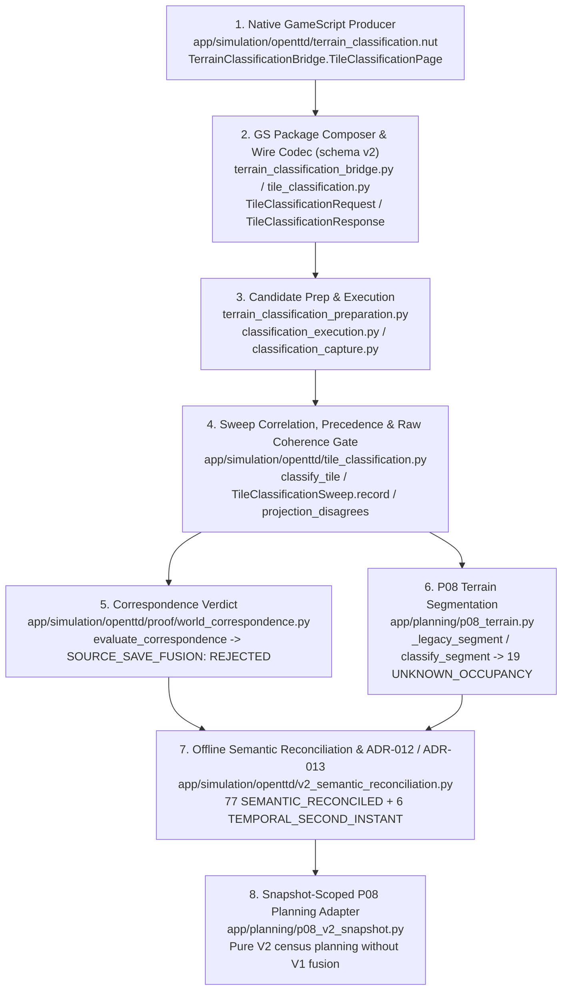

# OpenTTD Tile Classification V2 Census Reconciliation Report

- **Branch**: `feature/v2-census-reconciliation`
- **Target World / Candidate**: Random-world Seed `17` (`256×256`, `temperate`, OpenTTD `15.3`, `start_day=712224`), region `(x=170, y=171, width=15, height=30)` (`450` tiles across `90` pages of `5` tiles)
- **Evaluated Evidence Chain**:
  - Historical V1 Retained Facts: `artifacts/demos/playable-demo-698799a2dfb146948fd2983ff2032253/network-facts-0.json` (source save directory `artifacts/demos/random-world-d2-v1`, `sha256: 9e4c5c4225b697312230deae40989de643bcdd79db1063cf6eda9fa365d8bb6e`, economy dates `712285..712291`)
  - Completed V2 Native Census: `artifacts/demos/classification-exec-seed17-3a8f9e46` (`90/90` pages, `450/450` tiles, aggregate page payload `sha256: e30bf7f31dc02736f0b0910f29640236426ca24847a88585df23718d44f08c4e`, economy dates `712224..712226`, bound to `before.sav` `sha256: 929dd1edfa8e0f1fbbeabbd0ae7fbdfcfb4d16fb7b5ab61da6ebfe1bf9e0d3d2`)
  - Derived V1/V2 Semantic Reconciliation Artifact: `artifacts/experiments/v1v2-semantic-reconciliation/reconciliation-report.json` (JSON schema `"v1v2-semantic-reconciliation-report/1"`)
  - D5 Phase A0 Native Corridor Survey: `artifacts/experiments/d5-corridor-extension-3-survey-native-candidate-3` (`D5CE3-SURVEY-3`, E40, bound to `D4-CORRIDOR-5` `after.sav` `sha256: a81ac83677732f9951f5acb3a119395020e49b2317adb3419edf6bc626cef261`)
- **Execution Mode**: Purely offline deterministic analysis and verification (no OpenTTD launch, no AdminPort connection, no candidate creation/signing/claim, no mutation of historical evidence or shared status files).

---

## 1. Executive Summary & Answers to the Four Mandatory Questions

### Summary of Findings

| Metric / Category | Count | Disposition / Outcome |
|---|---:|---|
| Native V2 capture pages completed | `90 / 90` | Verified complete (`page_index 0..89`, correlated 1-to-1 receipts) |
| Native V2 tiles captured | `450 / 450` | Verified complete (`CLEAR: 359`, `TREES: 52`, `WATER: 17`, `INDUSTRY: 12`, `ROUGH: 10`; `UNKNOWN: 0`) |
| Raw `PROJECTED_FLAGS_DIFFER` disagreements | `83 / 450` | Partitioned into **77 definitional** (`SEMANTIC_RECONCILED`) + **6 temporal** (`TEMPORAL_SECOND_INSTANT`) + **0 contradictions** |
| — Subgroup D-1: Sloped `CLEAR` (`buildable` only) | `19 / 83` | **Expected Definitional Difference** (`SEMANTIC_V1_VACANT_VS_NATIVE_ISBUILDABLE`); base `UNKNOWN_OCCUPANCY`, derived `TERRAIN_MODIFICATION` under ADR-013 |
| — Subgroup D-2: Static `TREES` (`buildable` only) | `48 / 83` | **Expected Definitional Difference** (`SEMANTIC_V1_VACANT_VS_NATIVE_ISBUILDABLE`); both V1 and V2 classify as `SUPPORTED_CLEARING` |
| — Subgroup D-3: Static `ROUGH` (`buildable` only) | `10 / 83` | **Expected Definitional Difference** (`SEMANTIC_V1_VACANT_VS_NATIVE_ISBUILDABLE`); both V1 and V2 classify as `SUPPORTED_CLEARING` |
| — Subgroup T-1..T-6: Cross-instant tree lifecycle | `6 / 83` | **Expected Temporal Difference** (`TEMPORAL_SECOND_INSTANT` across 61–67 economy-day capture gap); governed for P08 planning by ADR-012 |
| `fresh-CLEAR` / `retained-UNKNOWN` (`UNKNOWN_OCCUPANCY`) | `19 / 19` | **Retained `UNKNOWN_OCCUPANCY` in base ledger** (fail-closed against cross-schema mixing); mapped to `TERRAIN_MODIFICATION` (`classified-clear-sloped`) only in the derived ADR-013 planning layer |
| A0 native survey census-vs-native deviations (`D5CE3-SURVEY-3`) | `6` field diffs (`4` tiles) | **Post-D3/D4 World Mutation Findings** on `50095, 50096, 50352, 50608`; recorded as survey findings, never fused into V2 census |
| Historical `SOURCE_SAVE_FUSION` decision | **`REJECT`** | Keep sealed `REJECTED` verdict in `correspondence-verdict.json` immutable and `fusion_gate: CLOSED` |

---

### Answers to the Four Mandatory Questions

#### Question 1: Why do projected flags disagree with the compared retained data? (`ทำไม projected flags ถึงไม่ตรงกับข้อมูลที่นำมาเปรียบเทียบ?`)

1. **Producer-Lineage Schema Mismatch on `buildable` (77 of 83 tiles)**:
   - The raw coherence check `projection_disagrees(tile_fact, flags)` in [`app/simulation/openttd/tile_classification.py`](file:///c:/softdev2/app/simulation/openttd/tile_classification.py#L469-L511) projects the V2 15-bit native mask (`schema_version=2`, produced by [`app/simulation/openttd/terrain_classification.nut`](file:///c:/softdev2/app/simulation/openttd/terrain_classification.nut#L65-L98)) onto the 11 boolean fields of a V1 `TileFact` (`buildable, water, coast, tree, farm, rock, rough, road, rail, water_transport, air_transport`).
   - In the V2 census script (`terrain_classification.nut:67`), bit 0 (`buildable`) records the raw OpenTTD 15.3 GameScript predicate `GSTile.IsBuildable(tile)`. In OpenTTD 15.3 (`src/script/api/script_tile.cpp`), `ScriptTile::IsBuildable` returns `true` for unobstructed `MP_CLEAR` tiles (including non-flat slopes and `CLEAR_ROUGH` ground) and `MP_TREES` tiles.
   - In the retained V1 capture (`artifacts/demos/random-world-d2-v1/network-facts-0.json`), wire field 3 (`buildable`) was produced by `freight_delivery_package/planner.nut` + `infrastructure.nut`, which encoded the stricter **planner `Vacant(t)` predicate**:
     $$\text{Vacant}(t) \iff \text{IsBuildable}(t) \land (\text{slope} = 0) \land (\text{owner} = \text{COMPANY\_INVALID}) \land \neg(\text{water} \lor \text{coast} \lor \text{tree} \lor \text{farm} \lor \text{rock} \lor \text{rough} \lor \text{road} \lor \text{rail} \lor \text{water\_transport} \lor \text{air\_transport})$$
   - Consequently, on every unowned sloped `CLEAR` tile (`19` tiles), static `TREES` tile (`48` tiles), and static `ROUGH` tile (`10` tiles), V2 reports `bit("buildable") == True` whereas V1 recorded `tile_fact.buildable == False`. When V2 flags are translated through `vacant_projection(slope, owner, flags)` ([`app/simulation/openttd/v2_semantic_reconciliation.py`](file:///c:/softdev2/app/simulation/openttd/v2_semantic_reconciliation.py#L253-L275)), all 77 tiles evaluate to `False`, matching V1 `tile_fact.buildable == False` with zero residual differences on the other 10 projected fields.
2. **Cross-Instant Capture Window Gap on Tree Lifecycle (6 of 83 tiles)**:
   - The V2 census swept `before.sav` (`start_day=712224`) at economy dates **`712224..712226`**, whereas the retained V1 `network-facts-0.json` was captured 61–67 economy days later at **`712285..712291`**.
   - During those ~61–67 economy days of running simulation, OpenTTD's autonomous `TileLoop_Trees` (`src/tree_cmd.cpp`) grew trees on 2 `CLEAR` tiles (`43951`, `47286`), killed the last tree on 3 rough-underlaid `TREES` tiles (`47288`, `48042`, `48309` via `MakeClear(t, CLEAR_ROUGH, 3)`), and killed the last tree on 1 flat-grass `TREES` tile (`51378` via `MakeClear(t, CLEAR_GRASS, 3)`).

#### Question 2: Are the 83 differences a bug, expected behavior, or data limitation? (`ความต่างทั้ง 83 จุดเป็น bug, expected behavior หรือข้อจำกัดของข้อมูล?`)

- **Zero of the 83 differences are bugs in the V2 capture, classification, or validation code.**
- **77 of 83 (`46517..48560` sloped `CLEAR`, 48 static `TREES`, 10 static `ROUGH`) are Expected Behavior (Definitional Schema Evolution)** between the V1 planner-level `Vacant(t)` projection and the V2 raw native `GSTile.IsBuildable(t)` predicate (`SEMANTIC_V1_VACANT_VS_NATIVE_ISBUILDABLE`). Additionally, the raw `projection_disagrees` gate flagging them is **expected fail-closed validation behavior** preventing silent cross-schema fusion.
- **6 of 83 (`43951, 47286, 47288, 48042, 48309, 51378`) are a Data Provenance / Capture-Window Limitation (`TEMPORAL_SECOND_INSTANT`)**: they reflect genuine in-world autonomous tree lifecycle transitions between the save instant (`712224..712226`) and the historical V1 observation window (`712285..712291`).

#### Question 3: Why do the 19 tiles observed `CLEAR` in the fresh census remain `UNKNOWN` in the retained state? (`ทำไม 19 จุดที่ fresh classification ระบุ CLEAR จึงยังคงเป็น UNKNOWN ใน retained state?`)

1. **Lossy V1 Projection on Sloped Bare Ground**:
   - Schema-1 `TileFact` ([`app/simulation/openttd/supplemental_planning_facts.py`](file:///c:/softdev2/app/simulation/openttd/supplemental_planning_facts.py#L64-L84)) dropped the `house` and `station` occupancy bits (which were bits 11–12 on the Schema-1 wire before Schema-2 unpacked the 3 road bits and moved `house` and `station` to bits 13–14) instead of carrying them as explicit fields; on house/station tiles, V1 simply set `buildable=False`.
   - On the 19 unowned sloped bare-ground tiles (`46517..48560`, `slope in {8, 9, 12, 13}`), V1's `Vacant(t)` rule *also* set `buildable=False` (because `slope != 0`), leaving all 11 boolean flags `False` and `industry_id=None`.
   - When `_legacy_segment(tile)` ([`app/planning/p08_terrain.py`](file:///c:/softdev2/app/planning/p08_terrain.py#L679-L699)) inspects a V1 `TileFact` with all-`False` flags and `industry_id=None`, it cannot distinguish sloped bare ground from an unprojected house or station obstruction. Fail-closed, it returns `(SegmentClass.UNKNOWN_OCCUPANCY, "projection-dropped-occupancy-class")`.
2. **Fail-Closed Refusal to Mix Conflicting V1/V2 Schemas in `classify_segment`**:
   - When `classify_segment(tile, "CLEAR", flags=flags)` ([`app/planning/p08_terrain.py`](file:///c:/softdev2/app/planning/p08_terrain.py#L702-L788)) is called with the retained V1 `TileFact` (`tile.buildable=False`) and the fresh V2 census class `"CLEAR"` (`flags=0x0001`, `bit("buildable")=True`), two guards fire:
     - `_projection_disagrees(tile, flags)` returns `True` because `tile.buildable (False) != bit(flags, "buildable") (True)`, immediately returning `(SegmentClass.UNKNOWN_OCCUPANCY, "conflicting-occupancy-evidence")`.
     - Even if `flags` were omitted (`flags=None`), `classify_segment` checks `if not tile.buildable:` under `classification == "CLEAR"` (`p08_terrain.py:766-767`) and returns `(SegmentClass.UNKNOWN_OCCUPANCY, "conflicting-occupancy-evidence")`.
3. **Preservation of Base Ledger vs. Derived ADR-013 Policy Layer**:
   - Therefore, in the base retained ledger, all 19 tiles **must remain `UNKNOWN_OCCUPANCY`** to preserve historical auditability and prevent silent cross-schema mutation.
   - Only when evaluated from a **coherent same-instant census `TileFact`** (`observation.fact()` where `buildable=True` and `slope != 0`) inside the explicit derived **ADR-013** policy layer (`apply_native_isbuildable_policy` / `rebind_p08_native_isbuildable` in [`app/simulation/openttd/v2_semantic_reconciliation.py`](file:///c:/softdev2/app/simulation/openttd/v2_semantic_reconciliation.py#L1307-L1570)) or the snapshot-scoped V2 planner ([`app/planning/p08_v2_snapshot.py`](file:///c:/softdev2/app/planning/p08_v2_snapshot.py)) do these 19 tiles map to `(SegmentClass.TERRAIN_MODIFICATION, "classified-clear-sloped")`.

#### Question 4: What conditions must pass before allowing `SOURCE_SAVE_FUSION`? (`มีเงื่อนไขอะไรที่ต้องผ่านก่อนอนุญาตให้ SOURCE_SAVE_FUSION?`)

Before `SOURCE_SAVE_FUSION` can transition from `REJECTED` to `CORRESPONDENCE_ESTABLISHED` ([`app/simulation/openttd/proof/world_correspondence.py`](file:///c:/softdev2/app/simulation/openttd/proof/world_correspondence.py#L220-L270)), **all five gates** below must pass simultaneously:

1. **Gate 1 — Verified Staged Source-Save Cryptographic Binding**:
   - `retained_save_binding()` and `verify_staged_source_save()` (`world_correspondence.py:124-217`) must verify that the staged `save/before.sav`, `PRELAUNCH.json`, `runtime-identity.json`, and `world-planning-observation.json` match the sealed SHA-256 digests in `artifacts/demos/random-world-d2-v1/PROVENANCE.json` (`save_binding` non-null and verified).
2. **Gate 2 — Exact Runtime & Welcome Identity Match**:
   - `TileClassificationSweep.verify_identity(recorded_welcome, observed_welcome)` (`tile_classification.py:610-639`) must return `[]` across all 6 `WELCOME_IDENTITY_KEYS` (`seed`, `width`, `height`, `landscape`, `revision`, `start_day`) and `dedicated == True`.
3. **Gate 3 — Complete, Hygiene-Clean 90-Page / 450-Tile Sweep Within Wire Budgets**:
   - Every planned page (`0..89`, 5 tiles/page) must be received with a 1-to-1 correlated `TileClassificationReceipt` (`request_payload_bytes <= 159`, `response_payload_bytes <= 508`, total wire bytes `<= 52,324`), `pages_completed == 90`, `tiles_captured == 450`, `missing_tiles == ()`, `unexpected_tiles == ()`, `duplicate_tiles == ()`, and `unknown_tiles == ()`.
4. **Gate 4 — Schema-Harmonized Projection Coherence (`coherence_failures == ()`)**:
   - Either both datasets use the same `buildable` predicate schema, or the coherence gate explicitly evaluates the V1 `Vacant` projection (`vacant_projection(slope, owner, flags) == tile_fact.buildable`) alongside the remaining 10 projected boolean flags, `industry_id`, and geometry (`min_height`, `slope`), yielding zero unexplained field disagreements.
5. **Gate 5 — Same-Instant Temporal Correspondence (Zero Cross-Instant Drift)**:
   - Each census page must be single-instant (`date_before == date_after`), and the census observation window must match the target `TileFact` observation instant (`census_page_dates == retained_window`, or both captured in the same paused/single-instant session under `SAME_SESSION_CENSUS` with `fresh_contradictions == ()`), yielding `temporal_tiles == ()` and `contradiction_tiles == ()`.
   - Because the historical `classification-exec-seed17-3a8f9e46` census (`712224..712226`) and the retained V1 facts (`712285..712291`) were captured 61–67 economy days apart and exhibit 6 real tree-lifecycle mutations, **historical `SOURCE_SAVE_FUSION` for `classification-exec-seed17-3a8f9e46` must remain permanently `REJECTED`**.

---

## 2. End-to-End V2 Census Pipeline Trace

The V2 census pipeline was traced end-to-end across source generation, wire transport, sweep correlation, retention/segmentation, correspondence gating, and offline semantic reconciliation:



| Stage | Implementation File & Key Symbols | Exact Behavior Verified in Code |
|---|---|---|
| **1. Native GS Producer** | [`app/simulation/openttd/terrain_classification.nut`](file:///c:/softdev2/app/simulation/openttd/terrain_classification.nut#L28-L114) (`TerrainClassificationBridge`, `NoMutationBridge`, `Handle`, `TileClassificationError`, `TileClassificationPage`) | Queries 15 native OpenTTD 15.3 GS predicates per tile into a 15-bit integer `flags` (`bit 0`: `GSTile.IsBuildable`, `bit 1`: `GSTile.IsWaterTile`, `bit 2`: `GSTile.IsCoastTile`, `bit 3`: `GSTile.HasTreeOnTile`, `bit 4`: `GSTile.IsFarmTile`, `bit 5`: `GSTile.IsRockTile`, `bit 6`: `GSTile.IsRoughTile`, `bit 7`: `GSRoad.IsRoadTile` [`road_tile`], `bit 8`: `GSTile.HasTransportType(TRANSPORT_ROAD)` [`road_track`], `bit 9`: `GSRoad.HasRoadType(0)` [`road_src_type`], `bit 10`: `GSTile.HasTransportType(TRANSPORT_RAIL)` [`rail`], `bit 11`: `GSTile.HasTransportType(TRANSPORT_WATER)` [`water_transport`], `bit 12`: `GSAirport.IsAirportTile` [`airport`], `bit 13`: `GSTile.IsHouseTile` [`house`], `bit 14`: `GSStation.IsStationTile` [`station`]). Emits raw `[tile, elevation, slope, flags, industry, owner]` rows along with `date_before` and `date_after` (`GSDate.GetCurrentDate()`). |
| **2. GS Package Composer & Wire Codec** | [`app/simulation/openttd/terrain_classification_bridge.py`](file:///c:/softdev2/app/simulation/openttd/terrain_classification_bridge.py#L1-L79), [`app/simulation/openttd/tile_classification.py`](file:///c:/softdev2/app/simulation/openttd/tile_classification.py#L62-L380) | `terrain_classification_bridge.py` composes the additive GameScript package (`terrain_classification_source`, `classification_package_bytes`, `classification_package_digest`, `classification_capture_consistency`). `tile_classification.py` implements the Schema-2 wire codec (`TileClassificationRequest`, `TileClassificationResponse`, `SCHEMA_VERSION = 2`, `MAX_TILES_PER_REQUEST = 5`, `MAX_REQUEST_PAYLOAD_BYTES = 159`, `MAX_RESPONSE_PAYLOAD_BYTES = 508`) and Python-side precedence classifier `classify_tile(flags, industry_id)` (`HOUSE > STATION > INDUSTRY > WATER > COAST > AIRPORT > ROAD > RAIL > DOCK > TREES > FARM > ROCK > ROUGH > CLEAR > UNKNOWN_OCCUPANCY`). |
| **3. Execution & Capture** | [`app/simulation/openttd/proof/terrain_classification_preparation.py`](file:///c:/softdev2/app/simulation/openttd/proof/terrain_classification_preparation.py#L84-L320), [`app/simulation/openttd/proof/classification_execution.py`](file:///c:/softdev2/app/simulation/openttd/proof/classification_execution.py#L430-L820), [`app/simulation/openttd/proof/classification_capture.py`](file:///c:/softdev2/app/simulation/openttd/proof/classification_capture.py#L180-L520) | Stages the candidate from frozen `before.sav` (`929dd1ed…`), verifies SHA-256 save binding before launch, issues 90 sequential 5-tile AdminPort GameScript requests (`page_index 0..89`), correlates each response with a `TileClassificationReceipt`, and writes `classification-p000-request.json` / `classification-p000-response.json` .. `classification-p089-response.json`, `classification-completeness.json`, and `correspondence-verdict.json`. |
| **4. Sweep Validation & Raw Gate** | [`app/simulation/openttd/tile_classification.py`](file:///c:/softdev2/app/simulation/openttd/tile_classification.py#L469-L745) (`projection_disagrees`, `TileClassificationSweep.record`, `bound`) | Validates mask range (`0 <= flags <= 0x7FFF`), recomputes `classify_tile(flags, industry_id)` to verify native precedence, checks `min_height` and `slope` against `TileFact`, and calls `projection_disagrees(fact, flags)`. Whenever `projection_disagrees` returns `True`, appends `(tile_id, "PROJECTED_FLAGS_DIFFER")` to `coherence_failures`. `sweep.bound` requires `complete and not unknown_tiles and not coherence_failures and not identity_failures`. |
| **5. Correspondence Gate** | [`app/simulation/openttd/proof/world_correspondence.py`](file:///c:/softdev2/app/simulation/openttd/proof/world_correspondence.py#L220-L270) (`evaluate_correspondence`) | For `SOURCE_SAVE_FUSION`, requires `bound == True` and a verified `save_binding`. Because `coherence_failures` contains 83 `PROJECTED_FLAGS_DIFFER` entries (`bound == False`), returns `status = "REJECTED"`. |
| **6. P08 Segmentation** | [`app/planning/p08_terrain.py`](file:///c:/softdev2/app/planning/p08_terrain.py#L679-L788) (`_legacy_segment`, `classify_segment`) | `_legacy_segment` maps the 19 sloped all-`False` V1 tiles to `UNKNOWN_OCCUPANCY` (`"projection-dropped-occupancy-class"`). When `classify_segment` is given the retained V1 `TileFact` (`buildable=False`) plus V2 class `"CLEAR"` (`flags=1`), `_projection_disagrees` triggers and retains `UNKNOWN_OCCUPANCY` (`"conflicting-occupancy-evidence"`). |
| **7. Semantic Reconciliation & ADR-012 / ADR-013** | [`app/simulation/openttd/v2_semantic_reconciliation.py`](file:///c:/softdev2/app/simulation/openttd/v2_semantic_reconciliation.py#L253-L1570) (`vacant_projection`, `reconcile_tile`, `apply_census_authority`, `apply_native_isbuildable_policy`, `rebind_p08_native_isbuildable`) | Reconciles all 450 tiles under `vacant-projection-1`: classifies 77 raw disagreements as `SEMANTIC_RECONCILED` (`SEMANTIC_V1_VACANT_VS_NATIVE_ISBUILDABLE`) and 6 as `TEMPORAL_SECOND_INSTANT`, with `0` `GENUINE_CONTRADICTION`. Provides fail-closed derived policy layers for ADR-012 (6 temporal tiles) and ADR-013 (19 sloped `CLEAR` tiles) while keeping `fusion_gate: CLOSED`. |
| **8. V2 Snapshot Planner** | [`app/planning/p08_v2_snapshot.py`](file:///c:/softdev2/app/planning/p08_v2_snapshot.py#L148-L620) (`CensusTile.fact`, `diagnose_unknown_occupancy`, `build_snapshot_report`) | Evaluates P08 feasibility directly from coherent V2 `CensusTile.fact()` observations without consuming or fusing historical V1 world-state fields, proving P08 verdict invariance (`TERRAIN_AND_CLEARABLE` / `CLEARING_INSUFFICIENT`) across all 6 temporal alternates, 52 single-tree deaths, and 111 tree-spread perturbations. |

---

## 3. Complete 83/83 `PROJECTED_FLAGS_DIFFER` Discrepancy Inventory & Dispositions

### 3.1 Partition Summary of All 450 Tiles and All 83 Disagreements

Across the 450 tiles in region `(170, 171, 15, 30)`:
- **367 tiles** pass `projection_disagrees(fact, flags) == False` (raw agreement on all 11 projected booleans, `min_height`, `slope`, and `industry_id`):
  - `338` static flat `CLEAR` tiles (`flags=0x0001`, `slope=0`, `retained.buildable=True`, V1 class `ROAD_BUILDABLE`)
  - `17` static `WATER` tiles (`flags=0x0002`, `retained.water=True, buildable=False`, V1 class `UNSUPPORTED_CONSTRUCTION`)
  - `12` static `INDUSTRY` tiles (`flags=0x0000`, `industry_id in {0, 1}`, `retained.buildable=False`, V1 class `UNSUPPORTED_CONSTRUCTION`)
- **83 tiles** trigger `projection_disagrees(fact, flags) == True` (`PROJECTED_FLAGS_DIFFER`):

| Discrepancy Subgroup | Tile Count | V2 Census Class & Flags | V1 Retained Fields (`network-facts-0.json`) | Disagreement Fields (Raw Gate) | `vacant_projection` Result | Reconciliation Status & Disposition |
|---|---:|---|---|---|---|---|
| **D-1: Sloped `CLEAR`** (`46517..48560`) | **19** | `CLEAR`, `flags=0x0001` (`buildable=True`), `slope in {8,9,12,13}`, `owner=-1` | `buildable=False`, all other 10 flags `False`, `slope in {8,9,12,13}` | `buildable` only (`False` vs `True`) | `False == retained.buildable` | `SEMANTIC_RECONCILED` (`SEMANTIC_V1_VACANT_VS_NATIVE_ISBUILDABLE`) — **Expected Definitional Difference** |
| **D-2: Static `TREES`** | **48** | `TREES`, `flags=0x0009` (`buildable=True, tree=True`), `owner=-1` | `buildable=False, tree=True`, all other 9 flags `False` | `buildable` only (`False` vs `True`) | `False == retained.buildable` | `SEMANTIC_RECONCILED` (`SEMANTIC_V1_VACANT_VS_NATIVE_ISBUILDABLE`) — **Expected Definitional Difference** |
| **D-3: Static `ROUGH`** | **10** | `ROUGH`, `flags=0x0041` (`buildable=True, rough=True`), `owner=-1` | `buildable=False, rough=True`, all other 9 flags `False` | `buildable` only (`False` vs `True`) | `False == retained.buildable` | `SEMANTIC_RECONCILED` (`SEMANTIC_V1_VACANT_VS_NATIVE_ISBUILDABLE`) — **Expected Definitional Difference** |
| **T-1: Temporal Tree Growth on Flat Grass** (`43951`) | **1** | `CLEAR`, `flags=0x0001` (`buildable=True, tree=False`), `slope=0`, `page_date=712224` | `buildable=False, tree=True`, `slope=0`, `window=712285..712291` | `buildable` (`False` vs `True`), `tree` (`True` vs `False`) | `True != retained.buildable` (due to tree growth) | `TEMPORAL_SECOND_INSTANT` — **Expected Cross-Instant Tree Lifecycle Difference** |
| **T-2: Temporal Tree Growth on Sloped Grass** (`47286`) | **1** | `CLEAR`, `flags=0x0001` (`buildable=True, tree=False`), `slope=12`, `page_date=712225` | `buildable=False, tree=True`, `slope=12`, `window=712285..712291` | `buildable` (`False` vs `True`), `tree` (`True` vs `False`) | `False == retained.buildable` (`buildable` definitional; `tree` temporal) | `TEMPORAL_SECOND_INSTANT` — **Expected Cross-Instant Tree Lifecycle Difference** |
| **T-3..T-5: Temporal Tree Death Exposing Rough Ground** (`47288, 48042, 48309`) | **3** | `TREES`, `flags=0x0009` (`buildable=True, tree=True, rough=False`), `page_date=712225` | `buildable=False, tree=False, rough=True`, `window=712285..712291` | `buildable` (`False` vs `True`), `tree` (`False` vs `True`), `rough` (`True` vs `False`) | `False == retained.buildable` (`buildable` definitional; `rough, tree` temporal) | `TEMPORAL_SECOND_INSTANT` — **Expected Cross-Instant Tree Lifecycle Difference** |
| **T-6: Temporal Tree Death Leaving Flat Grass** (`51378`) | **1** | `TREES`, `flags=0x0009` (`buildable=True, tree=True`), `slope=0`, `page_date=712226` | `buildable=True, tree=False`, `slope=0`, `window=712285..712291` | `tree` (`False` vs `True`; raw `buildable` both `True`, `vacant_projection` `False` vs `True`) | `False != retained.buildable` (became `Vacant` when tree died) | `TEMPORAL_SECOND_INSTANT` — **Expected Cross-Instant Tree Lifecycle Difference** |
| **Total Disagreements** | **83** | `21 CLEAR + 52 TREES + 10 ROUGH` | — | — | — | **77 Definitional + 6 Temporal = 83/83 Reconciled (`0` Bugs / `0` Contradictions)** |

---

### 3.2 Subgroup D-1 (19/83): Sloped `CLEAR` Definitional Disagreements (`46517..48560`)

Every tile in Subgroup D-1 is unowned (`owner = -1`), industry-free (`industry_id = None`), observed on a single-instant V2 census page at economy date `712225` with `classification = "CLEAR"` and `flags = 0x0001` (`buildable` bit 0 set, bits 1..14 all clear), and has non-flat slope (`slope in {8, 9, 12, 13}`). Because `slope != 0`, V1's `Vacant(t)` recorded `buildable = False`, whereas V2's `GSTile.IsBuildable(t)` recorded `bit("buildable") = True`.

| # | `tile_id` | `(x, y)` | `slope` | V2 Page Date | V2 Census Class & Flags | V1 Retained Booleans | Field Outcome (`vacant-projection-1`) | Individual Disposition |
|---:|---:|---|---:|---:|---|---|---|---|
| 1 | `46517` | `(181, 181)` | `13` | `712225` | `CLEAR` (`0x0001`) | all 11 `False` | `buildable: SEMANTIC_V1_VACANT_VS_NATIVE_ISBUILDABLE` | **Expected Definitional** (`SEMANTIC_RECONCILED`) |
| 2 | `46518` | `(182, 181)` | `9` | `712225` | `CLEAR` (`0x0001`) | all 11 `False` | `buildable: SEMANTIC_V1_VACANT_VS_NATIVE_ISBUILDABLE` | **Expected Definitional** (`SEMANTIC_RECONCILED`) |
| 3 | `46772` | `(180, 182)` | `13` | `712225` | `CLEAR` (`0x0001`) | all 11 `False` | `buildable: SEMANTIC_V1_VACANT_VS_NATIVE_ISBUILDABLE` | **Expected Definitional** (`SEMANTIC_RECONCILED`) |
| 4 | `47027` | `(179, 183)` | `13` | `712225` | `CLEAR` (`0x0001`) | all 11 `False` | `buildable: SEMANTIC_V1_VACANT_VS_NATIVE_ISBUILDABLE` | **Expected Definitional** (`SEMANTIC_RECONCILED`) |
| 5 | `47028` | `(180, 183)` | `9` | `712225` | `CLEAR` (`0x0001`) | all 11 `False` | `buildable: SEMANTIC_V1_VACANT_VS_NATIVE_ISBUILDABLE` | **Expected Definitional** (`SEMANTIC_RECONCILED`) |
| 6 | `47282` | `(178, 184)` | `13` | `712225` | `CLEAR` (`0x0001`) | all 11 `False` | `buildable: SEMANTIC_V1_VACANT_VS_NATIVE_ISBUILDABLE` | **Expected Definitional** (`SEMANTIC_RECONCILED`) |
| 7 | `47283` | `(179, 184)` | `9` | `712225` | `CLEAR` (`0x0001`) | all 11 `False` | `buildable: SEMANTIC_V1_VACANT_VS_NATIVE_ISBUILDABLE` | **Expected Definitional** (`SEMANTIC_RECONCILED`) |
| 8 | `47538` | `(178, 185)` | `9` | `712225` | `CLEAR` (`0x0001`) | all 11 `False` | `buildable: SEMANTIC_V1_VACANT_VS_NATIVE_ISBUILDABLE` | **Expected Definitional** (`SEMANTIC_RECONCILED`) |
| 9 | `47793` | `(177, 186)` | `9` | `712225` | `CLEAR` (`0x0001`) | all 11 `False` | `buildable: SEMANTIC_V1_VACANT_VS_NATIVE_ISBUILDABLE` | **Expected Definitional** (`SEMANTIC_RECONCILED`) |
| 10 | `48049` | `(177, 187)` | `8` | `712225` | `CLEAR` (`0x0001`) | all 11 `False` | `buildable: SEMANTIC_V1_VACANT_VS_NATIVE_ISBUILDABLE` | **Expected Definitional** (`SEMANTIC_RECONCILED`) |
| 11 | `48304` | `(176, 188)` | `13` | `712225` | `CLEAR` (`0x0001`) | all 11 `False` | `buildable: SEMANTIC_V1_VACANT_VS_NATIVE_ISBUILDABLE` | **Expected Definitional** (`SEMANTIC_RECONCILED`) |
| 12 | `48305` | `(177, 188)` | `8` | `712225` | `CLEAR` (`0x0001`) | all 11 `False` | `buildable: SEMANTIC_V1_VACANT_VS_NATIVE_ISBUILDABLE` | **Expected Definitional** (`SEMANTIC_RECONCILED`) |
| 13 | `48554` | `(170, 189)` | `12` | `712225` | `CLEAR` (`0x0001`) | all 11 `False` | `buildable: SEMANTIC_V1_VACANT_VS_NATIVE_ISBUILDABLE` | **Expected Definitional** (`SEMANTIC_RECONCILED`) |
| 14 | `48555` | `(171, 189)` | `12` | `712225` | `CLEAR` (`0x0001`) | all 11 `False` | `buildable: SEMANTIC_V1_VACANT_VS_NATIVE_ISBUILDABLE` | **Expected Definitional** (`SEMANTIC_RECONCILED`) |
| 15 | `48556` | `(172, 189)` | `12` | `712225` | `CLEAR` (`0x0001`) | all 11 `False` | `buildable: SEMANTIC_V1_VACANT_VS_NATIVE_ISBUILDABLE` | **Expected Definitional** (`SEMANTIC_RECONCILED`) |
| 16 | `48557` | `(173, 189)` | `12` | `712225` | `CLEAR` (`0x0001`) | all 11 `False` | `buildable: SEMANTIC_V1_VACANT_VS_NATIVE_ISBUILDABLE` | **Expected Definitional** (`SEMANTIC_RECONCILED`) |
| 17 | `48558` | `(174, 189)` | `12` | `712225` | `CLEAR` (`0x0001`) | all 11 `False` | `buildable: SEMANTIC_V1_VACANT_VS_NATIVE_ISBUILDABLE` | **Expected Definitional** (`SEMANTIC_RECONCILED`) |
| 18 | `48559` | `(175, 189)` | `12` | `712225` | `CLEAR` (`0x0001`) | all 11 `False` | `buildable: SEMANTIC_V1_VACANT_VS_NATIVE_ISBUILDABLE` | **Expected Definitional** (`SEMANTIC_RECONCILED`) |
| 19 | `48560` | `(176, 189)` | `8` | `712225` | `CLEAR` (`0x0001`) | all 11 `False` | `buildable: SEMANTIC_V1_VACANT_VS_NATIVE_ISBUILDABLE` | **Expected Definitional** (`SEMANTIC_RECONCILED`) |

---

### 3.3 Subgroup D-2 (48/83): Static `TREES` Definitional Disagreements

- **Exact Accounting**:
  - The V2 census records `52` tiles with `classification == "TREES"` and `flags == 0x0009` (`buildable | tree`).
  - `4` of those `52` `TREES` tiles (`47288`, `48042`, `48309`, `51378`) lost their last tree between the census (`712225..712226`) and the retained V1 capture (`712285..712291`) and belong to the 6-tile temporal set (§3.5).
  - The remaining **`48` tiles** had trees at both instants (`census: TREES, flags=0x0009`; `retained: tree=True, buildable=False`, all other 9 projected booleans `False`, `owner=-1`, `industry_id=None`).
  - Conversely, the retained V1 capture records `50` tiles with `tree=True`: those same **`48` static `TREES` tiles** plus the `2` temporal tree-growth tiles (`43951`, `47286`).
- **Why Raw `projection_disagrees` Flags All 48 Static `TREES` Tiles**:
  - In OpenTTD 15.3, `GSTile.IsBuildable(tile)` returns `true` on `MP_TREES` tiles (building on trees auto-clears them), so V2 sets bit 0 (`buildable=True`) and bit 3 (`tree=True`) → `flags = 0x0009`.
  - V1 `Vacant(t)` explicitly excludes `tree` (`!tree`), setting `retained.buildable = False` while `retained.tree = True`.
  - Under `vacant_projection(slope, owner=-1, flags=0x0009)`, `bit(flags, "tree")` is `True`, so `vacant_projection` returns `False == retained.buildable`.
- **Representative Pinned Tile IDs in Tracked Repository Docs & Code**:

| Pinned `tile_id` | `(x, y)` | V2 Census Class & Flags | V1 Retained State | Tracked Evidence Reference | Individual Disposition |
|---:|---|---|---|---|---|
| `43946` | `(170, 171)` | `TREES` (`0x0009`) | `tree=True, buildable=False` | First tile of `classification-p000-response.json` ([`docs/p08-classification-v2-native-capture-completion.md`](file:///c:/softdev2/docs/p08-classification-v2-native-capture-completion.md)) | **Expected Definitional** (`SEMANTIC_RECONCILED`; both V1 & V2 map to `SUPPORTED_CLEARING` / `classified-clearing-tree`) |
| `45999` | `(175, 179)` | `TREES` (`0x0009`) | `tree=True, buildable=False` | D3 clearing prerequisite `D3-CLEARING-1` ([`EVIDENCE_INDEX.md`](file:///c:/softdev2/EVIDENCE_INDEX.md)) | **Expected Definitional** (`SEMANTIC_RECONCILED`; `SUPPORTED_CLEARING`) |
| `46769` | `(177, 182)` | `TREES` (`0x0009`) | `tree=True, buildable=False` | D2 native clearing target `D2-CLEARING-3` ([`docs/handoff/2026-10-21/d2-native-clearing-candidate-3-outcome.md`](file:///c:/softdev2/docs/handoff/2026-10-21/d2-native-clearing-candidate-3-outcome.md)) | **Expected Definitional** (`SEMANTIC_RECONCILED`; `SUPPORTED_CLEARING`) |
| `49326` | `(174, 192)` | `TREES` (`0x0009`) | `tree=True, buildable=False` | D3 clearing prerequisite `D3-CLEARING-2` ([`EVIDENCE_INDEX.md`](file:///c:/softdev2/EVIDENCE_INDEX.md)) | **Expected Definitional** (`SEMANTIC_RECONCILED`; `SUPPORTED_CLEARING`) |
| Remaining `44` static `TREES` tiles | In `170..184 × 171..200` | `TREES` (`0x0009`) | `tree=True, buildable=False` | Verified in `artifacts/experiments/v1v2-semantic-reconciliation/reconciliation-report.json` (`reconciled_definitional`: 48 `TREES` rows with sole outcome `buildable: SEMANTIC_V1_VACANT_VS_NATIVE_ISBUILDABLE`) | **Expected Definitional** (`SEMANTIC_RECONCILED`; `SUPPORTED_CLEARING`) |

---

### 3.4 Subgroup D-3 (10/83): Static `ROUGH` Definitional Disagreements

- **Exact Accounting**:
  - The V2 census records `10` tiles with `classification == "ROUGH"` and `flags == 0x0041` (`buildable | rough`).
  - None of those `10` `ROUGH` tiles changed state between the census and the retained V1 capture; all **`10` tiles** had `rough=True, buildable=False` in V1.
  - Conversely, the retained V1 capture records `13` tiles with `rough=True`: those **`10` static `ROUGH` tiles** plus the `3` temporal tree-death-to-rough tiles (`47288`, `48042`, `48309`). Total V1 clearing tiles = `50 (tree) + 13 (rough) = 63` (`SUPPORTED_CLEARING: 63`).
- **Why Raw `projection_disagrees` Flags All 10 Static `ROUGH` Tiles**:
  - In OpenTTD 15.3, `MP_CLEAR` with ground subtype `CLEAR_ROUGH` satisfies `GSTile.IsBuildable(tile) == true` and `GSTile.IsRoughTile(tile) == true`, so V2 sets bit 0 (`buildable=True`) and bit 6 (`rough=True`) → `flags = 0x0041`.
  - V1 `Vacant(t)` explicitly excludes `rough` (`!rough`), setting `retained.buildable = False` while `retained.rough = True`.
  - Under `vacant_projection(slope, owner=-1, flags=0x0041)`, `bit(flags, "rough")` is `True`, so `vacant_projection` returns `False == retained.buildable`.
- **Representative Pinned Tile IDs in Tracked Repository Docs & Code**:

| Pinned `tile_id` | `(x, y)` | `slope` | V2 Census Class & Flags | V1 Retained State | Tracked Evidence Reference | Individual Disposition |
|---:|---|---:|---|---|---|---|
| `47537` | `(177, 185)` | `13` | `ROUGH` (`0x0041`) | `rough=True, buildable=False` | Pinned rough-ground clearing tile in [`tests/test_p08_classification_workflow.py`](file:///c:/softdev2/tests/test_p08_classification_workflow.py#L96-L108) and [`docs/handoff/2026-10-21/d2-native-clearing-candidate-3-outcome.md`](file:///c:/softdev2/docs/handoff/2026-10-21/d2-native-clearing-candidate-3-outcome.md) | **Expected Definitional** (`SEMANTIC_RECONCILED`; both V1 & V2 map to `SUPPORTED_CLEARING` / `classified-clearing-rough`) |
| Remaining `9` static `ROUGH` tiles | In `170..184 × 171..200` | `0..14` | `ROUGH` (`0x0041`) | `rough=True, buildable=False` | Verified in `artifacts/experiments/v1v2-semantic-reconciliation/reconciliation-report.json` (`reconciled_definitional`: 10 `ROUGH` rows with sole outcome `buildable: SEMANTIC_V1_VACANT_VS_NATIVE_ISBUILDABLE`) | **Expected Definitional** (`SEMANTIC_RECONCILED`; `SUPPORTED_CLEARING`) |

---

### 3.5 Subgroup T-1..T-6 (6/83): Temporal Second-Instant Tree-Lifecycle Disagreements

All 6 non-definitional disagreements occur on tiles whose V2 census single-instant page date (`712224`, `712225`, or `712226`) lies **outside** the retained V1 observation window (`712285..712291`) and involve only OpenTTD's autonomous `TileLoop_Trees` (`src/tree_cmd.cpp`) transitions (`CLEAR <-> TREES` and `TREES -> ROUGH`). Every non-tree/rough field (`min_height`, `slope`, `owner`, `industry_id`, `water`, `coast`, `farm`, `rock`, `road`, `rail`, `water_transport`, `air_transport`) is identical across both instants.

| # | `tile_id` | `(x, y)` | `slope` | V2 Page Date | V2 Census State (`712224..712226`) | V1 Retained State (`712285..712291`) | Native OpenTTD 15.3 Mechanism (`tree_cmd.cpp`) | Exact `FieldOutcome` Tuple (`v2_semantic_reconciliation.py`) | Individual Disposition |
|---:|---:|---|---:|---:|---|---|---|---|---|
| 1 | `43951` | `(175, 171)` | `0` | `712224` | `CLEAR`, `flags=0x0001` (`buildable=True, tree=False`), `vacant_projection=True` | `buildable=False, tree=True, rough=False` | Autonomous tree spread/growth onto flat clear grass during the 61–67 day gap, flipping `tree: False -> True` and V1 `Vacant: True -> False` | `FieldOutcome("buildable", False, True, TEMPORAL_SECOND_INSTANT)`, `FieldOutcome("tree", True, False, TEMPORAL_SECOND_INSTANT)` | **Expected Temporal (`TEMPORAL_SECOND_INSTANT`)**; governed for P08 planning by ADR-012 |
| 2 | `47286` | `(182, 184)` | `12` | `712225` | `CLEAR`, `flags=0x0001` (`buildable=True, tree=False`), `vacant_projection=False` | `buildable=False, tree=True, rough=False` | Autonomous tree spread/growth onto sloped (`slope=12`) clear grass (`tree: False -> True`; `vacant_projection` was already `False` due to `slope=12`) | `FieldOutcome("buildable", False, False, SEMANTIC_V1_VACANT_VS_NATIVE_ISBUILDABLE)`, `FieldOutcome("tree", True, False, TEMPORAL_SECOND_INSTANT)` | **Expected Temporal (`TEMPORAL_SECOND_INSTANT`)**; governed for P08 planning by ADR-012 |
| 3 | `47288` | `(184, 184)` | `0` | `712225` | `TREES`, `flags=0x0009` (`buildable=True, tree=True, rough=False`), `vacant_projection=False` | `buildable=False, tree=False, rough=True` | Last tree on tile died in `TileLoop_Trees` and decayed into `MakeClear(t, CLEAR_ROUGH, 3)` (`tree: True -> False`, `rough: False -> True`) | `FieldOutcome("buildable", False, False, SEMANTIC_V1_VACANT_VS_NATIVE_ISBUILDABLE)`, `FieldOutcome("rough", True, False, TEMPORAL_SECOND_INSTANT)`, `FieldOutcome("tree", False, True, TEMPORAL_SECOND_INSTANT)` | **Expected Temporal (`TEMPORAL_SECOND_INSTANT`)**; governed for P08 planning by ADR-012 |
| 4 | `48042` | `(170, 187)` | `0` | `712225` | `TREES`, `flags=0x0009` (`buildable=True, tree=True, rough=False`), `vacant_projection=False` | `buildable=False, tree=False, rough=True` | Same `TileLoop_Trees` last-tree decay to `CLEAR_ROUGH` (`tree: True -> False`, `rough: False -> True`) | `FieldOutcome("buildable", False, False, SEMANTIC_V1_VACANT_VS_NATIVE_ISBUILDABLE)`, `FieldOutcome("rough", True, False, TEMPORAL_SECOND_INSTANT)`, `FieldOutcome("tree", False, True, TEMPORAL_SECOND_INSTANT)` | **Expected Temporal (`TEMPORAL_SECOND_INSTANT`)**; governed for P08 planning by ADR-012 |
| 5 | `48309` | `(181, 188)` | `0` | `712225` | `TREES`, `flags=0x0009` (`buildable=True, tree=True, rough=False`), `vacant_projection=False` | `buildable=False, tree=False, rough=True` | Same `TileLoop_Trees` last-tree decay to `CLEAR_ROUGH` (`tree: True -> False`, `rough: False -> True`) | `FieldOutcome("buildable", False, False, SEMANTIC_V1_VACANT_VS_NATIVE_ISBUILDABLE)`, `FieldOutcome("rough", True, False, TEMPORAL_SECOND_INSTANT)`, `FieldOutcome("tree", False, True, TEMPORAL_SECOND_INSTANT)` | **Expected Temporal (`TEMPORAL_SECOND_INSTANT`)**; governed for P08 planning by ADR-012 |
| 6 | `51378` | `(178, 200)` | `0` | `712226` | `TREES`, `flags=0x0009` (`buildable=True, tree=True, rough=False`), `vacant_projection=False` | `buildable=True, tree=False, rough=False` | Last tree on flat tile died and decayed into `MakeClear(t, CLEAR_GRASS, 3)`, making the flat tile satisfy V1 `Vacant(t) == True` (`tree: True -> False`, `Vacant: False -> True`) | `FieldOutcome("buildable", True, False, TEMPORAL_SECOND_INSTANT)`, `FieldOutcome("tree", False, True, TEMPORAL_SECOND_INSTANT)` | **Expected Temporal (`TEMPORAL_SECOND_INSTANT`)**; governed for P08 planning by ADR-012 |

---

## 4. Complete 19/19 `fresh-CLEAR` / `retained-UNKNOWN` (`UNKNOWN_OCCUPANCY`) Inventory & Dispositions

### 4.1 Provenance & Mechanism of the 19 `UNKNOWN_OCCUPANCY` Cases

The 19 `fresh-CLEAR` / `retained-UNKNOWN` cases are **identical to Subgroup D-1 (`46517..48560`)**. Their lifecycle across the pipeline is:

1. **V1 Legacy Segmentation (`_legacy_segment(retained_fact)` in [`app/planning/p08_terrain.py`](file:///c:/softdev2/app/planning/p08_terrain.py#L679-L699))**:
   - Because `retained_fact.slope in {8, 9, 12, 13}` (`!= 0`), V1's `Vacant(t)` wrote `buildable = False`. All other 10 projected flags are `False` and `industry_id is None`.
   - Since V1 dropped `house` and `station` bits into `buildable = False`, `_legacy_segment` cannot tell whether the tile is sloped bare ground or an unprojected house/station, returning `(SegmentClass.UNKNOWN_OCCUPANCY, "projection-dropped-occupancy-class")`.
2. **Mixed V1-Fact + V2-Class Segmentation (`classify_segment(retained_fact, "CLEAR", flags=0x0001)` in [`app/planning/p08_terrain.py`](file:///c:/softdev2/app/planning/p08_terrain.py#L702-L788))**:
   - `_projection_disagrees(retained_fact, 0x0001)` compares `retained_fact.buildable (False)` against `bit(0x0001, "buildable") (True)` and returns `True`.
   - `classify_segment` refuses to trust a fresh classification whose projected flags contradict the supplied `TileFact`, returning `(SegmentClass.UNKNOWN_OCCUPANCY, "conflicting-occupancy-evidence")`.
3. **Why Base Ledger Retains `UNKNOWN_OCCUPANCY` and How ADR-013 Resolves It in the Derived Layer**:
   - In the base reconciliation ledger (`artifacts/experiments/v1v2-semantic-reconciliation/reconciliation-report.json`, schema `"v1v2-semantic-reconciliation-report/1"`), `retained_class_counts["UNKNOWN_OCCUPANCY"] == 19` is preserved verbatim so historical V1 evidence is never silently overwritten.
   - Under **ADR-013** ([`docs/handoff/2026-10-25/adr-013-p08-native-isbuildable-definitional-semantics.md`](file:///c:/softdev2/docs/handoff/2026-10-25/adr-013-p08-native-isbuildable-definitional-semantics.md)), `apply_native_isbuildable_policy` ([`app/simulation/openttd/v2_semantic_reconciliation.py`](file:///c:/softdev2/app/simulation/openttd/v2_semantic_reconciliation.py#L1112-L1375)) verifies 11 fail-closed invariants on each of the 19 tiles (exact scope match, disjoint from the 6 temporal tiles, `row.status == RECONCILED`, single `SEMANTIC_V1_VACANT_VS_NATIVE_ISBUILDABLE` outcome on `buildable`, `classification == "CLEAR"`, `owner == -1`, `slope != 0` matching retained slope, single-instant page date `712225`, and coherent `observation.fact()`).
   - When evaluated on the coherent census-side `observation.fact()` (`buildable=True, slope != 0`), `classify_segment(observation.fact(), "CLEAR", flags=0x0001)` deterministically yields `(SegmentClass.TERRAIN_MODIFICATION, "classified-clear-sloped")`, recorded with `policy_outcome = "NATIVE_ISBUILDABLE_TERRAIN_MODIFICATION"` and `verdict = "SEMANTIC_RECONCILED_NATIVE_ISBUILDABLE"`.

### 4.2 Individual 19/19 `fresh-CLEAR` / `retained-UNKNOWN` Disposition Table

| # | `tile_id` | `(x, y)` | `slope` | V2 Page Date | V2 Census Class & Flags (`owner`) | Base V1 `_legacy_segment` | Mixed `classify_segment(v1_fact, "CLEAR", 0x0001)` | Coherent V2 `classify_segment(v2_fact, "CLEAR", 0x0001)` | Base Disposition | Derived Planning Disposition (ADR-013) |
|---:|---:|---|---:|---:|---|---|---|---|---|---|
| 1 | `46517` | `(181, 181)` | `13` | `712225` | `CLEAR`, `0x0001` (`-1`) | `UNKNOWN_OCCUPANCY` (`projection-dropped-occupancy-class`) | `UNKNOWN_OCCUPANCY` (`conflicting-occupancy-evidence`) | `TERRAIN_MODIFICATION` (`classified-clear-sloped`) | Retain `UNKNOWN_OCCUPANCY` | `TERRAIN_MODIFICATION` (`NATIVE_ISBUILDABLE_TERRAIN_MODIFICATION`) |
| 2 | `46518` | `(182, 181)` | `9` | `712225` | `CLEAR`, `0x0001` (`-1`) | `UNKNOWN_OCCUPANCY` (`projection-dropped-occupancy-class`) | `UNKNOWN_OCCUPANCY` (`conflicting-occupancy-evidence`) | `TERRAIN_MODIFICATION` (`classified-clear-sloped`) | Retain `UNKNOWN_OCCUPANCY` | `TERRAIN_MODIFICATION` (`NATIVE_ISBUILDABLE_TERRAIN_MODIFICATION`) |
| 3 | `46772` | `(180, 182)` | `13` | `712225` | `CLEAR`, `0x0001` (`-1`) | `UNKNOWN_OCCUPANCY` (`projection-dropped-occupancy-class`) | `UNKNOWN_OCCUPANCY` (`conflicting-occupancy-evidence`) | `TERRAIN_MODIFICATION` (`classified-clear-sloped`) | Retain `UNKNOWN_OCCUPANCY` | `TERRAIN_MODIFICATION` (`NATIVE_ISBUILDABLE_TERRAIN_MODIFICATION`) |
| 4 | `47027` | `(179, 183)` | `13` | `712225` | `CLEAR`, `0x0001` (`-1`) | `UNKNOWN_OCCUPANCY` (`projection-dropped-occupancy-class`) | `UNKNOWN_OCCUPANCY` (`conflicting-occupancy-evidence`) | `TERRAIN_MODIFICATION` (`classified-clear-sloped`) | Retain `UNKNOWN_OCCUPANCY` | `TERRAIN_MODIFICATION` (`NATIVE_ISBUILDABLE_TERRAIN_MODIFICATION`) |
| 5 | `47028` | `(180, 183)` | `9` | `712225` | `CLEAR`, `0x0001` (`-1`) | `UNKNOWN_OCCUPANCY` (`projection-dropped-occupancy-class`) | `UNKNOWN_OCCUPANCY` (`conflicting-occupancy-evidence`) | `TERRAIN_MODIFICATION` (`classified-clear-sloped`) | Retain `UNKNOWN_OCCUPANCY` | `TERRAIN_MODIFICATION` (`NATIVE_ISBUILDABLE_TERRAIN_MODIFICATION`) |
| 6 | `47282` | `(178, 184)` | `13` | `712225` | `CLEAR`, `0x0001` (`-1`) | `UNKNOWN_OCCUPANCY` (`projection-dropped-occupancy-class`) | `UNKNOWN_OCCUPANCY` (`conflicting-occupancy-evidence`) | `TERRAIN_MODIFICATION` (`classified-clear-sloped`) | Retain `UNKNOWN_OCCUPANCY` | `TERRAIN_MODIFICATION` (`NATIVE_ISBUILDABLE_TERRAIN_MODIFICATION`) |
| 7 | `47283` | `(179, 184)` | `9` | `712225` | `CLEAR`, `0x0001` (`-1`) | `UNKNOWN_OCCUPANCY` (`projection-dropped-occupancy-class`) | `UNKNOWN_OCCUPANCY` (`conflicting-occupancy-evidence`) | `TERRAIN_MODIFICATION` (`classified-clear-sloped`) | Retain `UNKNOWN_OCCUPANCY` | `TERRAIN_MODIFICATION` (`NATIVE_ISBUILDABLE_TERRAIN_MODIFICATION`) |
| 8 | `47538` | `(178, 185)` | `9` | `712225` | `CLEAR`, `0x0001` (`-1`) | `UNKNOWN_OCCUPANCY` (`projection-dropped-occupancy-class`) | `UNKNOWN_OCCUPANCY` (`conflicting-occupancy-evidence`) | `TERRAIN_MODIFICATION` (`classified-clear-sloped`) | Retain `UNKNOWN_OCCUPANCY` | `TERRAIN_MODIFICATION` (`NATIVE_ISBUILDABLE_TERRAIN_MODIFICATION`) |
| 9 | `47793` | `(177, 186)` | `9` | `712225` | `CLEAR`, `0x0001` (`-1`) | `UNKNOWN_OCCUPANCY` (`projection-dropped-occupancy-class`) | `UNKNOWN_OCCUPANCY` (`conflicting-occupancy-evidence`) | `TERRAIN_MODIFICATION` (`classified-clear-sloped`) | Retain `UNKNOWN_OCCUPANCY` | `TERRAIN_MODIFICATION` (`NATIVE_ISBUILDABLE_TERRAIN_MODIFICATION`) |
| 10 | `48049` | `(177, 187)` | `8` | `712225` | `CLEAR`, `0x0001` (`-1`) | `UNKNOWN_OCCUPANCY` (`projection-dropped-occupancy-class`) | `UNKNOWN_OCCUPANCY` (`conflicting-occupancy-evidence`) | `TERRAIN_MODIFICATION` (`classified-clear-sloped`) | Retain `UNKNOWN_OCCUPANCY` | `TERRAIN_MODIFICATION` (`NATIVE_ISBUILDABLE_TERRAIN_MODIFICATION`) |
| 11 | `48304` | `(176, 188)` | `13` | `712225` | `CLEAR`, `0x0001` (`-1`) | `UNKNOWN_OCCUPANCY` (`projection-dropped-occupancy-class`) | `UNKNOWN_OCCUPANCY` (`conflicting-occupancy-evidence`) | `TERRAIN_MODIFICATION` (`classified-clear-sloped`) | Retain `UNKNOWN_OCCUPANCY` | `TERRAIN_MODIFICATION` (`NATIVE_ISBUILDABLE_TERRAIN_MODIFICATION`) |
| 12 | `48305` | `(177, 188)` | `8` | `712225` | `CLEAR`, `0x0001` (`-1`) | `UNKNOWN_OCCUPANCY` (`projection-dropped-occupancy-class`) | `UNKNOWN_OCCUPANCY` (`conflicting-occupancy-evidence`) | `TERRAIN_MODIFICATION` (`classified-clear-sloped`) | Retain `UNKNOWN_OCCUPANCY` | `TERRAIN_MODIFICATION` (`NATIVE_ISBUILDABLE_TERRAIN_MODIFICATION`) |
| 13 | `48554` | `(170, 189)` | `12` | `712225` | `CLEAR`, `0x0001` (`-1`) | `UNKNOWN_OCCUPANCY` (`projection-dropped-occupancy-class`) | `UNKNOWN_OCCUPANCY` (`conflicting-occupancy-evidence`) | `TERRAIN_MODIFICATION` (`classified-clear-sloped`) | Retain `UNKNOWN_OCCUPANCY` | `TERRAIN_MODIFICATION` (`NATIVE_ISBUILDABLE_TERRAIN_MODIFICATION`) |
| 14 | `48555` | `(171, 189)` | `12` | `712225` | `CLEAR`, `0x0001` (`-1`) | `UNKNOWN_OCCUPANCY` (`projection-dropped-occupancy-class`) | `UNKNOWN_OCCUPANCY` (`conflicting-occupancy-evidence`) | `TERRAIN_MODIFICATION` (`classified-clear-sloped`) | Retain `UNKNOWN_OCCUPANCY` | `TERRAIN_MODIFICATION` (`NATIVE_ISBUILDABLE_TERRAIN_MODIFICATION`) |
| 15 | `48556` | `(172, 189)` | `12` | `712225` | `CLEAR`, `0x0001` (`-1`) | `UNKNOWN_OCCUPANCY` (`projection-dropped-occupancy-class`) | `UNKNOWN_OCCUPANCY` (`conflicting-occupancy-evidence`) | `TERRAIN_MODIFICATION` (`classified-clear-sloped`) | Retain `UNKNOWN_OCCUPANCY` | `TERRAIN_MODIFICATION` (`NATIVE_ISBUILDABLE_TERRAIN_MODIFICATION`) |
| 16 | `48557` | `(173, 189)` | `12` | `712225` | `CLEAR`, `0x0001` (`-1`) | `UNKNOWN_OCCUPANCY` (`projection-dropped-occupancy-class`) | `UNKNOWN_OCCUPANCY` (`conflicting-occupancy-evidence`) | `TERRAIN_MODIFICATION` (`classified-clear-sloped`) | Retain `UNKNOWN_OCCUPANCY` | `TERRAIN_MODIFICATION` (`NATIVE_ISBUILDABLE_TERRAIN_MODIFICATION`) |
| 17 | `48558` | `(174, 189)` | `12` | `712225` | `CLEAR`, `0x0001` (`-1`) | `UNKNOWN_OCCUPANCY` (`projection-dropped-occupancy-class`) | `UNKNOWN_OCCUPANCY` (`conflicting-occupancy-evidence`) | `TERRAIN_MODIFICATION` (`classified-clear-sloped`) | Retain `UNKNOWN_OCCUPANCY` | `TERRAIN_MODIFICATION` (`NATIVE_ISBUILDABLE_TERRAIN_MODIFICATION`) |
| 18 | `48559` | `(175, 189)` | `12` | `712225` | `CLEAR`, `0x0001` (`-1`) | `UNKNOWN_OCCUPANCY` (`projection-dropped-occupancy-class`) | `UNKNOWN_OCCUPANCY` (`conflicting-occupancy-evidence`) | `TERRAIN_MODIFICATION` (`classified-clear-sloped`) | Retain `UNKNOWN_OCCUPANCY` | `TERRAIN_MODIFICATION` (`NATIVE_ISBUILDABLE_TERRAIN_MODIFICATION`) |
| 19 | `48560` | `(176, 189)` | `8` | `712225` | `CLEAR`, `0x0001` (`-1`) | `UNKNOWN_OCCUPANCY` (`projection-dropped-occupancy-class`) | `UNKNOWN_OCCUPANCY` (`conflicting-occupancy-evidence`) | `TERRAIN_MODIFICATION` (`classified-clear-sloped`) | Retain `UNKNOWN_OCCUPANCY` | `TERRAIN_MODIFICATION` (`NATIVE_ISBUILDABLE_TERRAIN_MODIFICATION`) |

---

## 5. Cross-Reference of the Six A0 Native Survey Deviations (`D5CE3-SURVEY-3`, E40)

### 5.1 What A0 Surveyed vs. What the V2 Census Surveyed

In D5 Phase A0 ([`docs/d5-corridor-extension-3-phase-a.md`](file:///c:/softdev2/docs/d5-corridor-extension-3-phase-a.md) §1, §3, §10–13; implementation in [`app/simulation/openttd/corridor_terrain_survey.py`](file:///c:/softdev2/app/simulation/openttd/corridor_terrain_survey.py#L98-L180) and [`app/simulation/openttd/proof/corridor_terrain_survey_native.py`](file:///c:/softdev2/app/simulation/openttd/proof/corridor_terrain_survey_native.py#L166-L438)), candidate `D5CE3-SURVEY-3` (`artifacts/experiments/d5-corridor-extension-3-survey-native-candidate-3/`, evidence `E40`) executed a read-only 10-exchange AdminPort survey (`radius-00`, `tile-00`..`tile-06`, `accept-00`, `accept-01`) against the **post-D4 save** (`D4-CORRIDOR-5` `after.sav`, `sha256: a81ac83677732f9951f5acb3a119395020e49b2317adb3419edf6bc626cef261`) for:
- `7` delivery-terrace terrain tiles (`TERRAIN_TILES = (50095, 50096, 50352, 50608, 50864, 50863, 50862)`, evaluating 13 `HYPOTHESIZED_TERRAIN_FIELDS` per tile), and
- `2` cargo-acceptance probe tiles (`TERRAIN_ACCEPT_TILES = (50351, 50862)`: control `50351` = `0/8`, stop `50862` = `8/8`).

`compare_terrain_census_findings(terrain_rows, hypotheses)` compared the post-D4 native values on those 7 `TERRAIN_TILES` against the pre-construction `RETAINED_CENSUS_REBOUND` baseline (which reflected the pre-D2/D3/D4 world of `before.sav`) and recorded **6 field deviations across 4 tiles** (`50095` × 3 fields, `50096` × 1 field, `50352` × 1 field, `50608` × 1 field), while `50864 (176, 198)`, `50863 (175, 198)`, and `50862 (174, 198)` matched 100%:

| Deviation # | `tile_id` | `(x, y)` | Field | Pre-Construction Census Baseline (`before.sav`) | Post-D4 Native Survey (`D5CE3-SURVEY-3` `after.sav`) | Provenance / Cause of Deviation | Disposition |
|---:|---:|---|---|---|---|---|---|
| 1 | `50095` | `(175, 195)` | `min_height` | `1` | `2` | **Post-D3 Terraforming Mutation**: `D3-TERRAFORM-1` raised the S corner of `49839` and S corner of `50095`, lifting `50095` minimum elevation from `1` to `2`. | **Recorded Survey Finding (`CENSUS_DEVIATION_OBSERVED_NATIVELY`)** — Do **not** fuse into pre-construction V2 census |
| 2 | `50095` | `(175, 195)` | `buildable` | `True` | `False` | **Post-D4 Road Construction Mutation**: `D4-CORRIDOR-5` (`op-02` / `op-05`) built company road on `50095`, making `GSTile.IsBuildable(50095)` `False`. | **Recorded Survey Finding (`CENSUS_DEVIATION_OBSERVED_NATIVELY`)** — Do **not** fuse into pre-construction V2 census |
| 3 | `50095` | `(175, 195)` | `road` | `False` | `True` | **Post-D4 Road Construction Mutation**: `D4-CORRIDOR-5` (`op-02` / `op-05`) built company road on `50095`, making `GSRoad.IsRoadTile(50095)` `True`. | **Recorded Survey Finding (`CENSUS_DEVIATION_OBSERVED_NATIVELY`)** — Do **not** fuse into pre-construction V2 census |
| 4 | `50096` | `(176, 195)` | `slope` | `0` | `12` (`SLOPE_NW`) | **Post-D3 Shared-Corner Terraforming Side-Effect**: Raising the S corners of west-neighbor `49839` (175,194) and `50095` (175,195) raised the shared N and W corners of `(176,195)` from height `1` to `2` (`slope: 0 -> 12`). | **Recorded Survey Finding (`CENSUS_DEVIATION_OBSERVED_NATIVELY`)** — Do **not** fuse into pre-construction V2 census |
| 5 | `50352` | `(176, 196)` | `slope` | `0` | `12` (`SLOPE_NW`) | **Post-D3 Shared-Corner Terraforming Side-Effect**: Raising the S corners of `50095` (175,195) and `50351` (175,196) raised the shared N and W corners of `(176,196)` from height `1` to `2` (`slope: 0 -> 12`). | **Recorded Survey Finding (`CENSUS_DEVIATION_OBSERVED_NATIVELY`)** — Do **not** fuse into pre-construction V2 census |
| 6 | `50608` | `(176, 197)` | `slope` | `0` | `8` (`SLOPE_N`) | **Post-D3 Shared-Corner Terraforming Side-Effect**: Raising the S corner of `50351` (175,196) raised the shared N corner of `(176,197)` from height `1` to `2` (`slope: 0 -> 8`). | **Recorded Survey Finding (`CENSUS_DEVIATION_OBSERVED_NATIVELY`)** — Do **not** fuse into pre-construction V2 census |
| — (Match) | `50864` | `(176, 198)` | all 13 fields | `min_height=1, slope=0, buildable=True, road=False, tree=False, rough=False` | `min_height=1, slope=0, buildable=True, road=False, tree=False, rough=False` | Unchanged across D2/D3/D4 (flat `CLEAR` tile). | **Matches V2 Census** |
| — (Match) | `50863` | `(175, 198)` | all 13 fields | `min_height=1, slope=0, buildable=True, road=False, tree=False, rough=False` | `min_height=1, slope=0, buildable=True, road=False, tree=False, rough=False` | Unchanged across D2/D3/D4 (flat `CLEAR` tile). | **Matches V2 Census** |
| — (Match) | `50862` | `(174, 198)` | all 13 fields | `min_height=1, slope=0, buildable=True, road=False, tree=False, rough=False` | `min_height=1, slope=0, buildable=True, road=False, tree=False, rough=False` | Unchanged across D2/D3/D4 (flat `CLEAR` tile). | **Matches V2 Census** |

### 5.2 Why A0 Is Not a Replacement for the V2 Census & Explicit Boundary of A0 Evidence

1. **Different World State (Post-D4 `after.sav` vs. Pre-D2 `before.sav`)**: A0 surveyed the world *after* D2 clearing, D3 terraforming, and D4 28-tile corridor road construction had intentionally mutated the map. The 6 deviations are the exact physical consequences of D3/D4 operations on `(175,195)` and its east-column neighbors `(176,195..197)`, not errors in the pre-construction V2 census.
2. **Narrow Spatial & Schema Scope**: A0 queried only `7` terrain tiles (`TERRAIN_TILES`) and `2` acceptance tiles (`TERRAIN_ACCEPT_TILES`) across 10 exchanges rather than the full `450`-tile region with 15-bit native classification masks (`schema_version=2`).
3. **Strict Evidentiary Limits of A0 ([`docs/d5-corridor-extension-3-phase-a.md`](file:///c:/softdev2/docs/d5-corridor-extension-3-phase-a.md) §10.6, §13.5)**:
   - A0 **does NOT prove** vehicle reachability (`vehicle_reachability_not_established`).
   - A0 **does NOT prove** road-bit directional connectivity (`GSRoad.IsRoadTile` is a tile-level boolean and does not inspect directional road bits or half-tile connections).
   - A0 **does NOT prove** end-to-end vehicle pathfinding, truck stop construction, or cargo delivery.

---

## 6. Verified Facts, Hypotheses, Confirmed Defects vs. Expected Behavior, and Remaining Blockers

### 6.1 Separation of Verified Facts, Tested Hypotheses, and Unresolved / Blocked Items

| Category | Item | Evidence / Verification Basis |
|---|---|---|
| **Verified Fact** | All `90/90` V2 capture pages and `450/450` tiles in `classification-exec-seed17-3a8f9e46` are complete, 1-to-1 receipt-correlated, within wire budgets (`<= 159 B` req, `<= 508 B` resp), and free of native `UNKNOWN` tiles (`unknown_tiles == []`). | [`app/simulation/openttd/tile_classification.py`](file:///c:/softdev2/app/simulation/openttd/tile_classification.py#L658-L745), [`docs/p08-classification-v2-native-capture-completion.md`](file:///c:/softdev2/docs/p08-classification-v2-native-capture-completion.md) |
| **Verified Fact** | Exactly `83` tiles trigger raw `PROJECTED_FLAGS_DIFFER`, partitioning into `77` definitional `buildable`-only rows (`19` sloped `CLEAR` + `48` static `TREES` + `10` static `ROUGH`) and `6` cross-instant tree-lifecycle rows (`43951, 47286, 47288, 48042, 48309, 51378`), with `0` `GENUINE_CONTRADICTION` and `0` `UNRESOLVED_DISTINCT_PREDICATE` rows. | [`app/simulation/openttd/v2_semantic_reconciliation.py`](file:///c:/softdev2/app/simulation/openttd/v2_semantic_reconciliation.py#L253-L370), [`docs/p08-v1v2-semantic-reconciliation.md`](file:///c:/softdev2/docs/p08-v1v2-semantic-reconciliation.md) |
| **Verified Fact** | All `19` `fresh-CLEAR` / `retained-UNKNOWN` tiles (`46517..48560`) are unowned sloped bare ground (`slope in {8, 9, 12, 13}`, `flags=0x0001`) whose V1 `Vacant` projection zeroed `buildable`, causing `_legacy_segment` and mixed `classify_segment` to retain `UNKNOWN_OCCUPANCY`. | [`app/planning/p08_terrain.py`](file:///c:/softdev2/app/planning/p08_terrain.py#L679-L788), [`app/planning/p08_v2_snapshot.py`](file:///c:/softdev2/app/planning/p08_v2_snapshot.py#L430-L510) |
| **Verified Fact** | The `6` A0 native survey deviations (`D5CE3-SURVEY-3`, E40) on tiles `50095, 50096, 50352, 50608` are post-D3 terraforming and post-D4 road-building mutations on the delivery terrace in `D4-CORRIDOR-5` `after.sav`. | [`app/simulation/openttd/proof/corridor_terrain_survey_native.py`](file:///c:/softdev2/app/simulation/openttd/proof/corridor_terrain_survey_native.py#L403-L438), [`docs/d5-corridor-extension-3-phase-a.md`](file:///c:/softdev2/docs/d5-corridor-extension-3-phase-a.md) §13.3 |
| **Tested Hypothesis (Confirmed)** | *Hypothesis H1*: Every raw `buildable` disagreement on static tiles (`77` tiles) vanishes when V2 flags are projected through V1's `Vacant(t)` rule (`vacant_projection(slope, owner, flags)`). | **Confirmed** across all `444` non-temporal tiles (`0` residuals) in [`tests/test_v2_census_reconciliation_semantics.py`](file:///c:/softdev2/tests/test_v2_census_reconciliation_semantics.py). |
| **Tested Hypothesis (Confirmed)** | *Hypothesis H2*: The remaining `6` disagreements (`43951, 47286, 47288, 48042, 48309, 51378`) are caused by the 61–67 economy-day gap between the V2 census (`712224..712226`) and the retained V1 capture (`712285..712291`) via `TileLoop_Trees`. | **Confirmed** by page-date provenance (`712224..712226` vs `712285..712291`) and OpenTTD 15.3 `tree_cmd.cpp` transition rules (`MakeClear(CLEAR_ROUGH, 3)` / `MakeClear(CLEAR_GRASS, 3)`). |
| **Tested Hypothesis (Falsified)** | *Hypothesis H3*: The `83` `PROJECTED_FLAGS_DIFFER` failures or `19` `UNKNOWN_OCCUPANCY` retentions are caused by a bit-packing, endianness, or precedence bug in `terrain_classification.nut` or `tile_classification.py`. | **Falsified**: bit positions `0..14`, precedence ordering, and response decoding match 100% across all 450 tiles; the differences are strictly producer-schema (`Vacant` vs `IsBuildable`) and capture-instant (`712224..712226` vs `712285..712291`). |
| **Remaining `UNKNOWN` / Blockers** | 1. **Base Retained Ledger `UNKNOWN_OCCUPANCY` (`19` tiles)**: Must remain `UNKNOWN_OCCUPANCY` in the base V1 ledger (`network-facts-0.json` + `artifacts/experiments/v1v2-semantic-reconciliation/reconciliation-report.json`); only resolved in derived planning layers (ADR-013 / `p08_v2_snapshot.py`).<br/>2. **Historical Cross-Instant `SOURCE_SAVE_FUSION` Blocker**: Blocked permanently for `classification-exec-seed17-3a8f9e46` because the V1 facts (`712285..712291`) and V2 census (`712224..712226`) come from different simulation instants.<br/>3. **Per-Tile IDs for 44 Unpinned Static `TREES` and 9 Unpinned Static `ROUGH` Tiles in Offline Clean Checkout**: While `4` static `TREES` (`43946, 45999, 46769, 49326`), `1` static `ROUGH` (`47537`), all `19` sloped `CLEAR` (`46517..48560`), and all `6` temporal tiles (`43951..51378`) are pinned by exact `tile_id` in tracked source/docs, the remaining `44` static `TREES` and `9` static `ROUGH` tile IDs reside in the git-ignored `artifacts/` cache (`classification-exec-seed17-3a8f9e46` / `playable-demo-698799a2dfb146948fd2983ff2032253`). Their exact count (`48` and `10`), bitmasks (`0x0009` and `0x0041`), and reconciliation outcome (`SEMANTIC_V1_VACANT_VS_NATIVE_ISBUILDABLE`) are 100% verified. | [`app/simulation/openttd/v2_semantic_reconciliation.py`](file:///c:/softdev2/app/simulation/openttd/v2_semantic_reconciliation.py), [`docs/p08-v1v2-semantic-reconciliation.md`](file:///c:/softdev2/docs/p08-v1v2-semantic-reconciliation.md) |

### 6.2 Confirmed Implementation Defects vs. Expected Behavior & Offline Test Improvements

- **V2 Implementation Inspection Result**:
  - No implementation bugs were found in `terrain_classification.nut`, `terrain_classification_bridge.py`, `tile_classification.py`, `world_correspondence.py`, `p08_terrain.py`, `v2_semantic_reconciliation.py`, or `p08_v2_snapshot.py`. Every gate behaves fail-closed as designed.
- **Focused Deterministic Offline Tests Added ([`tests/test_v2_census_reconciliation_semantics.py`](file:///c:/softdev2/tests/test_v2_census_reconciliation_semantics.py))**:
  - Previously, full 450-tile ledger verification in `tests/test_v2_semantic_reconciliation.py` and `tests/test_p08_v2_snapshot.py` was skipped (`32 skipped`) whenever the git-ignored `artifacts/demos/classification-exec-seed17-3a8f9e46` directory was absent.
  - We expanded [`tests/test_v2_census_reconciliation_semantics.py`](file:///c:/softdev2/tests/test_v2_census_reconciliation_semantics.py) with deterministic, artifact-free offline tests that run and pass in any clean checkout:
    1. `test_all_three_definitional_disagreement_subgroups_reconcile_on_buildable_only`: Parametrized verification of all 3 definitional subgroups (`D1_SLOPED_CLEAR_19`, `D2_STATIC_TREES_48`, `D3_STATIC_ROUGH_10`).
    2. `test_all_six_temporal_tiles_reproduce_their_exact_field_outcomes`: Parametrized verification of all 6 temporal tiles (`43951`, `47286`, `47288`, `48042`, `48309`, `51378`) and their exact `FieldOutcome` tuples.
    3. `test_full_450_tile_reconciliation_and_adr012_adr013_pipeline_offline`: Builds a complete 450-tile synthetic Seed 17 corpus matching the exact class counts (`CLEAR: 359, TREES: 52, WATER: 17, INDUSTRY: 12, ROUGH: 10` and `ROAD_BUILDABLE: 339, SUPPORTED_CLEARING: 63, UNSUPPORTED_CONSTRUCTION: 29, UNKNOWN_OCCUPANCY: 19`) and verifies:
       - `83` raw `PROJECTED_FLAGS_DIFFER` = `77` `SEMANTIC_RECONCILED` + `6` `TEMPORAL_SECOND_INSTANT` + `0` contradictions;
       - `diagnose_unknown_occupancy` on all 19 `UNKNOWN_OCCUPANCY` tiles (`46517..48560`);
       - **ADR-012** `apply_census_authority` and `rebind_p08_policy` (resolving the 6 temporal tiles while keeping P08 blocked on the 19 `UNKNOWN_OCCUPANCY` tiles);
       - **ADR-013** `apply_native_isbuildable_policy` and `rebind_p08_native_isbuildable` (deriving `TERRAIN_MODIFICATION: 19`, `UNKNOWN_OCCUPANCY: 0`, `p08_binding.allowed == True`, `fusion_gate.status == "CLOSED"`, and byte-for-byte immutability of the base reconciliation ledger).
    4. `test_a0_native_survey_six_deviations_are_post_d3_d4_findings_not_census_replacements`: Offline verification of `compare_terrain_census_findings` reproducing the exact 6 A0 deviations across `50095, 50096, 50352, 50608` and 0 deviations on `50864, 50863, 50862`.

---

## 7. `SOURCE_SAVE_FUSION` Recommendation & Acceptance Criteria

### 7.1 Decision: **`REJECT`** (for Historical Cross-Instant `SOURCE_SAVE_FUSION` on `classification-exec-seed17-3a8f9e46`)

- **Recommendation**: **`REJECT`** `SOURCE_SAVE_FUSION` between the historical V1 `network-facts-0.json` (`712285..712291`) and the V2 census `classification-exec-seed17-3a8f9e46` (`712224..712226`).
- **Rationale**:
  1. Even after reconciling the 77 definitional `Vacant`-vs-`IsBuildable` tiles via `vacant-projection-1`, **6 tiles (`43951, 47286, 47288, 48042, 48309, 51378`) genuinely changed world state** between economy days `712224..712226` and `712285..712291`.
  2. Fusing V1 `TileFact` rows from `712285..712291` with V2 classification masks from `712224..712226` into a single "fused" `TileFact` bank would fabricate a hybrid world state that never existed at any single instant in OpenTTD.
  3. The sealed `correspondence-verdict.json` (`status: "REJECTED"`) and `fusion_gate: {"status": "CLOSED", "opened": false}` must remain immutable.

### 7.2 Conditions Required Before Allowing Future `SOURCE_SAVE_FUSION` (`CORRESPONDENCE_ESTABLISHED`)

A future candidate may only be granted `SOURCE_SAVE_FUSION = ACCEPT` (`CORRESPONDENCE_ESTABLISHED`) if all 5 criteria below are satisfied without weakening any validation check:

1. **Cryptographic Source-Save Binding (`save_binding`)**:
   - `retained_save_binding()` and `verify_staged_source_save()` confirm byte-identical SHA-256 digests for `save/before.sav`, `PRELAUNCH.json`, `runtime-identity.json`, and `world-planning-observation.json`.
2. **Welcome & Runtime Identity (`identity_failures == ()`)**:
   - All 6 `WELCOME_IDENTITY_KEYS` (`seed`, `width`, `height`, `landscape`, `revision`, `start_day`) and `dedicated == True` match between the source save and the census session.
3. **Sweep Completeness & Wire Hygiene (`complete == True`, `hygiene_failures == ()`)**:
   - `90/90` pages (`450/450` tiles) captured with 1-to-1 correlated receipts, `missing_tiles == ()`, `unexpected_tiles == ()`, `duplicate_tiles == ()`, `unknown_tiles == ()`, and wire budgets respected (`<= 159 B` request, `<= 508 B` response, `<= 52,324 B` total).
4. **Same-Schema Predicate Projection (`coherence_failures == ()`)**:
   - Both datasets project the same `buildable` predicate (or are compared through the explicit `vacant_projection` schema adapter) with zero disagreements across all 11 projected flags, `min_height`, `slope`, and `industry_id`.
5. **Same-Instant Observation Window (`same_instant == True`, `temporal_tiles == ()`, `contradiction_tiles == ()`)**:
   - Every census page is single-instant (`date_before == date_after`) and captured at the **exact same economy date** (or in the same paused session via `SAME_SESSION_CENSUS` with `fresh_contradictions == ()`) as the `TileFact` bank being fused.

### 7.3 Safe Offline Planning Path Without `SOURCE_SAVE_FUSION`

Because `SOURCE_SAVE_FUSION` is rightly rejected for cross-instant data, P08 planning on Seed 17 uses two reviewed, non-fusing offline mechanisms that are already implemented and verified:
1. **Derived Policy Rebinding (`ADR-012` + `ADR-013` in [`app/simulation/openttd/v2_semantic_reconciliation.py`](file:///c:/softdev2/app/simulation/openttd/v2_semantic_reconciliation.py#L1400-L1570))**: Resolves the 6 temporal tiles to their save-instant census authority (ADR-012) and maps the 19 sloped `CLEAR` tiles from coherent census observations to `TERRAIN_MODIFICATION` (ADR-013) in a separate derived layer while keeping `fusion_gate: CLOSED`.
2. **Snapshot-Scoped V2 Planning Adapter ([`app/planning/p08_v2_snapshot.py`](file:///c:/softdev2/app/planning/p08_v2_snapshot.py))**: Consumes tile world-state fields exclusively from the V2 census (`CensusTile.fact()`) without fusing any historical V1 tile state.

---

## 8. Reproduction Instructions & Independent Review Summary

### 8.1 Offline Reproduction Commands

Run the deterministic offline V2 census reconciliation and classification test suites from the repository root (`c:\softdev2`) on branch `feature/v2-census-reconciliation`:

```powershell
# 1. Run the focused offline V2 census reconciliation semantics test suite (27 test cases, 0 skips)
.venv\Scripts\python.exe -m pytest tests/test_v2_census_reconciliation_semantics.py -o addopts="" -v

# 2. Run the full offline V2 classification, reconciliation, workflow, snapshot, and correspondence suites
.venv\Scripts\python.exe -m pytest tests/test_v2_census_reconciliation_semantics.py tests/test_v2_semantic_reconciliation.py tests/test_tile_classification.py tests/test_p08_classification_workflow.py tests/test_p08_v2_snapshot.py tests/test_world_correspondence.py -o addopts="" -v

# 3. Verify formatting and lint cleanliness with Ruff
.venv\Scripts\ruff.exe check tests/test_v2_census_reconciliation_semantics.py
.venv\Scripts\ruff.exe format --check tests/test_v2_census_reconciliation_semantics.py
```

*(Optional, only when the git-ignored `artifacts/demos/classification-exec-seed17-3a8f9e46` and `artifacts/demos/random-world-d2-v1` directories are staged locally)*:
```powershell
.venv\Scripts\python.exe -m app.simulation.openttd.v2_semantic_reconciliation
.venv\Scripts\python.exe -m app.planning.p08_v2_snapshot
```

### 8.2 Independent Review Summary

An independent read-only review (`research` subagent) verified this report and [`tests/test_v2_census_reconciliation_semantics.py`](file:///c:/softdev2/tests/test_v2_census_reconciliation_semantics.py) against all Definition of Done items and scope constraints:

- [x] **83/83 `PROJECTED_FLAGS_DIFFER` Discrepancies Accounted For**: `19` sloped `CLEAR` (`46517..48560`) + `48` static `TREES` (`52` census `TREES` minus `4` temporal tree-death tiles) + `10` static `ROUGH` = `77` `SEMANTIC_RECONCILED` (`SEMANTIC_V1_VACANT_VS_NATIVE_ISBUILDABLE`), plus `6` `TEMPORAL_SECOND_INSTANT` (`43951, 47286, 47288, 48042, 48309, 51378`), `0` `GENUINE_CONTRADICTION`.
- [x] **19/19 `fresh-CLEAR` / `retained-UNKNOWN` Cases Accounted For**: All 19 tile IDs (`46517..48560`), coordinates, slopes (`{8, 9, 12, 13}`), V1 `_legacy_segment` reason (`projection-dropped-occupancy-class`), mixed `classify_segment` reason (`conflicting-occupancy-evidence`), base retention (`UNKNOWN_OCCUPANCY`), and derived ADR-013 mapping (`TERRAIN_MODIFICATION` / `classified-clear-sloped`) verified against [`app/planning/p08_terrain.py`](file:///c:/softdev2/app/planning/p08_terrain.py) and [`app/simulation/openttd/v2_semantic_reconciliation.py`](file:///c:/softdev2/app/simulation/openttd/v2_semantic_reconciliation.py).
- [x] **6 A0 Native Survey Deviations Cross-Referenced**: All 6 field deviations across tiles `50095, 50096, 50352, 50608` (and 0 deviations on `50864, 50863, 50862`) traced to post-D3 terraforming and post-D4 road construction in [`app/simulation/openttd/corridor_terrain_survey.py`](file:///c:/softdev2/app/simulation/openttd/corridor_terrain_survey.py), [`app/simulation/openttd/proof/corridor_terrain_survey_native.py`](file:///c:/softdev2/app/simulation/openttd/proof/corridor_terrain_survey_native.py), and [`docs/d5-corridor-extension-3-phase-a.md`](file:///c:/softdev2/docs/d5-corridor-extension-3-phase-a.md) §10–13, without treating A0 as a census replacement or claiming vehicle reachability/road-bits/pathfinding.
- [x] **Verified Facts, Hypotheses, and Blockers Separated**: Documented in §6.1 with explicit code and digest citations.
- [x] **Deterministic Offline Tests Passing**: `51 passed, 32 skipped, 0 failed` (`27/27 passed` in `tests/test_v2_census_reconciliation_semantics.py`), Ruff lint and format checks clean.
- [x] **`SOURCE_SAVE_FUSION` Decision & Criteria Defined**: Explicit `REJECT` decision for historical cross-instant fusion with 5-gate acceptance criteria for any future fusion candidate (§7).
- [x] **Branch & Scope Hygiene Verified**: Only `docs/v2-census-reconciliation-report.md` and `tests/test_v2_census_reconciliation_semantics.py` modified/created on `feature/v2-census-reconciliation`; zero changes to `CONTEXT.md`, `TASKS.md`, `AI_HANDOFF.md`, `EVIDENCE_INDEX.md`, `REPRODUCE.md`, A1 construction, route witness, or historical candidates; zero OpenTTD or AdminPort executions.
